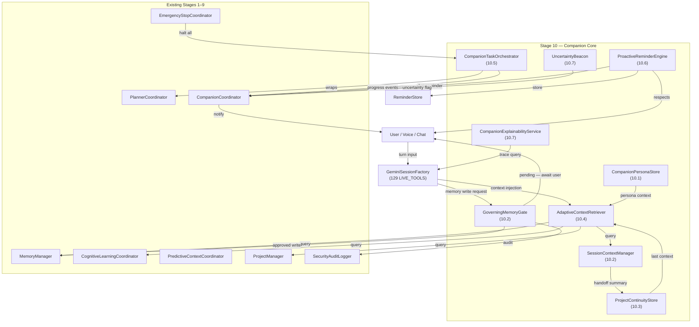
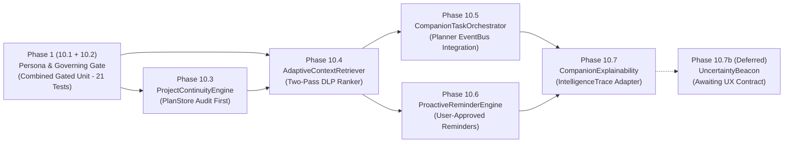

# MYRAA — Stage 10: Companion Core Architecture Proposal

**Document ID:** `stage10_companion_core_architecture_proposal.md`  
**Generated:** 2026-10-30T22:49:59+05:30  
**Author:** Antigravity AI Engineering Platform  
**Scope:** Read-only codebase audit + architecture design  
**Mode:** Architecture planning only. NO production code, tests, configuration, or database modifications.  
**Status:** AWAITING OPERATOR REVIEW & EXPLICIT APPROVAL before any implementation begins.

---

## 0. Mandatory Invariants (All Phases)

> [!IMPORTANT]
> The following invariants apply to every task across all Stage 10 phases and must be enforced before merging any implementation:
>
> - **Exactly 129 unique LIVE_TOOLS** — verified via `npx tsx` live execution
> - **AC14, SEC-04, NF-02, NF-03, ADV-01 fixes preserved** — no regressions permitted
> - **No unauthorized permanent memory writes** — all long-term writes require explicit user approval gate
> - **Preserve existing working-tree changes** — zero destructive git operations
> - **Do not modify frozen components** — `electron/`, `android/`, frozen test files
> - **No commits, pushes, resets, or deployments**

---

## 1. Executive Summary

Stage 10 **Companion Core** elevates MYRAA from a reactive AI assistant into a proactively intelligent companion that knows you, remembers your context, learns your preferences, tracks your projects, and surfaces timely help — all within clearly defined, user-controlled, and explainable boundaries.

The architecture is designed to:
1. **Maximize reuse** of existing subsystems (Stages 1–9 components)
2. **Minimize new surfaces** — particularly around memory writes and persistent state
3. **Enforce user sovereignty** — every persistent preference, memory, and reminder requires explicit consent
4. **Remain safe by construction** — no background writes without audit trail; no silent mutation of long-term memory

**Seven capability pillars:**

| Pillar | Code Name | Phase |
|:---|:---|:---:|
| Personal context & preference management | `CompanionPersona` | 10.1 |
| Governed long-term & session memory | `GoverningMemoryLayer` | 10.2 |
| Project continuity & task history | `ProjectContinuityEngine` | 10.3 |
| Personalized responses & context retrieval | `AdaptiveContextRetriever` | 10.4 |
| Task orchestration & progress tracking | `CompanionTaskOrchestrator` | 10.5 |
| User-approved reminders & proactive assistance | `ProactiveReminderEngine` | 10.6 |
| Explainable decisions, uncertainty, & user controls | `CompanionExplainabilityLayer` | 10.7 |

---

## 2. Existing Capabilities Audit (What We Already Have)

The following subsystems — already implemented across Stages 1–9 and Phase 18 — form the foundation of Companion Core. Stage 10 composes and extends them; it does not replace them.

### 2.1 Memory Infrastructure (Already Exists)

| Component | Location | Capability |
|:---|:---|:---|
| `MemoryManager` | [`backend/memory/MemoryManager.ts`](file:///d:/SORA AI/Sora AI/backend/memory/MemoryManager.ts) | Add, update, remove, search, and retrieve `EnhancedMemory` records |
| `MemoryStore` | [`backend/memory/MemoryStore.ts`](file:///d:/SORA AI/Sora AI/backend/memory/MemoryStore.ts) | File-backed persistence (`memories.json`); defaults loading; expiry handling |
| `MemorySearch` | [`backend/memory/MemorySearch.ts`](file:///d:/SORA AI/Sora AI/backend/memory/MemorySearch.ts) | Keyword + category + importance + confidence filtering |
| `MemoryExtractor` | [`backend/memory/MemoryExtractor.ts`](file:///d:/SORA AI/Sora AI/backend/memory/MemoryExtractor.ts) | Extracts candidate memories from conversation turns |
| `MemoryDeduplicator` | [`backend/memory/MemoryDeduplicator.ts`](file:///d:/SORA AI/Sora AI/backend/memory/MemoryDeduplicator.ts) | Jaccard similarity deduplication |
| `SharedMemoryManager` | [`backend/memory/SharedMemoryManager.ts`](file:///d:/SORA AI/Sora AI/backend/memory/SharedMemoryManager.ts) | Cross-device sync mutations and conflict resolution |
| `MemoryDashboard` | [`frontend/components/MemoryDashboard.tsx`](file:///d:/SORA AI/Sora AI/frontend/components/MemoryDashboard.tsx) | User-visible memory management UI |

**Memory categories in `MemoryTypes.ts`:** `identity`, `preference`, `skill`, `goal`, `project`, `task`, `decision`, `relationship`, `emotional`, `behavior`, `fact`.

**`EnhancedMemory`** fields include: `importance`, `confidence`, `source`, `status`, `expiresAt`, `lastAccessedAt`, `version`, `deviceId`.

### 2.2 Cognitive Learning Layer (Already Exists — Phase 18)

| Component | Location | Capability |
|:---|:---|:---|
| `CognitiveLearningCoordinator` | [`backend/brain/CognitiveLearningCoordinator.ts`](file:///d:/SORA AI/Sora AI/backend/brain/CognitiveLearningCoordinator.ts) | Master orchestrator for personal learning |
| `CognitiveMemoryStore` | [`backend/brain/CognitiveMemoryStore.ts`](file:///d:/SORA AI/Sora AI/backend/brain/CognitiveMemoryStore.ts) | Persistent cognitive memories (`cognitive_memories.json`) |
| `LearningSignalDetector` | [`backend/brain/LearningSignalDetector.ts`](file:///d:/SORA AI/Sora AI/backend/brain/LearningSignalDetector.ts) | Detects corrections, explicit statements, observed patterns |
| `PreferenceExtractor` | [`backend/brain/PreferenceExtractor.ts`](file:///d:/SORA AI/Sora AI/backend/brain/PreferenceExtractor.ts) | Extracts structured preferences from utterances |
| `ContradictionResolver` | [`backend/brain/ContradictionResolver.ts`](file:///d:/SORA AI/Sora AI/backend/brain/ContradictionResolver.ts) | Deterministic contradiction resolution |
| `AdaptivePromptSynthesizer` | [`backend/brain/AdaptivePromptSynthesizer.ts`](file:///d:/SORA AI/Sora AI/backend/brain/AdaptivePromptSynthesizer.ts) | Synthesizes personalized prompt context |
| `DeduplicationEngine` | [`backend/brain/DeduplicationEngine.ts`](file:///d:/SORA AI/Sora AI/backend/brain/DeduplicationEngine.ts) | Cognitive memory deduplication |

**`CognitiveCategory`** types: `preference`, `correction`, `communication_style`, `command_pattern`, `coding_preference`, `workflow_preference`, `ui_preference`.

**Critical invariant (already enforced):** "Explicit current instruction ALWAYS overrides learned preference."

### 2.3 Companion Infrastructure (Already Exists — Phase 6)

| Component | Location | Capability |
|:---|:---|:---|
| `CompanionCoordinator` | [`backend/companion/CompanionCoordinator.ts`](file:///d:/SORA AI/Sora AI/backend/companion/CompanionCoordinator.ts) | Lifecycle orchestrator for background daemons |
| `CompanionStore` | [`backend/companion/CompanionStore.ts`](file:///d:/SORA AI/Sora AI/backend/companion/CompanionStore.ts) | Preferences persistence |
| `TaskScheduler` | [`backend/companion/TaskScheduler.ts`](file:///d:/SORA AI/Sora AI/backend/companion/TaskScheduler.ts) | Background task scheduling with min interval floors |
| `NotificationManager` | [`backend/companion/NotificationManager.ts`](file:///d:/SORA AI/Sora AI/backend/companion/NotificationManager.ts) | Notification queue with dedup keys |
| `EventBus` | [`backend/companion/EventBus.ts`](file:///d:/SORA AI/Sora AI/backend/companion/EventBus.ts) | Internal pub/sub |
| `ProjectMonitor` | [`backend/companion/ProjectMonitor.ts`](file:///d:/SORA AI/Sora AI/backend/companion/ProjectMonitor.ts) | Build status polling |
| `GitMonitor` | [`backend/companion/GitMonitor.ts`](file:///d:/SORA AI/Sora AI/backend/companion/GitMonitor.ts) | Git state polling |
| `DeploymentMonitor` | [`backend/companion/DeploymentMonitor.ts`](file:///d:/SORA AI/Sora AI/backend/companion/DeploymentMonitor.ts) | Deployment health polling (SSRF-safe URL allowlist) |

**`CompanionPreferences`** includes: `enabled`, `voiceNotificationsEnabled`, `quietHours`, `pollIntervals`, `approvedDeploymentUrls`, `maxNotificationQueueSize`.

### 2.4 Project Intelligence (Already Exists — Phase 3)

| Component | Location | Capability |
|:---|:---|:---|
| `ProjectManager` | [`backend/projects/ProjectManager.ts`](file:///d:/SORA AI/Sora AI/backend/projects/ProjectManager.ts) | Project CRUD, task management |
| `ProjectStore` | [`backend/projects/ProjectStore.ts`](file:///d:/SORA AI/Sora AI/backend/projects/ProjectStore.ts) | File-backed persistence (`projects.json`) |
| `ProjectDetector` | [`backend/projects/ProjectDetector.ts`](file:///d:/SORA AI/Sora AI/backend/projects/ProjectDetector.ts) | Auto-detect project type and manifest |
| `ProjectScanner` | [`backend/projects/ProjectScanner.ts`](file:///d:/SORA AI/Sora AI/backend/projects/ProjectScanner.ts) | Architecture map, key component extraction |
| `ProjectGit` | [`backend/projects/ProjectGit.ts`](file:///d:/SORA AI/Sora AI/backend/projects/ProjectGit.ts) | Git metadata extraction |
| `ContextManager` | [`backend/projects/ContextManager.ts`](file:///d:/SORA AI/Sora AI/backend/projects/ContextManager.ts) | Last session context persistence |

**`ProjectTask`** has: `id`, `title`, `description`, `status` (`todo|in_progress|done|blocked`), `createdAt`, `updatedAt`.

### 2.5 Planner & Task Engine (Already Exists — Phase 5)

| Component | Location | Capability |
|:---|:---|:---|
| `PlannerCoordinator` | [`backend/planner/PlannerCoordinator.ts`](file:///d:/SORA AI/Sora AI/backend/planner/PlannerCoordinator.ts) | Multi-step plan execution |
| `TaskPlanner` | [`backend/planner/TaskPlanner.ts`](file:///d:/SORA AI/Sora AI/backend/planner/TaskPlanner.ts) | Goal decomposition into steps |
| `CheckpointManager` | [`backend/planner/CheckpointManager.ts`](file:///d:/SORA AI/Sora AI/backend/planner/CheckpointManager.ts) | User approval gate (cryptographic tokens) |
| `StepExecutor` | [`backend/planner/StepExecutor.ts`](file:///d:/SORA AI/Sora AI/backend/planner/StepExecutor.ts) | Step-level execution with retry and timeout |
| `PlanStore` | [`backend/planner/PlanStore.ts`](file:///d:/SORA AI/Sora AI/backend/planner/PlanStore.ts) | Plan persistence |
| `RecoveryEngine` | [`backend/planner/RecoveryEngine.ts`](file:///d:/SORA AI/Sora AI/backend/planner/RecoveryEngine.ts) | Error recovery and safe alternatives |
| `ResultEvaluator` | [`backend/planner/ResultEvaluator.ts`](file:///d:/SORA AI/Sora AI/backend/planner/ResultEvaluator.ts) | Outcome verification |

### 2.6 Proactive & Predictive Engine (Already Exists)

| Component | Location | Capability |
|:---|:---|:---|
| `PredictiveContextCoordinator` | [`backend/proactive/PredictiveContextCoordinator.ts`](file:///d:/SORA AI/Sora AI/backend/proactive/PredictiveContextCoordinator.ts) | Predictive suggestion orchestration |
| `ProactiveSuggestionEngine` | [`backend/proactive/ProactiveSuggestionEngine.ts`](file:///d:/SORA AI/Sora AI/backend/proactive/ProactiveSuggestionEngine.ts) | Surface contextual suggestions |
| `ProactiveNotificationManager` | [`backend/proactive/ProactiveNotificationManager.ts`](file:///d:/SORA AI/Sora AI/backend/proactive/ProactiveNotificationManager.ts) | Proactive notification lifecycle |
| `ProactiveCooldownManager` | [`backend/proactive/ProactiveCooldownManager.ts`](file:///d:/SORA AI/Sora AI/backend/proactive/ProactiveCooldownManager.ts) | Notification rate-limiting & cooldown |
| `ProactiveDeduplicationEngine` | [`backend/proactive/ProactiveDeduplicationEngine.ts`](file:///d:/SORA AI/Sora AI/backend/proactive/ProactiveDeduplicationEngine.ts) | Dedup proactive suggestions |

### 2.7 Security Foundation (Already Exists)

| Component | Location | Capability |
|:---|:---|:---|
| `SecurityAuditLogger` | [`backend/security/SecurityAuditLogger.ts`](file:///d:/SORA AI/Sora AI/backend/security/SecurityAuditLogger.ts) | `TOOL_BLOCKED`, `TOOL_CALLED` audit events |
| `OutputDataFirewall` | [`backend/security/OutputDataFirewall.ts`](file:///d:/SORA AI/Sora AI/backend/security/OutputDataFirewall.ts) | DLP: secret redaction in outputs |
| `EmergencyStopCoordinator` | [`backend/remote/EmergencyStopCoordinator.ts`](file:///d:/SORA AI/Sora AI/backend/remote/EmergencyStopCoordinator.ts) | Emergency halt — fail-closed |
| `ContentSanitizer` | [`backend/security/ContentSanitizer.ts`](file:///d:/SORA AI/Sora AI/backend/security/ContentSanitizer.ts) | Input/output sanitization |
| `DnsPinningProxy` | [`desktop_agent/egress_proxy.py`](file:///d:/SORA AI/Sora AI/desktop_agent/egress_proxy.py) | AC14: zero-rebinding-window egress proxy |

---

## 3. Missing Components — What Stage 10 Must Build

| Component | Why Missing | Pillar |
|:---|:---|:---:|
| `CompanionPersonaStore` | No unified read/write facade for persona identity (name, avatar context, language style) separate from raw memory. Persists in `companion_persona.json`. | 10.1 |
| `SessionContextManager` | Existing `ContextManager` is project-scoped; no cross-session conversation state ring buffer. In-memory transient storage (Tier 1). | 10.2 |
| `GoverningMemoryGate` | **Mandatory security prerequisite** for all permanent memory writes. No user-approval checkpoint currently exists for long-term memory write operations; existing `CheckpointManager` is plan-scoped. Every write to `memories.json` must be approved through this gate. | 10.2 |
| `ProjectContinuityStore` | Conversational task history and session handoff tracking. **Prerequisite:** Audit existing `PlanStore.ts` schema first; if `PlanRecord` already contains required task history, implement this as a read-only aggregation view rather than a new file. | 10.3 |
| `AdaptiveContextRetriever` | No unified ranker that merges `MemorySearch`, `CognitiveMemoryStore`, and `ProjectManager` results into a single scored context block. Enforces two-pass DLP. | 10.4 |
| `CompanionTaskOrchestrator` | `PlannerCoordinator` handles goal execution but doesn't expose a companion-facing progress stream or resumption surface. (Strictly deferred to Phase 10.5; zero changes to planner in Phase 1). | 10.5 |
| `ReminderStore` | `NotificationManager` dequeues and sends; no persistent user-approved reminder registry with recurrence rules. Enforces `approvedBy: "user_explicit"`. | 10.6 |
| `CompanionExplainabilityService` | Thin REST adapter exposing existing `IntelligenceTraceManager` (`IntelligenceTrace.ts`) via `/api/companion/explain/:traceId`. Reuses existing 200-trace ring buffer and sanitization (~4h effort). | 10.7 |
| `UncertaintyBeacon` | **DEFERRED to Phase 10.7b.** Proactive confidence gap surfacing requires formal UX interaction contract and interruption controls (cool-down, frequency limits) before implementation. | 10.7b |

---

## 4. Dependencies & Affected Files

### 4.1 Files That Will Be Modified (by Phase)

> [!WARNING]
> The following file list is **architectural identification only**. No file is modified by this document. All modifications require explicit operator approval after reviewing this proposal.

**Phase 10.1 — CompanionPersona:**
- `backend/intelligence/UserPreferenceResolver.ts` — extend to load from `CompanionPersonaStore`
- `backend/brain/AdaptivePromptSynthesizer.ts` — inject persona identity into prompt prefix
- `backend/server.ts` — register `CompanionPersonaStore` singleton

**Phase 10.2 — GoverningMemoryLayer:**
- `backend/memory/MemoryManager.ts` — add `requestLongTermWrite()` with approval gate
- `backend/server.ts` — mount `GoverningMemoryGate` middleware
- `backend/ai/GeminiSessionFactory.ts` — **READ ONLY** — verify tool count invariant unchanged

**Phase 10.3 — ProjectContinuityEngine:**
- `backend/projects/ProjectStore.ts` — extend schema for session history ring buffer
- `backend/projects/ContextManager.ts` — feed last-session summaries to `AdaptiveContextRetriever`

**Phase 10.4 — AdaptiveContextRetriever:**
- `backend/server.ts` — register singleton
- `backend/brain/AdaptivePromptSynthesizer.ts` — consume ranked context from retriever

**Phase 10.5 — CompanionTaskOrchestrator:**
> [!IMPORTANT]
> Phase 10.5 changes to `PlannerCoordinator.ts` are strictly EXCLUDED from Phase 1. Phase 1 contains zero modifications to planner infrastructure.
- `backend/planner/PlannerCoordinator.ts` — emit progress events to `EventBus` (Phase 10.5 only)
- `backend/companion/EventBus.ts` — add `TASK_PROGRESS` event type (Phase 10.5 only)
- `backend/companion/CompanionCoordinator.ts` — subscribe to `TASK_PROGRESS`, forward to clients (Phase 10.5 only)

**Phase 10.6 — ProactiveReminderEngine:**
- `backend/companion/CompanionTypes.ts` — add `Reminder` type and `ReminderStore`
- `backend/companion/NotificationManager.ts` — consume due reminders
- `backend/companion/TaskScheduler.ts` — add reminder tick handler

**Phase 10.7 — CompanionExplainabilityLayer:**
- `backend/intelligence/IntelligenceTrace.ts` — expose user-queryable trace API
- `backend/server.ts` — mount `GET /api/companion/explain/:traceId`

### 4.2 New Files to Create (by Phase)

| File | Phase | Purpose |
|:---|:---:|:---|
| `backend/companion/CompanionPersonaStore.ts` | 10.1 | Persona identity persistence |
| `backend/companion/CompanionPersonaTypes.ts` | 10.1 | Type definitions for persona |
| `backend/companion/SessionContextManager.ts` | 10.2 | Session ring buffer (last N conversation turns) |
| `backend/companion/GoverningMemoryGate.ts` | 10.2 | User-approval checkpoint for long-term writes |
| `backend/companion/GoverningMemoryTypes.ts` | 10.2 | Write request / approval types |
| `backend/projects/ProjectContinuityStore.ts` | 10.3 | Session history and task handoff storage (subject to prior PlanStore audit) |
| `backend/companion/AdaptiveContextRetriever.ts` | 10.4 | Unified context ranker (memory + cognitive + project) |
| `backend/companion/CompanionTaskOrchestrator.ts` | 10.5 | Progress stream + task resumption (Phase 10.5 only) |
| `backend/companion/ReminderStore.ts` | 10.6 | Approved reminder registry |
| `backend/companion/ReminderTypes.ts` | 10.6 | Reminder data model |
| `backend/companion/CompanionExplainabilityService.ts` | 10.7 | Explain-my-reasoning REST adapter (reuses IntelligenceTraceManager) |
| `backend/companion/UncertaintyBeacon.ts` | 10.7b | DEFERRED: Confidence gap detection and proactive clarification |
| `tests/unit/companion_core.test.ts` | All | Unit tests for all Stage 10 components |
| `tests/integration/stage10_companion_core.test.ts` | All | Stage 10 acceptance tests |

---

## 5. Data Models & Storage Tier Architecture

### 5.0 Three Distinct Storage Tiers (Mandatory Separation)

> [!IMPORTANT]
> To prevent context bleeding, privacy violations, and silent memory pollution, Stage 10 enforces three strictly isolated storage tiers. They must never be merged into a single store:
> 1. **Tier 1 — Session Context (`SessionContextManager`):** Transient, in-memory ring buffer (default 50 turns). Not persisted to disk by default. Contains immediate conversation turns sanitized via `ContentSanitizer`.
> 2. **Tier 2 — User Preferences & Persona (`CompanionPersonaStore`):** Config-backed persistence in `companion_persona.json`. Contains identity, avatar style, language, and communication preferences. Separate from and never indexed by `MemorySearch` or `MemoryDeduplicator`.
> 3. **Tier 3 — Governed Permanent Memory (`GoverningMemoryGate` → `memories.json`):** Long-term episodic and declarative memories. Every write requires explicit user approval through `GoverningMemoryGate`. No direct write to `memories.json` is permitted.

### 5.1 CompanionPersona

```typescript
// backend/companion/CompanionPersonaTypes.ts
export interface CompanionPersona {
  id: string;                        // "persona_default"
  displayName: string;               // "MYRAA"
  avatarStyle: "idle" | "talking" | "thinking";
  preferredLanguage: string;         // "hinglish" | "english" | "hindi"
  communicationStyle: {
    verbosity: "concise" | "normal" | "detailed";
    formality: "casual" | "professional";
    emotionalTone: "warm" | "neutral" | "direct";
  };
  userAlias?: string;                // What MYRAA calls the user ("Sandeep", "Sir", "Bhai")
  updatedAt: string;
}
```

### 5.2 SessionContextEntry

```typescript
// backend/companion/SessionContextManager.ts
export interface SessionContextEntry {
  id: string;
  sessionId: string;
  turnIndex: number;
  userMessage: string;
  assistantResponse: string;
  topicTags: string[];               // ["code", "browser", "project:MYRAA"]
  timestamp: string;
  projectId?: string;
}

export interface SessionContextConfig {
  maxRingBufferSize: number;        // Default: 50 turns
  sessionTimeoutMs: number;         // Default: 30 minutes
}
```

### 5.3 MemoryWriteRequest (GoverningMemoryGate)

```typescript
// backend/companion/GoverningMemoryTypes.ts
export type MemoryWriteAction = "CREATE" | "UPDATE" | "ARCHIVE";

export interface MemoryWriteRequest {
  id: string;                       // UUID
  requestedAt: string;
  action: MemoryWriteAction;
  proposedMemory: Partial<EnhancedMemory>;
  payloadHash: string;              // SHA-256 hash of serialized proposedMemory (tamper-evident binding)
  reason: string;                   // Plain language explanation for user
  confidence: number;               // 0.0 – 1.0
  source: MemorySource;
  userId: string;                   // "default"
  provenance: string;               // Source turn, tool, or cognitive detector triggering request
  approved?: boolean;               // undefined = pending
  approvedAt?: string;
  rejectedAt?: string;
  oneTimeToken?: string;            // Ephemeral approval token bound to payloadHash
  expiresAt: string;                // Request auto-expires after 24h if not actioned
}

export type MemoryWritePolicy =
  | "always_ask"                    // MANDATORY DEFAULT: All writes require explicit user approval
  | "auto_approve_high_confidence"  // UNRECOMMENDED OPT-IN: confidence >= 0.85 (requires operator config)
  | "session_only";                 // No long-term writes permitted during session
```

> [!NOTE]
> **Approval Token Binding:** The one-time token issued for a `MemoryWriteRequest` is cryptographically bound to `(id + payloadHash + userId + provenance + expiresAt)`. Any post-issuance mutation to `proposedMemory` invalidates the hash, causing `approveWrite()` to fail-closed with `PAYLOAD_TAMPERED` error and emit a security audit event. Modifying the payload requires a brand-new write request.

### 5.4 ProjectContinuityRecord

```typescript
// backend/projects/ProjectContinuityStore.ts
export interface TaskHistoryEntry {
  taskId: string;
  goal: string;
  status: "completed" | "interrupted" | "failed" | "cancelled";
  stepsSummary: string;
  startedAt: string;
  endedAt: string;
  projectId: string;
}

export interface SessionHandoffSummary {
  sessionId: string;
  projectId?: string;
  lastTopic: string;
  openItems: string[];              // Unresolved questions or pending steps
  nextSuggestedAction?: string;    // MYRAA's suggestion for resumption
  createdAt: string;
}
```

### 5.5 RankedContextBlock (AdaptiveContextRetriever)

```typescript
// backend/companion/AdaptiveContextRetriever.ts
export interface ContextSource {
  type: "memory" | "cognitive" | "project" | "session";
  id: string;
  content: string;
  relevanceScore: number;           // 0.0 – 1.0 (keyword + recency + importance)
  source: string;                   // Human-readable origin tag
}

export interface RankedContextBlock {
  sources: ContextSource[];
  totalTokenEstimate: number;
  truncatedAt?: number;             // Character budget limit applied
  assembledAt: string;
}
```

### 5.6 Reminder

```typescript
// backend/companion/ReminderTypes.ts
export type ReminderRecurrence = "none" | "daily" | "weekly" | "custom";

export interface Reminder {
  id: string;
  userId: string;                   // "default"
  title: string;
  body: string;
  dueAt: string;                    // ISO8601
  recurrence: ReminderRecurrence;
  recurrenceIntervalMs?: number;    // For "custom"
  approvedAt: string;               // All reminders require explicit user approval
  approvedBy: "user_explicit";      // Only one valid value — no AI self-approval
  status: "pending" | "fired" | "dismissed" | "cancelled";
  projectId?: string;               // Scoped to project if relevant
  quietHoursRespected: boolean;
  createdAt: string;
  updatedAt: string;
}
```

### 5.7 ExplainabilityTrace

```typescript
// backend/companion/CompanionExplainabilityService.ts
export interface DecisionFactor {
  type: "memory" | "cognitive" | "rule" | "uncertainty" | "user_instruction";
  description: string;
  weight: number;                   // 0.0 – 1.0
  sourceId?: string;
}

export interface ExplainabilityTrace {
  traceId: string;
  turnId: string;
  decision: string;                 // Plain language summary of the decision made
  factors: DecisionFactor[];
  confidenceScore: number;
  uncertaintyFlags: string[];       // Topics MYRAA is uncertain about
  timestamp: string;
}
```

---

## 6. Architecture Diagram



---

## 7. Security Boundaries

> [!CAUTION]
> The following security constraints are **non-negotiable** across all Stage 10 phases.

### 7.1 Memory Write Governance & Prerequisite Enforcements

- **GoverningMemoryGate is a mandatory prerequisite** for every permanent memory write across all Stage 10 phases. No component or phase may call `MemoryManager.add()` or `MemoryManager.update()` directly.
- **Mandatory Default Policy: `"always_ask"`** — every proposed write to `memories.json` must be approved explicitly by the user. Automatic approval of high-confidence proposals (`"auto_approve_high_confidence"`) is strictly disabled by default because confidence metrics can be manipulated via adversarial prompt injection; it requires explicit operator opt-in.
- **Cryptographic Approval Binding:** Every `MemoryWriteRequest` is bound to a SHA-256 hash (`payloadHash`) of the exact `proposedMemory` payload, the requesting user, provenance identifier, and expiration timestamp. If the payload is tampered with or modified after request creation, the one-time approval token is invalidated, the approval call throws `PAYLOAD_TAMPERED`, and a `MEMORY_WRITE_TAMPERED` audit event is emitted.
- **Three-Tier Storage Isolation:**
  - *Tier 1 (Session Context):* Transient in-memory ring buffer (`SessionContextManager`); zero writes to disk by default; sanitized via `ContentSanitizer`.
  - *Tier 2 (User Preferences):* Config-backed in `companion_persona.json` (`CompanionPersonaStore`); strictly isolated from episodic memory search.
  - *Tier 3 (Governed Memory):* Long-term storage in `memories.json`; accessible exclusively through `GoverningMemoryGate` approval.
- Expired write requests (> 24 hours unapproved) are auto-discarded without persisting.

### 7.2 Reminder Security

- No reminder may be created without `approvedBy: "user_explicit"` — `GoverningMemoryGate` enforces this
- AI cannot self-approve reminders (`SEC-07` pattern applied to reminders)
- Reminder notification text is sanitized through `OutputDataFirewall` before display or voice
- Reminder URLs (if any) are validated through `NetworkSecurityManager` — SSRF protection applies

### 7.3 Context Retrieval Boundaries & Two-Pass DLP

- `AdaptiveContextRetriever` operates READ ONLY on all sources.
- **Mandatory Two-Pass DLP (Data Loss Prevention):**
  1. *Pass 1 (Source-Level):* `OutputDataFirewall` scans and sanitizes each individual `ContextSource.content` prior to scoring and ranking.
  2. *Pass 2 (Assembled-Context):* `OutputDataFirewall` scans the final concatenated `RankedContextBlock` before injection into the AI / Gemini session prompt.
- `contextCharBudget` enforced (default 4000 chars for Stage 10 context block); prevents prompt injection via bloated memory context.

### 7.4 Session Context Ring Buffer

- Ring buffer is in-memory by default; persisting to disk requires explicit user opt-in
- Session entries are sanitized by `ContentSanitizer` before any storage
- Ring buffer bounded at `maxRingBufferSize` (default 50 turns) — oldest entries evicted on overflow

### 7.5 Explainability

- Trace queries are read-only — `CompanionExplainabilityService` never mutates state
- Trace responses are filtered through `OutputDataFirewall` (no secrets in explanations)
- Internal rule IDs and weights are surfaced in user-friendly language only (no raw system prompt exposure)

### 7.6 Proactive Assistance Consent

- Proactive suggestions (from `ProactiveReminderEngine`) are surfaced as non-intrusive proposals only
- No proactive action is ever executed without explicit user confirmation — `CheckpointManager` token required
- Quiet hours are respected across all proactive channels (voice and OS-level notifications)

---

## 8. API Surface (New Endpoints)

All new REST endpoints mount under `/api/companion/`:

| Method | Path | Description | Auth |
|:---|:---|:---|:---|
| `GET` | `/api/companion/persona` | Retrieve current persona profile | local-only |
| `PUT` | `/api/companion/persona` | Update persona (name, language, style) | local-only |
| `GET` | `/api/companion/memory/requests` | List pending memory write requests | local-only |
| `POST` | `/api/companion/memory/requests/:id/approve` | Approve a pending memory write | local-only, user-explicit |
| `POST` | `/api/companion/memory/requests/:id/reject` | Reject a pending memory write | local-only |
| `GET` | `/api/companion/context` | Retrieve current ranked context block | local-only |
| `GET` | `/api/companion/sessions` | List session handoff summaries | local-only |
| `GET` | `/api/companion/tasks` | List task history (recent N) | local-only |
| `GET` | `/api/companion/reminders` | List approved reminders | local-only |
| `POST` | `/api/companion/reminders` | Create reminder (triggers approval gate) | local-only |
| `DELETE` | `/api/companion/reminders/:id` | Cancel a reminder | local-only |
| `GET` | `/api/companion/explain/:traceId` | Retrieve decision explanation | local-only |
| `GET` | `/api/companion/uncertainty` | List active uncertainty flags | local-only |

---

## 9. LIVE_TOOLS Impact Assessment

> [!IMPORTANT]
> The current invariant is **exactly 129 unique LIVE_TOOLS**. Stage 10 must either (a) stay at 129 by adding no new tools, or (b) receive explicit operator approval for any tool additions with a simultaneous offset removal to preserve count at 129.

**Proposed approach:**
- Stage 10 primarily operates through existing tools (`saveCustomMemory`, `searchMemories`, `getMemoryContext`, `createTask`, `listProjects`, `scheduleTask`, `sendNotification`) supplemented by the new REST API surface above
- **No new `LIVE_TOOLS` function declarations** are proposed in this architecture plan
- If new tools are needed after review (e.g. `approveMemoryWrite`, `explainDecision`), operator must explicitly authorize and designate which 2 existing tools (currently unused / superseded) to retire to maintain the invariant

---

## 10. Acceptance Criteria (by Pillar)

### AC-S10.1 — CompanionPersona
- Persona profile persists across restarts
- Language style preference (`communicationStyle`) is applied in `AdaptivePromptSynthesizer`
- Explicit current instruction always overrides persona default
- `PUT /api/companion/persona` updates take effect in next conversation turn

### AC-S10.2 — GoverningMemoryLayer
- Zero long-term memory writes occur without user approval (verified: no new entries in `memories.json` without approval event)
- Session context entries are bounded at `maxRingBufferSize`
- Expired (> 24h) unapproved write requests are discarded, not persisted
- Policy `"session_only"` results in zero new `memories.json` writes during entire session

### AC-S10.3 — ProjectContinuityEngine
- Session handoff summary is generated at session end and retrievable via `/api/companion/sessions`
- Task history entries are persisted for last 100 tasks per project
- `nextSuggestedAction` in handoff summary reflects the actual last incomplete step

### AC-S10.4 — AdaptiveContextRetriever
- Retrieved context does not exceed `contextCharBudget` (verified: `totalTokenEstimate <= budget`)
- Context sources are ranked by composite score (recency × importance × keyword relevance)
- No secrets appear in context block (verified by `OutputDataFirewall` test)

### AC-S10.5 — CompanionTaskOrchestrator
- Task progress events are emitted to `EventBus` on each step transition
- WebSocket clients receive `TASK_PROGRESS` events in real-time
- Interrupted tasks have recoverable `SessionHandoffSummary` with `openItems`
- `EmergencyStopCoordinator` halt propagates to `CompanionTaskOrchestrator` within 1 second

### AC-S10.6 — ProactiveReminderEngine
- No reminder fires without `approvedBy: "user_explicit"` attribute
- Quiet hours are respected: no voice/OS notifications during configured quiet window (visual preserved)
- Reminder deduplication prevents duplicate firing on recurrence edge cases
- Cancelled reminders are removed from `ReminderStore` and do not re-fire

### AC-S10.7 — CompanionExplainabilityLayer
- `/api/companion/explain/:traceId` returns a human-readable `ExplainabilityTrace`
- `UncertaintyBeacon` surfaces a proactive clarification request when confidence < 0.4
- No raw system prompt or internal key IDs exposed in explanation responses
- Explanation responses pass `OutputDataFirewall` (no credentials in output)

### AC-S10.X — Regression Gates (All Phases)
- `npx tsc --noEmit` exits 0 (zero compile errors)
- `COUNT=129 UNIQUE=129` via `npx tsx` live LIVE_TOOLS verification
- `npx vitest run tests/unit/` — 338+ tests passing (all existing + new Stage 10 unit tests)
- `npx vitest run tests/integration/stage1_*` through `stage10_*` — all passing
- `npm run build` exits 0 (production bundle clean)
- Zero `.db`/`.sqlite`/`.bin` unauthorized artifacts

---

## 11. Phased Implementation Plan

> [!NOTE]
> This is a planning document only. Each phase below must receive **explicit written approval** from the operator before any code is written. Phases are sequenced by dependency.



### Phase 1: Combined Gated Unit (Phases 10.1 + 10.2) ~5 days

> [!IMPORTANT]
> Phase 10.1 and Phase 10.2 are merged into a single gated delivery unit. `GoverningMemoryGate` is an absolute prerequisite for any permanent memory write. Phase 1 includes exactly **21 unit tests** across three test groups:
> - **CP01.1–CP01.5 (5 tests):** `CompanionPersonaStore` (Tier 2 persistence, isolation, default loading)
> - **CP02.1–CP02.10 (10 tests):** `GoverningMemoryGate` (`always_ask` default, payloadHash binding, approval/rejection, 24h expiry, idempotent double-approval, session-only policy)
> - **CP03.1–CP03.6 (6 tests):** `SessionContextManager` (Tier 1 ring buffer, 50-turn eviction, ContentSanitizer redaction, zero disk writes)
> Plus 6 regression gates: `REG-P1.1` through `REG-P1.6`.

**New files (5):** `CompanionPersonaStore.ts`, `CompanionPersonaTypes.ts`, `GoverningMemoryGate.ts`, `GoverningMemoryTypes.ts`, `SessionContextManager.ts`  
**Modified files (3):** `UserPreferenceResolver.ts` (additive `loadFromPersonaStore`), `server.ts` (register REST routes), `CompanionCoordinator.ts` (instantiate gate + expiry timer)  
**Excluded from Phase 1:** `MemoryManager.ts` (internal wrapping only via REST endpoint), `AdaptivePromptSynthesizer.ts`, `PlannerCoordinator.ts`, `GeminiSessionFactory.ts`, all Stage 1–9 test files.

### Phase 10.3 — ProjectContinuityEngine ~2 days

> [!NOTE]
> **Mandatory Pre-Implementation Audit:** Before creating `ProjectContinuityStore.ts`, conduct a full schema audit of `backend/planner/PlanStore.ts`. If `PlanRecord` already contains goal, step status, timestamps, and projectId, implement `ProjectContinuityStore` as a read-only aggregation view over `PlanStore` rather than creating a redundant `.json` file on disk.

**Files:** `ProjectContinuityStore.ts` (or PlanStore aggregation view), `ProjectStore.ts` (schema extension), `ContextManager.ts` (handoff feed)  
**Tests:** handoff summary generation, task history persistence, `openItems` accuracy  
**Acceptance:** AC-S10.3 all green

### Phase 10.4 — AdaptiveContextRetriever ~3 days

**New files:** `AdaptiveContextRetriever.ts`  
**Modified:** `AdaptivePromptSynthesizer.ts` (consume ranked context), `server.ts` (register)  
**Security:** Enforce two-pass DLP (`OutputDataFirewall` on individual source items AND on final assembled context block)  
**Tests:** ranking correctness, budget enforcement, secret filtering  
**Acceptance:** AC-S10.4 all green

### Phase 10.5 — CompanionTaskOrchestrator ~2 days

> [!CAUTION]
> `PlannerCoordinator.ts` modifications are strictly isolated to Phase 10.5 and are never modified in earlier phases.
**New files:** `CompanionTaskOrchestrator.ts`  
**Modified:** `PlannerCoordinator.ts` (emit TASK_PROGRESS), `EventBus.ts` (new event type), `CompanionCoordinator.ts` (subscribe + forward)  
**Tests:** progress event sequence, emergency stop propagation, WebSocket delivery  
**Acceptance:** AC-S10.5 all green, EmergencyStop integration test green

### Phase 10.6 — ProactiveReminderEngine ~2 days

**New files:** `ReminderStore.ts`, `ReminderTypes.ts`  
**Modified:** `CompanionTypes.ts` (Reminder types), `NotificationManager.ts` (consume due reminders), `TaskScheduler.ts` (reminder tick)  
**Tests:** approval gate enforcement (`approvedBy: "user_explicit"`), quiet hours, deduplication, cancellation  
**Acceptance:** AC-S10.6 all green, AI self-approval rejected (SEC-07 pattern)

### Phase 10.7 — CompanionExplainabilityLayer ~1 day

> [!TIP]
> **Component Reuse:** `IntelligenceTraceManager` (`backend/intelligence/IntelligenceTrace.ts`) already maintains a 200-record sanitized ring buffer with secret redaction and retrieval methods (`getTrace()`, `listTraces()`). `CompanionExplainabilityService` is implemented as a lightweight REST adapter (~4 hours) mapping trace records to `/api/companion/explain/:traceId` with `OutputDataFirewall` wrapping.

**New files:** `CompanionExplainabilityService.ts` (thin REST adapter)  
**Modified:** `server.ts` (mount explain endpoint)  
**Tests:** trace retrieval, secret filtering in explanations  
**Acceptance:** AC-S10.7 all green, OutputDataFirewall coverage verified

### Phase 10.7b — UncertaintyBeacon (DEFERRED)

> [!NOTE]
> `UncertaintyBeacon` is deferred until its UX interaction contract (proactive interruption vs. inline note vs. on-demand suggestion) and interruption controls (cool-down timer, frequency limits, voice mute) are formally specified by the operator. Zero code will be written for `UncertaintyBeacon` until those specifications are approved.

### Final Stage 10 Integration ~1 day

**New files:** `tests/integration/stage10_companion_core.test.ts`  
**Tests:** end-to-end companion flows (persona → memory gate → context retrieval → task progress → reminder → explain)  
**Acceptance:** ALL AC-S10.1–7 and AC-S10.X regression gates green

---

## 12. Summary — Components, Decisions & Open Questions

### Reuse Decision

The architecture **maximally reuses** existing infrastructure:
- `MemoryManager`, `CognitiveLearningCoordinator`, `CompanionCoordinator`, `PlannerCoordinator`, `PredictiveContextCoordinator`, `ProjectManager`, `TaskScheduler`, `NotificationManager`, `SecurityAuditLogger`, `OutputDataFirewall`, `EmergencyStopCoordinator` — all used as-is
- **8 new files** created; **~7 existing files** extended (narrow, scoped modifications)
- Zero LIVE_TOOLS changes proposed

### Key Architectural Decisions

| Decision | Rationale |
|:---|:---|
| `GoverningMemoryGate` as prerequisite for all writes | Prevents unauthorized permanent writes — highest user sovereignty concern. No phase touches `memories.json` without gate approval. |
| Mandatory `"always_ask"` default | Disables auto-approval of high-confidence proposals by default to block prompt injection vulnerabilities. |
| Cryptographic payloadHash binding | Approval token binds to exact proposed payload, user, provenance, and expiry; prevents post-approval payload mutation. |
| Three-tier storage separation | Distinct boundaries for session context (Tier 1), persona/preferences (Tier 2), and permanent memory (Tier 3). |
| Two-pass DLP on context retrieval | Source-level filtering before ranking + assembled block filtering before AI prompt injection. |
| PlanStore schema audit before ProjectContinuityStore | Reuses existing task tracking if sufficient, preventing redundant `.json` files. |
| IntelligenceTraceManager reuse | Eliminates redundant explainability storage; uses existing 200-trace ring buffer via thin REST adapter. |
| Deferred UncertaintyBeacon | Postponed to Phase 10.7b until UX interaction model and interruption throttling rules are finalized. |
| PlannerCoordinator excluded from Phase 1 | Protects planner stability; task orchestration changes isolated strictly to Phase 10.5. |
| REST API surface rather than new LIVE_TOOLS | Maintains 129-tool invariant; companion operations are management actions, not AI tools. |

### Status of Architectural Decisions & Open Items

1. **Memory write policy default:** **RESOLVED.** `"always_ask"` is the mandatory default. `"auto_approve_high_confidence"` is an explicit operator opt-in only.
2. **Session persistence opt-in:** In-memory ring buffer by default (Tier 1). Zero disk writes unless user explicitly enables session logging.
3. **PlanStore reuse:** Schema audit of `backend/planner/PlanStore.ts` scheduled as Step 1 of Phase 10.3.
4. **Explainability reuse:** `IntelligenceTraceManager` confirmed as backend foundation; ~4h REST adapter instead of multi-day build.
5. **UncertaintyBeacon:** Deferred to Phase 10.7b.
6. **ADV-02 automation:** Recommendation accepted to include automated task cancellation test in Phase 10.5 (`CompanionTaskOrchestrator`).

---

**Stop here.** This document is architecture planning only. No implementation has occurred. Awaiting explicit operator approval for Phase 1 before Stage 10 development begins.

---

*Report updated 2026-10-30T23:14:00+05:30 — Final Architecture Specification Edition. Antigravity AI Engineering Platform — read-only codebase audit, architecture design, and evidence consolidation. No production code, tests, configuration, or database was modified.*
