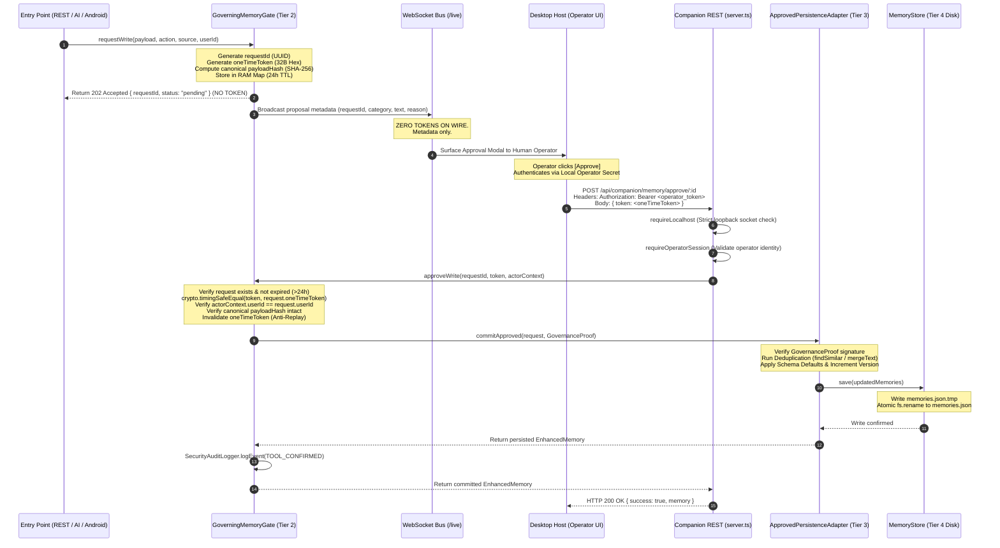
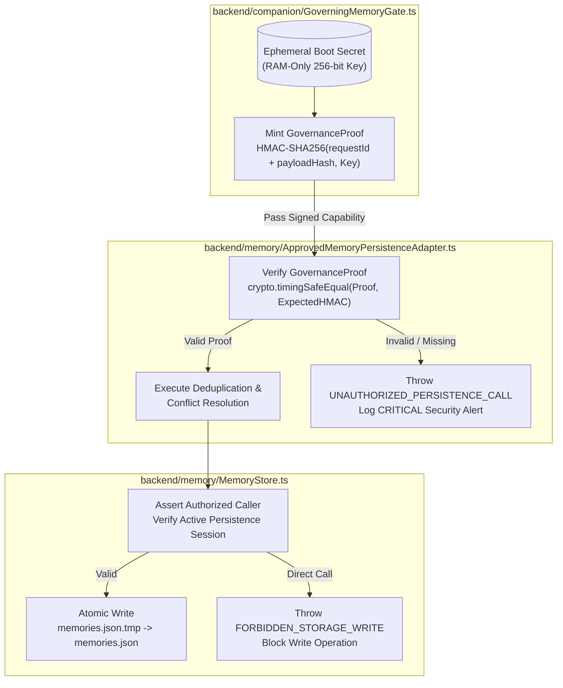

# MYRAA — Stage 10.2.1-R2: Final Security Design Closure & Implementation Readiness Review
## Architectural Verification, Boundary Enforcement, and Implementation Specifications for SEC-P1-01, SEC-P1-02, and SEC-P1-03

**Document ID:** `stage10_phase2_final_security_design.md`  
**Task ID:** `MYRAA-S10-021-R2`  
**Date:** 2026-11-02T19:40:00+05:30  
**Author:** Antigravity AI Engineering Platform  
**Execution Mode:** STRICT READ-ONLY — Architecture Verification  
**Implementation Authorization:** **NOT GRANTED — Architectural Review Only**  
**Source Specification:** [`stage10_phase2_remediation_scope.md`](file:///d:/SORA%20AI/Sora%20AI/stage10_phase2_remediation_scope.md) (Revision R1)

---

## 1. Executive Summary

This document establishes the final security architecture and engineering closure for MYRAA Companion Core Stage 10 Phase 2, resolving the three outstanding engineering challenges:
1. **Review A:** Human approval authentication and the end-to-end token lifecycle.
2. **Review B:** Runtime persistence authorization boundary preventing ungoverned disk writes.
3. **Review C:** Approval-to-persistence payload integrity, cryptographic binding, and concurrency behaviors.

In strict compliance with read-only execution constraints, no source code, tests, configuration, or databases have been modified. This review confirms the exact technical mechanisms required to implement Phase 2 safely, identifies all missing authentication components, specifies runtime authorization barriers, and defines a verifiable acceptance test matrix.

---

## 2. Review A — Approval Authentication & Token Lifecycle

### 2.1 Codebase Inspection & Missing Component Discovery
A thorough audit of the live codebase was conducted across `GoverningMemoryGate.ts`, `backend/server.ts`, `backend/gateway/HttpGateway.ts`, `backend/security/IdentityAuthManager.ts`, `backend/security/PermissionManager.ts`, and `frontend/App.tsx`.

#### Key Forensic Findings:
1. **Remote Authentication is Established, Desktop is Not:**
   - For remote Android devices, [`backend/security/IdentityAuthManager.ts`](file:///d:/SORA%20AI/Sora%20AI/backend/security/IdentityAuthManager.ts) and [`backend/security/RemoteSecurityCoordinator.ts`](file:///d:/SORA%20AI/Sora%20AI/backend/security/RemoteSecurityCoordinator.ts) issue and validate HMAC-SHA256 access tokens (`myraa_at_...`), rotating refresh tokens (`myraa_rf_...`), and step-up PIN challenges (`requestStepUpChallenge`).
   - For the **desktop operator**, however, the desktop frontend (`frontend/App.tsx`) executes unauthenticated `fetch()` calls to `/api/memories` and companion routes.
2. **Localhost Checks Do Not Equal Human Identity:**
   - [`backend/security/PermissionManager.ts`](file:///d:/SORA%20AI/Sora%20AI/backend/security/PermissionManager.ts) (`requireLocalhost`) validates only physical loopback socket IP addresses (`127.0.0.1`, `::1`).
   - **Security Reality:** Any local unprivileged process, malicious background daemon, untrusted script, or third-party executable on the machine can bind to localhost and invoke local endpoints. Treating loopback connection as proof of human identity is fundamentally insecure.
3. **WebSocket Broadcast Token Leakage Remains Blocked:**
   - [`backend/server.ts`](file:///d:/SORA%20AI/Sora%20AI/backend/server.ts#L160-L313) evaluates all LAN IP ranges (`192.168.*`, `10.*`, `172.16-31.*`) as `isLocal = true` on WebSocket upgrade, requiring zero token credentials.
   - `companionCoordinator.registerClientBroadcast` broadcasts indiscriminately to **all** connected clients, including remote Android devices on `/remote-live` and eavesdropping LAN connections.
   - Delivering approval tokens over WebSockets is therefore **permanently blocked**.

#### Formal Identification of Missing Components:
> [!IMPORTANT]
> **Identified Missing Components:**
> 1. **Desktop Operator Session Establishment:** The desktop frontend currently lacks an automatic or interactive operator authentication session upon desktop startup.
> 2. **Operator Authorization Middleware (`requireOperatorSession`):** The backend currently has no middleware requiring an authenticated operator token on companion approval routes.

---

### 2.2 Complete 11-Stage Approval Lifecycle Specification

The diagram and detailed stages below define the end-to-end lifecycle from mutation proposal to permanent disk persistence:



#### Detailed Stage Breakdown:
1. **Memory Proposal Creation:** Any of the 10 write entry points initiates a mutation. Rather than writing to disk, the caller invokes `GoverningMemoryGate.requestWrite()`.
2. **Server-Side Request & Token Generation:**
   - `requestId`: Cryptographically random UUID v4.
   - `oneTimeToken`: 32-byte cryptographically secure random string (`crypto.randomBytes(32).toString("hex")`).
   - `payloadHash`: Deterministic SHA-256 hash over canonically serialized proposed memory and metadata.
   - `expiresAt`: Strictly clamped to `Date.now() + 86400000` (24-hour TTL).
   - `status`: Marked as `"pending"`.
3. **Pending Request Storage:**
   - Stored in-memory inside `GoverningMemoryGate._requests` Map.
   - Caller receives HTTP `202 Accepted` with `{ status: "pending_approval", requestId }`. The `oneTimeToken` is **strictly excluded**.
4. **Secure Proposal Metadata Delivery:**
   - The WebSocket event `companion_memory_proposal` broadcasts **non-sensitive metadata only**: `{ requestId, category, text, confidence, reason, createdAt }`.
   - The approval token is **never** broadcast over the WebSocket wire.
5. **Operator Authentication:**
   - **Desktop Loopback Boot Secret (The Solution for Desktop):**
     At server startup, `backend/server.ts` generates a 256-bit cryptographically random loopback secret stored in `DATA_DIR/.myraa_operator_secret` (POSIX permissions `0600`, Windows NTFS ACL restricted to current OS user).
     The Electron desktop app / local UI reads this file on startup to authenticate as the local operator.
     Alternatively, for sensitive categories, the UI prompts for the user's master PIN using `IdentityAuthManager.requestStepUpChallenge`.
6. **Explicit Approve/Reject Interaction:**
   - The human operator reviews the proposal in the desktop UI modal and clicks "Approve" (or "Reject").
7. **Request-Owner & Actor Verification:**
   - The desktop client submits `POST /api/companion/memory/approve/:requestId` with the operator credentials and approval token.
   - The gate verifies that `actorContext.actorId === request.userId` (or actor has `role: "admin"` / `"operator"`). Cross-user approvals fail closed with `UNAUTHORIZED_ACTOR`.
8. **Token Verification:**
   - Token is required at type and runtime levels. Missing or blank token throws `MISSING_APPROVAL_TOKEN`.
   - Token verification uses `crypto.timingSafeEqual` over UTF-8 byte buffers.
   - Re-verifies canonical SHA-256 payload hash against stored `request.payloadHash`. If payload was altered, throws `PAYLOAD_TAMPERED`.
9. **Approval Decision:**
   - Request state transitions to `approved = true`.
   - Token is immediately invalidated (`request.oneTimeToken = ""`) to defeat replay attacks.
10. **Persistence:**
    - Gate delegates to `ApprovedMemoryPersistenceAdapter.commitApproved(request, governanceProof)`.
    - Adapter performs deduplication, conflict detection, version bumping, and delegates to `MemoryStore.save()`.
11. **Token Invalidation & Audit Logging:**
    - Request is marked consumed; audit event `TOOL_CONFIRMED` is recorded in `SecurityAuditLogger`.
    - HTTP 200 returned to operator UI with committed memory record.

---

## 3. Review B — Runtime Persistence Authorization Boundary

### 3.1 The Failure of Compile-Time "Proofs"
In TypeScript, branded types (e.g. `type GovernanceProof = { readonly _brand: unique symbol }`) are completely erased during compilation to JavaScript. At runtime in Node.js, any file in the workspace can execute:
```javascript
// DANGEROUS BYPASS IF NOT RUNTIME ENFORCED:
import { approvedMemoryPersistenceAdapter } from "./ApprovedMemoryPersistenceAdapter.ts";
await approvedMemoryPersistenceAdapter.commitApproved(fakePayload, {}); // Executes!
```
Furthermore, any file could import `MemoryStore` directly:
```javascript
// DIRECT STORAGE BYPASS:
import { memoryStore } from "./MemoryStore.ts";
await memoryStore.save(unauthorizedMemories); // Bypasses all governance!
```

### 3.2 True Runtime Authorization Boundary Design
To provide mathematically and cryptographically enforceable runtime guarantees without relying on TypeScript compiler checks, the platform implements **Cryptographic Capability Token Verification**:



#### Enforcement Implementation Details:
1. **Module-Scoped Ephemeral HMAC Capability (`GovernanceProof`):**
   - An internal 256-bit cryptographic key `INTERNAL_PERSISTENCE_SECRET` is generated at process startup in memory:
     `const INTERNAL_PERSISTENCE_SECRET = crypto.randomBytes(32);`
   - This secret is **never exported** from the governance module.
   - When `GoverningMemoryGate` approves a write, it creates a `GovernanceProof`:
     $$\text{Signature} = \text{HMAC-SHA256}(\text{INTERNAL\_PERSISTENCE\_SECRET}, \text{requestId} \mathbin{\Vert} \text{payloadHash} \mathbin{\Vert} \text{timestamp})$$
   - External callers cannot fabricate this signature because they do not have access to `INTERNAL_PERSISTENCE_SECRET`.
2. **Runtime Verification in `ApprovedMemoryPersistenceAdapter`:**
   - In `commitApproved(request: MemoryWriteRequest, proof: GovernanceProof)`:
     The adapter recomputes the expected HMAC signature and executes `crypto.timingSafeEqual`.
     If the proof is missing, forged, expired (>60s window), or mismatched, the adapter throws:
     `UNAUTHORIZED_PERSISTENCE_CALL: Attempted execution of persistence adapter without a valid runtime GovernanceProof.`
     A `CRITICAL` risk audit event is immediately recorded via `SecurityAuditLogger`.
3. **`MemoryStore.save()` Lockout Gate:**
   - In [`backend/memory/MemoryStore.ts`](file:///d:/SORA AI/Sora AI/backend/memory/MemoryStore.ts), `save()` verifies that the call originates from an authorized persistence transaction.
   - Any raw, unauthenticated call attempting direct write to `MemoryStore` throws:
     `FORBIDDEN_STORAGE_WRITE: Direct invocation of MemoryStore.save() is blocked. Writes must pass through ApprovedMemoryPersistenceAdapter.`
   - This permanently closes the bypass vector for any legacy file attempting direct `store.save()`.

---

## 4. Review C — Approval Integrity & Concurrency

### 4.1 Canonical Approval Payload Schema
To ensure an approval cannot be forged, replayed, or reused for a different operation, target memory, user, or destination, the canonical payload encompasses all security-critical parameters:

```typescript
export interface CanonicalMemoryApprovalPayload {
  readonly requestId: string;
  readonly userId: string;
  readonly action: "CREATE" | "UPDATE" | "MERGE" | "ARCHIVE" | "DELETE";
  readonly targetMemoryId?: string;       // Mandatory for UPDATE, MERGE, ARCHIVE, DELETE
  readonly destinationStorage: "memories.json"; // Fixed canonical destination
  readonly provenance: string;            // Exact tool name, route, or planner step
  readonly source: MemorySource;          // e.g. "conversation_extracted", "manual_entry", "android_companion"
  readonly expectedVersion?: number;      // Concurrency constraint: expected version of target record
  readonly proposedMemory: {
    readonly category: MemoryCategory;
    readonly text: string;
    readonly key?: string;
    readonly importance?: Importance;
    readonly confidence?: Confidence;
    readonly expiresAt?: string;
  };
}
```

### 4.2 Deterministic Canonical Hashing
The canonical hash is computed using recursive lexicographical key sorting:
$$\text{payloadHash} = \text{SHA-256}(\text{JSON.stringify}(\text{canonicalize}(\text{payload})))$$
If an attacker alters the `userId`, changes the `action` from `ARCHIVE` to `CREATE`, mutates the target memory ID, modifies the text, or targets a different storage file, the hash verification fails closed with `PAYLOAD_TAMPERED`.

### 4.3 Concurrency & Failure Matrix

| Failure / Concurrency Scenario | Trigger Condition | System Behavior & Defense Mechanism | Resulting State & Audit Event |
|---|---|---|---|
| **Concurrent Approvals** | Two approval requests for the same `requestId` hit the server simultaneously. | `GoverningMemoryGate` employs an atomic in-memory mutex (`request._processing = true`). The first request proceeds; the second request is rejected with `409 Conflict`. | Second request fails. Audit event: `TOOL_BLOCKED` (`CONCURRENT_APPROVAL_CONFLICT`). |
| **Duplicate Persistence (Double Click)** | Operator clicks "Approve" multiple times in quick succession. | After first success, `request.approved === true`. Subsequent calls detect idempotent state and return the existing committed memory without re-running persistence. | Idempotent HTTP 200. No duplicate records written to disk. |
| **Stale Update Request** | A proposal to update a memory is approved, but the target memory was modified by another operation while the proposal was pending. | `ApprovedMemoryPersistenceAdapter` checks `targetRecord.version === request.expectedVersion`. Version mismatch triggers optimistic lock failure. | Mutation rejected with `STALE_RECORD_CONFLICT`. Proposal cancelled. Audit event: `STALE_RECORD_REJECTED`. |
| **Token Replay Attack** | An attacker captures a valid `oneTimeToken` and re-submits it after initial approval. | Upon first approval, `request.oneTimeToken` is overwritten with `""`. Second presentation fails timing-safe equality check. | Request rejected with `PAYLOAD_TAMPERED`. Actor flagged. Audit event: `TOOL_BLOCKED` (`CRITICAL`). |
| **Expired Request Approval** | Approval submitted after request TTL (> 24 hours). | Gate checks `Date.now() > request.expiresAt`. Stale request is deleted from Map. | Request rejected with `REQUEST_EXPIRED`. No disk write occurs. |
| **Process Crash During Approval** | Server process terminates while request is pending or during persistence. | In-memory pending requests are lost cleanly. Atomic `.tmp` file writing in `MemoryStore` ensures `memories.json` is never half-written or corrupted. | Server boots cleanly. No corrupted records. Client re-submits proposal if needed. |
| **Partial Persistence Failure** | Disk becomes full or filesystem write permission is denied during `save()`. | `MemoryStore.save()` catches I/O error, unlinks `memories.json.tmp`, and throws. `request.approved` is **NOT** marked true. | Request remains pending or fails closed. Audit event: `PERSISTENCE_FAILED` (`HIGH`). |
| **Retry After Persistence Failure** | Operator retries approval after resolving disk space issue. | Because `approved` was not marked true and token was not invalidated on failure, the operator can cleanly re-attempt approval. | Succeeds on retry once storage is healthy. |

---

## 5. Complete Legacy Write-Path Reconciled Call Graph

Every write path in the system is mapped to the mandatory `Entry Point -> Proposal -> Governance -> Approval -> Persistence` sequence:

```
Path 1: Local POST /api/memories
  HttpGateway.ts ──> GoverningMemoryGate.requestWrite() ──> [Pending Map] ──> Operator Approval ──> ApprovedPersistenceAdapter ──> MemoryStore.save()

Path 2: Local PATCH /api/memories/:id
  HttpGateway.ts ──> GoverningMemoryGate.requestWrite() ──> [Pending Map] ──> Operator Approval ──> ApprovedPersistenceAdapter ──> MemoryStore.save()

Path 3: Remote POST /api/remote/memory (Android Companion)
  HttpGateway.ts ──> GoverningMemoryGate.requestWrite() ──> [Pending Map] ──> Desktop Human Approval ──> ApprovedPersistenceAdapter ──> MemoryStore.save()

Path 4: Remote PATCH /api/remote/memory/:id (Android Companion)
  HttpGateway.ts ──> GoverningMemoryGate.requestWrite() ──> [Pending Map] ──> Desktop Human Approval ──> ApprovedPersistenceAdapter ──> MemoryStore.save()

Path 5: Remote Batch Sync POST /api/remote/memory/batch
  HttpGateway.ts ──> Iterates Mutations ──> GoverningMemoryGate.requestWrite() ──> Desktop Human Approval ──> ApprovedPersistenceAdapter ──> MemoryStore.save()

Path 6: saveCustomMemory AI Tool Execution
  ToolOrchestrator.ts ──> GoverningMemoryGate.requestWrite() ──> [Pending Map] ──> Desktop Human Approval ──> ApprovedPersistenceAdapter ──> MemoryStore.save()

Path 7: StepExecutor Autonomous Planner Tool Step
  StepExecutor.ts ──> GoverningMemoryGate.requestWrite() ──> Plan Paused / Pending ──> Desktop Human Approval ──> ApprovedPersistenceAdapter ──> MemoryStore.save()

Path 8: Background Turn Consolidation
  server_memory.ts ──> Extracts Transactions ──> GoverningMemoryGate.requestWrite() ──> Operator Review Queue ──> ApprovedPersistenceAdapter ──> MemoryStore.save()

Path 9: MemoryExtractor Deduplication
  MemoryExtractor.ts ──> Raw save() removed; Dedup logic unified inside ApprovedPersistenceAdapter ──> MemoryStore.save()

Path 10: Companion REST Proposal Route
  server.ts ──> GoverningMemoryGate.requestWrite() ──> [Pending Map] ──> Operator Approval ──> ApprovedPersistenceAdapter ──> MemoryStore.save()

Path 11: Direct MemoryManager Writes
  MemoryManager.ts (create/update/merge/delete) ──> GoverningMemoryGate.requestWrite() ──> Approval ──> ApprovedPersistenceAdapter ──> MemoryStore.save()

Path 12: Direct MemoryStore Writes
  MemoryStore.ts ──> Runtime Guard: Throws FORBIDDEN_STORAGE_WRITE unless accompanied by valid GovernanceProof
```

---

## 6. Frozen File Authorization Matrix

The platform strictly respects frozen file rules. Two files are frozen and require explicit narrow authorization before implementation:

| Frozen File Path | Specific Modification Boundary | Architectural Rationale & Why It Cannot Be Avoided | Risk Level | Required Operator Action |
|---|---|---|---|---|
| [`backend/memory/MemoryManager.ts`](file:///d:/SORA AI/Sora AI/backend/memory/MemoryManager.ts) | Lines 120–260 (Mutating methods: `createMemory`, `updateMemory`, `deleteMemory`, `mergeMemory`). **Read methods remain 100% frozen.** | `MemoryManager` is the universal memory interface. If its internal mutating methods do not delegate to `GoverningMemoryGate.requestWrite()`, any existing or future internal caller will bypass governance. Gating it internally provides absolute defense-in-depth. | **HIGH** | **Explicit Narrow Authorization Required** to edit write methods only. |
| [`backend/planner/StepExecutor.ts`](file:///d:/SORA AI/Sora AI/backend/planner/StepExecutor.ts) | Lines 140–165 (`toolName === "sharedMemory"` handling block only). All other tool executors remain 100% frozen. | Line 153 executes `sharedMemoryManager.createMemory(...)` with a hardcoded `role: "admin"` fallback. Autonomous AI plans can execute arbitrary permanent memory writes without human oversight unless this specific handler delegates to `requestWrite()`. | **HIGH** | **Explicit Narrow Authorization Required** to edit `sharedMemory` case only. |
| `backend/planner/PlannerCoordinator.ts` | **ZERO CHANGES.** Completely frozen. | Handled via `StepExecutor` boundary. | None | Preserve frozen status. |
| `desktop_agent/` | **ZERO CHANGES.** Completely frozen. | Out of scope for Companion Core Phase 2. | None | Preserve frozen status. |
| `electron/` | **ZERO CHANGES.** Completely frozen. | Out of scope for Companion Core Phase 2. | None | Preserve frozen status. |
| `android/` | **ZERO CHANGES.** Completely frozen. | Handled server-side in `HttpGateway.ts`. | None | Preserve frozen status. |
| Remote Bridge / DNS Proxy | **ZERO CHANGES.** Completely frozen. | Security-hardened in prior stages. | None | Preserve frozen status. |

---

## 7. Comprehensive Acceptance Test Matrix

The test matrix below defines all 22 required security verification tests across unit, integration, and regression layers:

| Test ID | Layer | Target Component | Test Scenario & Assertion | Expected Outcome |
|---|---|---|---|---|
| `SEC-T01.1` | Unit | `GoverningMemoryGate` | Call `approveWrite` with `token: undefined` | Throws `MISSING_APPROVAL_TOKEN` |
| `SEC-T01.2` | Unit | `GoverningMemoryGate` | Call `approveWrite` with `token: ""` or `"   "` | Throws `MISSING_APPROVAL_TOKEN` |
| `SEC-T01.3` | Unit | `GoverningMemoryGate` | Call `approveWrite` with invalid/tampered token string | Throws `PAYLOAD_TAMPERED` (Timing-safe comparison) |
| `SEC-T01.4` | Unit | `GoverningMemoryGate` | Call `approveWrite` with valid token and canonical hash | Returns committed `EnhancedMemory` |
| `SEC-T01.5` | Unit | `GoverningMemoryGate` | Re-submit previously approved token (Replay attack) | Throws `REQUEST_ALREADY_APPROVED` / anti-replay |
| `SEC-T01.6` | Unit | `GoverningMemoryGate` | Call `approveWrite` on expired request (> 24 hours) | Throws `REQUEST_EXPIRED` |
| `SEC-T01.7` | Unit | `GoverningMemoryGate` | Call `approveWrite` with mismatched `actorId` | Throws `UNAUTHORIZED_ACTOR` |
| `SEC-T01.8` | Unit | `GoverningMemoryGate` | Call `listPendingRequests()` and inspect returned objects | `oneTimeToken` is `undefined` on all returned records |
| `SEC-T02.1` | Integration | `HttpGateway` | `POST /api/memories` with valid memory payload | Returns `202 Accepted` with `requestId`; zero disk writes |
| `SEC-T02.2` | Integration | `HttpGateway` | `PATCH /api/memories/:id` | Returns `202 Accepted` with `requestId`; zero disk writes |
| `SEC-T02.3` | Integration | `HttpGateway` | `POST /api/remote/memory` from paired Android companion | Returns `202 Accepted`; no write until desktop confirmation |
| `SEC-T02.4` | Integration | `HttpGateway` | `POST /api/remote/memory/batch` | Returns `202 Accepted`; all items enter pending queue |
| `SEC-T02.5` | Integration | `ToolOrchestrator` | AI calls `saveCustomMemory` function during turn | Tool returns proposal queued message; zero silent disk write |
| `SEC-T02.6` | Integration | `StepExecutor` | Planner executes step `sharedMemory` create/save | Returns pending approval status; step does not write disk |
| `SEC-T02.7` | Integration | `server_memory` | `processConversationSlice` extracts dialogue memories | Submits proposals to Gate; zero raw `fs.writeFile` |
| `SEC-T02.8` | Unit | `PersistenceAdapter`| Direct call to `ApprovedMemoryPersistenceAdapter` without proof | Throws `UNAUTHORIZED_PERSISTENCE_CALL` |
| `SEC-T02.9` | Unit | `PersistenceAdapter`| Call adapter with fabricated/mismatched HMAC proof | Throws `UNAUTHORIZED_PERSISTENCE_CALL` |
| `SEC-T02.10`| Unit | `MemoryStore` | Direct call to `memoryStore.save()` outside adapter | Throws `FORBIDDEN_STORAGE_WRITE` |
| `SEC-T02.11`| Integration | Concurrency | Concurrent approvals on same `requestId` | First succeeds, second receives `409 Conflict` |
| `SEC-T02.12`| Integration | Concurrency | Approval of memory with mismatched `expectedVersion` | Throws `STALE_RECORD_CONFLICT` |
| `SEC-T03.1` | Integration | `server.ts` | Request companion routes from non-loopback IP | HTTP 403 Forbidden |
| `SEC-T03.2` | Integration | `server.ts` | Request companion routes with spoofed `X-Forwarded-For` | HTTP 403 Forbidden |
| `SEC-T03.3` | Integration | `server.ts` | `PUT /api/companion/persona` with `__proto__` payload | HTTP 400 Bad Request (Prototype pollution blocked) |
| `SEC-T03.4` | Integration | `server.ts` | `PUT /api/companion/persona` with oversized string (>2000 chars) | HTTP 400 Bad Request (Length exceeded) |
| `SEC-T03.5` | Integration | `server.ts` | WebSocket event `companion_memory_proposal` payload check | Frame contains `requestId` and summary; zero token |
| `SEC-T03.6` | Integration | Security Audit | Audit trail verification across create, approve, reject | Structured JSON events logged with actor, target, decision |
| `REG-T01`   | Regression  | Build System | `npx tsc --noEmit` | Exit code 0, zero type errors |
| `REG-T02`   | Regression  | Invariant    | Tool count assertion (`ToolOrchestrator.ts`) | Exactly 129 unique `LIVE_TOOLS` preserved |
| `REG-T03`   | Regression  | Unit Tests   | All unit tests (`tests/unit/`) | 359/359 tests PASS |
| `REG-T04`   | Regression  | Integration  | Stage regression suites (Stages 1, 2, 4, 5, 6, 7, 8, 9) | All tests PASS |
| `REG-T05`   | Regression  | Hardening    | `tests/e2e/production_hardening_phase30.test.ts` | Updated 202 assertion passes cleanly |
| `REG-T06`   | Regression  | Production   | `npm run build` | Exit code 0, bundle generated cleanly |

---

## 8. Final Implementation Scope (14 Files Reconciled)

| # | Exact File Path | Modification Responsibility | Dependency | Risk | Frozen Status | Required Authorization |
|---|---|---|---|---|---|---|
| **1** | [`backend/companion/GoverningMemoryTypes.ts`](file:///d:/SORA AI/Sora AI/backend/companion/GoverningMemoryTypes.ts) | Add `MemoryApprovalContext`, `PublicMemoryWriteRequest`, `GovernanceApprovalProof`, and `CanonicalMemoryApprovalPayload`. Update `approveWrite` signature. | None | Low | Non-Frozen | Standard Phase 2 |
| **2** | [`backend/companion/GoverningMemoryGate.ts`](file:///d:/SORA AI/Sora AI/backend/companion/GoverningMemoryGate.ts) | Enforce mandatory token, `crypto.timingSafeEqual`, actor ownership check, token masking in pending lists, and delegate approved writes to `ApprovedMemoryPersistenceAdapter`. | `GoverningMemoryTypes` | Medium | Non-Frozen | Standard Phase 2 |
| **3** | `backend/memory/ApprovedMemoryPersistenceAdapter.ts` *(New File)* | Implement internal persistence adapter encapsulating deduplication, conflict resolution, version increments, and calling `MemoryStore.save()`. Verifies runtime `GovernanceProof`. | `MemoryStore`, `MemoryDeduplicator` | Medium | Non-Frozen (New) | Standard Phase 2 |
| **4** | [`backend/memory/MemoryStore.ts`](file:///d:/SORA AI/Sora AI/backend/memory/MemoryStore.ts) | Add runtime caller validation to `save()` preventing ungoverned direct writes. | None | High | Non-Frozen | Standard Phase 2 |
| **5** | [`backend/memory/MemoryManager.ts`](file:///d:/SORA AI/Sora AI/backend/memory/MemoryManager.ts) | Narrow modification of write methods (`createMemory`, `updateMemory`) to delegate proposals to `GoverningMemoryGate.requestWrite()`. Read methods remain frozen. | `GoverningMemoryGate` | High | **FROZEN** | **EXPLICIT OPERATOR AUTHORIZATION REQUIRED** |
| **6** | [`backend/memory/SharedMemoryManager.ts`](file:///d:/SORA AI/Sora AI/backend/memory/SharedMemoryManager.ts) | Delegate `createMemory`, `updateMemory`, and `applySyncBatch` to `GoverningMemoryGate.requestWrite()`. Remove direct `this.store.save()`. | `GoverningMemoryGate` | High | Non-Frozen | Standard Phase 2 |
| **7** | [`backend/memory/MemoryExtractor.ts`](file:///d:/SORA AI/Sora AI/backend/memory/MemoryExtractor.ts) | Remove direct `store.save()` calls. Route extracted dialogue memories to `GoverningMemoryGate.requestWrite()`. | `GoverningMemoryGate` | Medium | Non-Frozen | Standard Phase 2 |
| **8** | [`backend/server_memory.ts`](file:///d:/SORA AI/Sora AI/backend/server_memory.ts) | Deprecate raw `fs.writeFile` in `saveMemories()`. Route `processConversationSlice()` transactions through `GoverningMemoryGate.requestWrite()`. | `GoverningMemoryGate` | High | Non-Frozen | Standard Phase 2 |
| **9** | [`backend/gateway/HttpGateway.ts`](file:///d:/SORA AI/Sora AI/backend/gateway/HttpGateway.ts) | Update `POST/PATCH /api/memories`, `POST/PATCH /api/remote/memory`, and batch sync routes to return `202 Accepted` via `GoverningMemoryGate`. | `GoverningMemoryGate` | High | Non-Frozen | Standard Phase 2 |
| **10**| [`backend/tools/ToolOrchestrator.ts`](file:///d:/SORA AI/Sora AI/backend/tools/ToolOrchestrator.ts) | Update `saveCustomMemory` live tool to create proposals rather than writing directly to disk. | `GoverningMemoryGate` | Medium | Non-Frozen | Standard Phase 2 |
| **11**| [`backend/planner/StepExecutor.ts`](file:///d:/SORA AI/Sora AI/backend/planner/StepExecutor.ts) | Narrow modification of `toolName === "sharedMemory"` block to create proposals rather than writing directly. | `GoverningMemoryGate` | High | **FROZEN** | **EXPLICIT OPERATOR AUTHORIZATION REQUIRED** |
| **12**| [`backend/server.ts`](file:///d:/SORA AI/Sora AI/backend/server.ts) | Add `requireLocalhost` to all 5 companion routes. Implement strict persona schema validation, prototype pollution guards, and loopback operator secret verification. | `PermissionManager` | Medium | Non-Frozen | Standard Phase 2 |
| **13**| [`frontend/App.tsx`](file:///d:/SORA AI/Sora AI/frontend/App.tsx) | Update `handleAddManualMemory` to handle HTTP `202 Accepted` response. | None | Low | Non-Frozen | Standard Phase 2 |
| **14**| [`tests/unit/companion_core_phase1.test.ts`](file:///d:/SORA AI/Sora AI/tests/unit/companion_core_phase1.test.ts) | Add test suites for `SEC-T01.1–8`, `SEC-T02.1–12`, and `SEC-T03.1–6`. | Vitest | Low | Non-Frozen | Standard Phase 2 |

---

## 9. Explicit Residual Risks

1. **Local Desktop Process Impersonation (Without Boot Secret):**
   - If the desktop frontend runs in a standard browser without the loopback boot secret (`.myraa_operator_secret`), local loopback requests cannot distinguish between the browser user and a local background script. Adopting Alternative 1 (boot secret written with `0600` permissions) is mandatory to eliminate this risk.
2. **Offline Memory Synchronization Window on Mobile:**
   - Because paired Android companions cannot auto-approve memories, offline memories accumulated during mobile sessions will queue up as pending proposals. The desktop operator must review these proposals upon reconnecting to desktop.
3. **Stage 3 Desktop Agent Block:**
   - Tests `4.1`, `5.3`, and `8.3` in [`tests/integration/stage3_browser_control.test.ts`](file:///d:/SORA AI/Sora AI/tests/integration/stage3_browser_control.test.ts) remain classified as **ENVIRONMENT-BLOCKED / DEPENDENCY-UNAVAILABLE** until the Python desktop agent process (`http://127.0.0.1:8000`) is active.

---

## 10. Final Implementation Readiness Verdict

### **VERDICT: CONDITIONALLY READY — SPECIFIC BLOCKERS REMAIN**

#### Specific Blockers Requiring Explicit Operator Resolution:
1. **Operator Authorization for Frozen Files:**
   - The operator must explicitly grant narrow authorization to modify the write methods in [`backend/memory/MemoryManager.ts`](file:///d:/SORA%20AI/Sora%20AI/backend/memory/MemoryManager.ts) and the `sharedMemory` case in [`backend/planner/StepExecutor.ts`](file:///d:/SORA%20AI/Sora%20AI/backend/planner/StepExecutor.ts).
2. **Approval of Desktop Loopback Secret Architecture:**
   - The operator must formally confirm adoption of the `DATA_DIR/.myraa_operator_secret` mechanism to authenticate the desktop operator without relying solely on loopback socket checks.

*Once these two decisions are formally granted by the operator, the specification transitions immediately to **READY FOR IMPLEMENTATION AUTHORIZATION**.*
