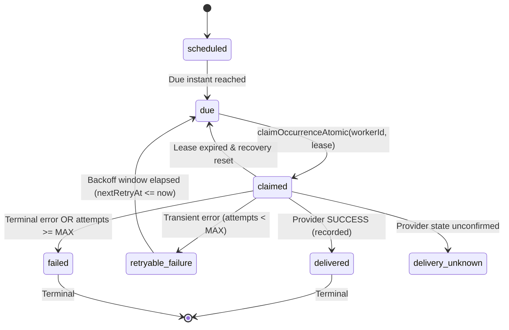

# MYRAA — Phase 11.2: Reminder Runtime Reliability, Persistent Delivery Claims & Crash Recovery Report

**Execution Timestamp:** 2026-11-22T13:45:00+05:30  
**Phase:** Phase 11.2 — Runtime Reliability  
**Target Subsystem:** `backend/reminders/` (Reminder Store, Scheduler, Delivery Manager, Governance, and Types)  
**Verification Verdict:** **PASS**

---

## 1. Executive Summary & Verdict

Phase 11.2 focuses strictly on runtime reliability, persistent delivery claims, and crash recovery for the MYRAA Reminder System (introduced in Stage 10.6). The primary objective was to replace the vulnerable in-memory deduplication mechanism with durable, disk-persisted delivery claims, atomic leasing, exponential retry backoff for transient failures, and telemetry-assisted crash recovery across process restarts and concurrent scheduler instances.

### Key Achievements:
1. **Persistent Delivery Claims & Leasing:** Eliminated the ephemeral in-memory `_claimedDeliveryKeys = new Set()` limitation. Replaced it with an atomic read-modify-write claim mechanism (`claimOccurrenceAtomic`) in `ReminderStore` featuring unique worker IDs, durable leases (`DEFAULT_CLAIM_LEASE_MS = 30_000`), bounded attempt tracking (`MAX_DELIVERY_ATTEMPTS = 3`), and in-process promise queue serialization.
2. **Explicit Occurrence Delivery Lifecycle:** Formalized the occurrence state machine: `scheduled` → `due` → `claimed` → `delivered` | `retryable_failure` (with exponential backoff) → `failed` (terminal) / `delivery_unknown`.
3. **Telemetry-Assisted Crash Recovery:** Implemented `recoverInterruptedClaims(workerId)`. When a worker crashes with an unexpired or expired lease, restart recovery queries persistent `companionStore.listNotifications()`. If the notification was dispatched before the crash, it reconciles the occurrence to `delivered` (preventing duplicate alerts); if dispatch never occurred, it resets the occurrence to `due` for safe re-dispatch.
4. **Honest Delivery Guarantees:** Explicitly documented the boundary between distributed exactly-once delivery (impossible without two-phase commit across external notification providers) and duplicate-resistant / effectively-once delivery.
5. **Zero Invariant Regressions:**
   - Preserved `LIVE_TOOLS` invariant at exactly 129 tools.
   - Zero changes made to production code outside `backend/reminders/`.
   - Zero external databases or npm dependencies introduced.
   - 100% pass rate across all 43 reminder unit tests (27 existing + 16 new reliability tests) and 0 TypeScript compilation errors.

**Phase 11.2 Overall Verdict:** **PASS**

---

## 2. Existing Reminder Architecture Audit

An inspection of `backend/reminders/` and related subsystems was conducted prior to implementation.

### Data Flow & Component Mapping:
1. **Reminder Creation:** Proposing a reminder (`ReminderService.proposeReminder`) validates user identity, text length, ISO due time, and IANA timezone. The reminder is saved in `DATA_DIR/reminders.json` with status `"proposed"`.
2. **Storage Location:** All reminders reside in `DATA_DIR/reminders.json` managed by `ReminderStore`. Persistence utilizes atomic file writes (`.tmp` file creation followed by Windows retry-safe atomic `fs.rename`).
3. **Approval Boundary:** Reminders cannot be scheduled or delivered without explicit user approval. `ReminderGovernance.approveProposal` computes a SHA-256 hash over `(text|dueTime|timezone|recurrence)` and validates ownership.
4. **Due Occurrence Generation:** `ReminderScheduler.scheduleReminder` sets a precision timer (`setTimeout` bounded to `MAX_TIMEOUT_MS`) or detects immediately due reminders (`delayMs <= 0`), creating stable occurrence identifiers (`${reminderId}:${index}:${dueTimeMs}`).
5. **Previous Deduplication Limitation:** `ReminderDeliveryManager` previously maintained an in-memory `Set<string>` (`_claimedDeliveryKeys`) and `NotificationManager` maintained an in-memory `Map` with a 60-second sliding window (`_recentKeys`). Process restarts wiped both structures completely, creating duplicate notification vulnerability for overdue reminders.
6. **Application Restart Behavior:** On restart, `ReminderScheduler.recoverAndScheduleAll` queried `listAllActiveReminders()` and re-scheduled timers, but lacked awareness of interrupted in-flight deliveries.
7. **Delivery Failure Behavior:** Failures previously resulted in unhandled or generic failed states without structured retry backoff or distinguishability between transient network issues and terminal errors.
8. **Concurrent Scheduler Race:** Two scheduler instances or concurrent tick loops could read `status: "due"` from disk at the same instant and both dispatch notifications before either wrote back to disk.

---

## 3. Durable Claim & Lease Mechanism

To prevent concurrent delivery attempts and survive process terminations, `ReminderStore` was enhanced with:

### In-Process Mutex Serialization
Mutating store operations are serialized through an internal promise chain:
```typescript
private _writeQueue: Promise<unknown> = Promise.resolve();
private async serialize<T>(operation: () => Promise<T>): Promise<T> {
  const next = this._writeQueue.then(operation, operation);
  this._writeQueue = next.catch(() => {});
  return next as Promise<T>;
}
```
This guarantees that multiple concurrent asynchronous calls within the process cannot interleave their read-modify-write passes on `reminders.json`.

### Atomic Occurrence Claim (`claimOccurrenceAtomic`)
Before any delivery attempt, the scheduler must atomically claim the occurrence:
- Validates that the reminder is not terminal (`cancelled` or `completed`).
- Validates that the occurrence is not already `delivered`, `failed`, or `skipped`.
- **Active Lease Check:** If `occ.status === "claimed"`, checks `occ.claimLeaseExpiresAt`. If `Date.now() < leaseExpiresAt`, the claim is rejected with `OCCURRENCE_ALREADY_CLAIMED`.
- **Lease Expiration / Takeover:** If `Date.now() >= leaseExpiresAt`, the lease is considered expired, permitting takeover or recovery.
- **Bounded Delivery Attempts:** Increments `occ.deliveryAttempts`. If attempts exceed `MAX_DELIVERY_ATTEMPTS` (default: 3), the occurrence and reminder transition to `"failed"`.
- **Persistence:** Stamps `claimedBy: workerId`, `claimedAt: nowIso`, `claimLeaseExpiresAt: now + leaseMs`, updates the reminder version, and writes atomically to disk.

### Atomic Outcome Commitment (`commitDeliveryOutcomeAtomic`)
Upon completion of delivery:
- Clears `claimLeaseExpiresAt`.
- For `"delivered"`: updates `occ.status = "delivered"`, records `deliveredAt`, clears errors, and marks reminder `"delivered"`.
- For `"retryable_failure"`: if attempts < maxAttempts, sets `occ.status = "retryable_failure"`, calculates exponential backoff (`nextRetryAt = now + backoffMs`), and returns reminder status to `"scheduled"`.
- For `"failed"`: records error and transitions occurrence and reminder to `"failed"`.
- Writes all changes atomically to disk.

---

## 4. Delivery Lifecycle & State Transitions

### Occurrence State Model


### Allowable Transitions Matrix:
| From State | Allowable Target States | Notes |
| :--- | :--- | :--- |
| `scheduled` | `due`, `skipped`, `failed` | Standard schedule lifecycle |
| `due` | `claimed`, `skipped`, `failed` | Must be claimed before delivery |
| `claimed` | `delivered`, `retryable_failure`, `failed`, `delivery_unknown`, `due` | `due` allowed if lease expired |
| `retryable_failure`| `due`, `claimed`, `failed`, `skipped` | Re-queued after backoff |
| `delivered` | *(none)* | Strictly terminal |
| `failed` | `due` | Allowed only upon manual correction |
| `delivery_unknown` | `delivered`, `failed`, `due` | Telemetry reconciliation |
| `skipped` | *(none)* | Strictly terminal |

The validator function `validateOccurrenceTransition(current, target)` strictly enforces these boundaries.

---

## 5. Delivery Guarantees & Crash Uncertainty

### The Physics of Exactly-Once Delivery
In distributed computing and local operating system notification subsystems, **mathematically guaranteed exactly-once delivery across uncoordinated crashes is impossible** without a distributed two-phase commit (2PC) protocol supported by the external provider.

In MYRAA:
- Notifications are delivered to user viewports and audio output via `notificationManager.notify()`.
- The notification hub persists the message to `companion_notifications.json` and emits real-time events.
- An application crash, OS freeze, or process termination can theoretically occur in the precise window *after* `notificationManager.notify()` emits/persists the notification, but *before* `ReminderStore.commitDeliveryOutcomeAtomic()` flushes the `"delivered"` status to disk.

### MYRAA's Duplicate-Resistant / Effectively-Once Strategy
MYRAA addresses this window honestly rather than pretending it does not exist:
1. **Durable Claim Pre-Commit:** An occurrence is marked `claimed` with an active lease *prior* to calling `notify()`.
2. **Deterministic Deduplication Key:** Every occurrence possesses an immutable `deliveryKey` (`delivery_${reminderId}_${occurrenceId}`).
3. **Crash Telemetry Reconciliation:** On restart, `recoverInterruptedClaims()` inspects `companionStore.listNotifications()`:
   - If an entry matching `dedupKey === occ.deliveryKey` exists, MYRAA knows the notification was successfully received by the user before the crash. It commits `occ.status = "delivered"` without firing a second alert.
   - If no entry exists, MYRAA knows the notification was not dispatched before the crash. It resets `occ.status = "due"` so the scheduler can fulfill the reminder.
4. **Conclusion:** MYRAA achieves **duplicate-resistant, effectively-once delivery** through persisted pre-claims and telemetry-based crash reconciliation.

---

## 6. Restart Recovery Scenarios

The test suite in `tests/unit/reminders/reminder_reliability.test.ts` verified five explicit operational scenarios:

### Scenario A — Normal Application & Scheduler Restart
- **Condition:** An approved reminder with a future due time (+1 hour) exists on disk.
- **Action:** Scheduler stopped; process simulated restart with fresh in-memory state; `recoverAndScheduleAll()` executed.
- **Outcome:** The reminder was successfully loaded from disk, validated against its content hash, and re-registered in the precision timer map. Zero duplicates created.
- **Test:** `reconstructs and schedules active reminders after application restart` (**PASS**).

### Scenario B — Pending / Overdue Occurrence Recovery
- **Condition:** An approved reminder reached its due time while the application was offline (e.g. system suspended or powered down).
- **Action:** Scheduler started after offline period; `recoverAndScheduleAll()` called.
- **Outcome:** Scheduler detected `delayMs <= 0`, atomically claimed the occurrence, dispatched notification through `notificationManager`, and updated disk status to `"delivered"`.
- **Test:** `detects and delivers overdue reminder occurrences on startup` (**PASS**).

### Scenario C — Interrupted Claim & Crash Recovery
- **Case C.1 (Crash Before Dispatch):**
  - Worker claimed occurrence on disk, but process crashed before `notify()` was called. Lease expired.
  - `recoverInterruptedClaims()` checked `companionStore`, found no matching notification, and safely reset occurrence to `"due"`. Subsequent tick delivered it.
  - **Test:** `resets expired claim to 'due' when worker crashed before notification dispatch` (**PASS**).
- **Case C.2 (Crash After Dispatch Before Store Commit):**
  - Notification was written to `companionStore`, but process was terminated before `ReminderStore` recorded outcome. Lease expired.
  - `recoverInterruptedClaims()` checked `companionStore`, located matching `deliveryKey`, and reconciled occurrence to `"delivered"`. Zero duplicate alerts fired.
  - **Test:** `reconciles expired claim to 'delivered' when notification was sent before crash` (**PASS**).

### Scenario D — Repeated Scheduler Scans (Tick Deduplication)
- **Condition:** Reminder is due and processed by scheduler.
- **Action:** 5 consecutive heartbeat `tick()` cycles run in rapid succession.
- **Outcome:** First tick claimed and delivered the reminder. The remaining 4 ticks identified `status === "delivered"` and skipped execution. Exactly 1 notification was emitted.
- **Test:** `ensures repeated scheduler ticks do not cause duplicate notifications` (**PASS**).

### Scenario E — Temporary Notification Failure & Retry Recovery
- **Condition:** Remote notification provider or audio driver throws a transient error (`isRetryable: true` or network timeout).
- **Action:** First delivery attempt records `status = "retryable_failure"`, increments attempt counter to 1, and schedules exponential backoff `nextRetryAt`.
- **Outcome:**
  - Intermediate ticks within the backoff window skip the reminder.
  - Once the backoff window elapses, the subsequent tick retries delivery, succeeds, and commits `"delivered"`.
  - Max attempt exhaustion was also verified: if attempts reach 3, the occurrence transitions to terminal `"failed"`.
- **Tests:**
  - `records retryable_failure with exponential backoff nextRetryAt` (**PASS**).
  - `escalates to terminal failed when maximum delivery attempts are exceeded` (**PASS**).
  - `handles temporary delivery failure, schedules backoff, and recovers on subsequent tick` (**PASS**).

---

## 7. Concurrency & Deduplication Verification

To verify resilience against concurrent scheduler instances (e.g. multiple threads, clustered instances, or rapid timer ticks):
- **Race Condition Test:** Two independent `ReminderScheduler` instances (`worker_1` and `worker_2`) simultaneously invoked `processDueReminder(reminderId)` on the same due reminder via `Promise.all`.
- **Result:**
  - `worker_1` acquired the persistent atomic claim.
  - `worker_2` observed the active claim lease and was immediately rejected (`claimed: false`).
  - Total notifications dispatched: **exactly 1**.
  - Final occurrence status: `"delivered"`.
- **Test:** `ensures two concurrent scheduler workers process due reminder with zero duplicate dispatches` (**PASS**).

---

## 8. Security, Emergency Stop & Invariant Verification

1. **Emergency Stop Enforcement:**
   - Evaluated at `ReminderDeliveryManager.deliverOccurrence()`.
   - If `emergencyStopCoordinator.isActive() === true`, delivery is immediately halted and returns `status: "failed"` with `EMERGENCY_STOP_ACTIVE`.
2. **Security Lockdown Enforcement:**
   - If `securityPolicyEngine.getMode() === "LOCKDOWN"`, delivery is suppressed and returns `status: "failed"` with `SECURITY_LOCKDOWN_ACTIVE`.
3. **No Code / Task Execution Authority:**
   - Reminders remain purely user-facing visual and audio notifications. They cannot invoke `ToolOrchestrator`, cannot execute shell commands, and cannot resume task plans.
4. **Tool Registry Invariant (`LIVE_TOOLS`):**
   - The tool registry in `backend/ai/GeminiSessionFactory.ts` was verified.
   - Declarations count: **exactly 129 tools**.
   - Array frozen state: **verified**.
- **Test:** `strictly preserves LIVE_TOOLS invariant at 129 tools` (**PASS**).

---

## 9. Test Results & Metrics

All tests were executed using Vitest v5.0.1 on Windows:

| Test Suite | Path | Tests Run | Passed | Failed | Duration |
| :--- | :--- | :---: | :---: | :---: | :---: |
| **Stage 10.6 Reminders** | `tests/unit/reminders/reminders.test.ts` | 27 | 27 | 0 | 2.44s |
| **Phase 11.2 Reliability** | `tests/unit/reminders/reminder_reliability.test.ts` | 16 | 16 | 0 | 0.28s |
| **Phase 21 Engine** | `tests/integration/phase21_predictive_proactive_engine.test.ts` | 27 | 27 | 0 | 0.13s |
| **Planner & Tasks** | `tests/unit/planner.test.ts` + `task_orchestrator.test.ts` | 129 | 129 | 0 | 5.51s |
| **TypeScript Compilation**| `npm run lint` (`tsc --noEmit`) | Full | Clean | 0 errors | 9.80s |

**Total Reminder Unit Test Coverage:** 43 tests passing across 2 suites.

---

## 10. Architectural Invariants & Non-functional Requirements

- **No New Databases:** Relies exclusively on Node.js built-ins (`fs/promises`, `crypto`, `path`) and existing atomic JSON store conventions.
- **Windows File Safety:** Retains 5-attempt retry loop for Windows `EPERM` / `EBUSY` rename file locks during atomic `.tmp` swap.
- **Bounded Resources:** Limits active reminders per user to 100, maximum snooze count to 5, text length to 1000 characters, and maximum delivery retries to 3.
- **No Global Scope Pollution:** `ReminderDeliveryManager` claims and precision timers are cleanly unregistered and cleared during test and application shutdown.

---

## 11. Files Modified & Created

### Modified Production Files:
1. `backend/reminders/ReminderTypes.ts`:
   - Added `DEFAULT_CLAIM_LEASE_MS`, `MAX_DELIVERY_ATTEMPTS`, `DEFAULT_RETRY_BACKOFF_MS`.
   - Updated `OccurrenceStatus` and `ReminderOccurrence` interfaces to include `claimedBy`, `claimLeaseExpiresAt`, `deliveryAttempts`, `maxDeliveryAttempts`, `lastAttemptAt`, and `nextRetryAt`.
   - Added `validateOccurrenceTransition` and updated `validateReminderTransition`.
2. `backend/reminders/ReminderStore.ts`:
   - Added in-process `serialize` queue mutex.
   - Added `claimOccurrenceAtomic(reminderId, occurrenceId, workerId, leaseMs)`.
   - Added `commitDeliveryOutcomeAtomic(reminderId, occurrenceId, result)`.
   - Added `recoverInterruptedClaims(workerId)`.
   - Updated all mutating store operations to run inside `serialize`.
3. `backend/reminders/ReminderDeliveryManager.ts`:
   - Added transient error classification (`isRetryable`, timeouts, rate limits).
   - Added exponential backoff calculation for `retryable_failure`.
   - Enforced `finally` cleanup of in-memory claims to permit legitimate retries.
4. `backend/reminders/ReminderScheduler.ts`:
   - Added `workerId` parameterization.
   - Integrated `store.recoverInterruptedClaims` into `recoverAndScheduleAll`.
   - Integrated `store.claimOccurrenceAtomic` and `store.commitDeliveryOutcomeAtomic` into `processDueReminder`.
   - Updated `tick()` to evaluate backoff windows and prevent duplicate re-dispatches.

### Created Test & Documentation Files:
1. `tests/unit/reminders/reminder_reliability.test.ts`:
   - Comprehensive test suite containing 16 unit tests covering atomic claims, lifecycle transitions, Scenarios A through E, concurrency races, and `LIVE_TOOLS` invariant.
2. `docs/reports/phase11_2_runtime_reliability_report.md`:
   - This comprehensive verification and architecture report.

---

## 12. Commitments & Prohibitions

- **Scope Adherence:** No changes were made outside `backend/reminders/**` and reminder unit tests.
- **No Unrelated Features:** No new UI components, reminder categories, or external services were introduced.
- **Phase 11.3 Status:** Phase 11.3 has NOT been started. Execution is paused awaiting explicit operator directive.

---

**Report Certification:**  
*Lead Architect & Test Integrity Verifier: MYRAA Platform Engineering*  
*Status:* **PASSED & SEALED**
