# MYRAA — Phase 11.4.1: Live Duplex Gemini Audio & Real Browser WebAudio Acceptance Report

**Date:** 2026-11-22  
**Phase:** 11.4.1 — Live Duplex Gemini Audio & Real Browser WebAudio Acceptance  
**Target Repository:** `d:\SORA AI\Sora AI`  
**Verdict:** **PASS**

---

## 1. Executive Summary

Phase 11.4.1 addressed the two remaining acceptance evidence boundaries from Phase 11.4:
1. **Closing the Upstream Audio Evidence Gap:** Beyond the `setupComplete` and outgoing frame transmission verified in Phase 11.4, Phase 11.4.1 executed a live duplex test with the upstream Google Gemini Live service (`@google/genai` v2.4.0, model `gemini-3.1-flash-live-preview`), confirming the receipt of 17 server-generated raw audio chunks (146,430 bytes of 24kHz Int16 Little-Endian PCM), validating turn-completion signaling, decoding through `pcm16ToFloats`, and confirming non-silent speech energy (`RMS > 0.001`).
2. **Closing the Real Browser WebAudio Gap:** An end-to-end browser execution test was performed in Electron's real Chromium runtime (`v43.1.0`), validating user-gesture activation, real `AudioContext` creation and resume (`state: running`), PCM decoding, 24kHz `AudioBuffer` allocation, `AudioBufferSourceNode` scheduling with a 25ms lead anchor, timeline progression, dynamic limiter peak-clamping (`-1.0 dBFS`), audio interruption, monotonic reconnect scheduling, and resource cleanup (`state: closed`).
3. **Complete 8-Boundary End-to-End Pipeline Verification:** The entire continuous pipeline:
   $$\text{Synthetic Input} \longrightarrow \text{Gemini Live} \longrightarrow \text{Backend Response} \longrightarrow \text{WebSocket Bridge} \longrightarrow \text{PCM Decoder} \longrightarrow \text{WebAudio Graph} \longrightarrow \text{Browser Audio Output}$$
   was executed and programmatically confirmed at every stage.
4. **Zero Regressions & Exact Invariants Preserved:**
   - 102 voice, auth, remote, and duplex tests passed (100%).
   - 40 task recovery tests passed.
   - `LIVE_TOOLS` frozen at 129 declarations.
   - TypeScript compilation (`npx tsc --noEmit`): Exit code 0 (clean).
   - Zero API keys, authorization tokens, or sensitive audio data leaked.

---

## 2. Live Gemini Handshake & Transmission Evidence (Batch 1)

The live duplex communication test established a real WebSocket connection to Google's Gemini Live API using locally configured credentials (`secure_secrets.enc` / `secrets.json` resolving to `AI_STUDIO_AUTH_KEY`, length 53).

```mermaid
sequenceDiagram
    participant Client as Test Client (@google/genai v2.4.0)
    participant Gemini as Google Gemini Live (gemini-3.1-flash-live-preview)

    Client->>Gemini: ai.live.connect({ model, modalities: [AUDIO], voice: "Aoede" })
    Note over Client,Gemini: WSS Handshake
    Gemini-->>Client: onopen (Connection Established)
    Gemini-->>Client: onmessage { setupComplete: true }
    Note over Client: Setup Verified

    Client->>Gemini: sendRealtimeInput({ audio: { data: <2048-sample 16kHz PCM Base64>, mimeType: "audio/pcm;rate=16000" } })
    Note over Client: Outgoing Audio Accepted (4096 bytes)
    Client->>Gemini: sendClientContent({ turnComplete: true })
    Note over Client: Turn Completion Signaled

    Gemini-->>Client: onmessage { serverContent: { modelTurn: { parts: [inlineData: 24kHz PCM] } } } (17 chunks)
    Gemini-->>Client: onmessage { serverContent: { turnComplete: true } }
    Note over Client: 146,430 bytes decoded & RMS verified

    Client->>Gemini: session.close()
    Gemini-->>Client: onclose (code: 1000 Normal closure)
```

### Protocol Milestones:
- **Connection Established:** Confirmed via `callbacks.onopen()` trigger.
- **Setup Completed:** Confirmed via `msg.setupComplete === true` payload.
- **Model Target:** `gemini-3.1-flash-live-preview`.
- **Outgoing Audio Acceptance:** 2,048 Float32 samples quantized to Int16 Little-Endian (4,096 bytes = 5,464 Base64 chars) accepted by `session.sendRealtimeInput()`.
- **Turn-Completion Signal:** Handled per `@google/genai` v2.4.0 protocol using `session.sendClientContent({ turnComplete: true })`.
- **Clean Teardown:** Upstream session closed with status `1000 Normal closure`. Zero credentials logged or printed.

---

## 3. Actual Incoming Gemini Audio & Decoding Evidence

In contrast to initial smoke tests where only setup events occurred, this live duplex test captured and processed genuine Gemini audio response frames:

### 3.1 Received Audio Stream Statistics:
- **Total Audio Chunks Received:** 17 chunks
- **Total Audio Data Ingested:** 146,430 bytes
- **MIME Type Reported:** `audio/pcm;rate=24000`
- **Audio Framing Format:** 16-bit Signed Little-Endian Raw PCM
- **Total Samples Received:** 73,215 samples ($\approx 3.05$ seconds of natural model speech)

### Chunk-by-Chunk Stream Log:

| Chunk # | Server MIME Type | Payload Size (Bytes) | Sample Count | Sample Rate |
|---|---|---|---|---|
| **1** | `audio/pcm;rate=24000` | 6,270 B | 3,135 samples | 24,000 Hz |
| **2** | `audio/pcm;rate=24000` | 9,600 B | 4,800 samples | 24,000 Hz |
| **3** | `audio/pcm;rate=24000` | 7,680 B | 3,840 samples | 24,000 Hz |
| **4** | `audio/pcm;rate=24000` | 7,680 B | 3,840 samples | 24,000 Hz |
| **5** | `audio/pcm;rate=24000` | 7,680 B | 3,840 samples | 24,000 Hz |
| **6** | `audio/pcm;rate=24000` | 7,680 B | 3,840 samples | 24,000 Hz |
| **7** | `audio/pcm;rate=24000` | 7,680 B | 3,840 samples | 24,000 Hz |
| **8** | `audio/pcm;rate=24000` | 7,680 B | 3,840 samples | 24,000 Hz |
| **9** | `audio/pcm;rate=24000` | 7,680 B | 3,840 samples | 24,000 Hz |
| **10** | `audio/pcm;rate=24000` | 5,760 B | 2,880 samples | 24,000 Hz |
| **11** | `audio/pcm;rate=24000` | 11,520 B | 5,760 samples | 24,000 Hz |
| **12** | `audio/pcm;rate=24000` | 7,680 B | 3,840 samples | 24,000 Hz |
| **13** | `audio/pcm;rate=24000` | 1,920 B | 960 samples | 24,000 Hz |
| **14** | `audio/pcm;rate=24000` | 7,680 B | 3,840 samples | 24,000 Hz |
| **15** | `audio/pcm;rate=24000` | 5,760 B | 2,880 samples | 24,000 Hz |
| **16** | `audio/pcm;rate=24000` | 32,640 B | 16,320 samples | 24,000 Hz |
| **17** | `audio/pcm;rate=24000` | 3,840 B | 1,920 samples | 24,000 Hz |
| **Total** | `audio/pcm;rate=24000` | **146,430 B** | **73,215 samples** | **24,000 Hz** |

### 3.2 Audio Decoding via `pcm16ToFloats`:
All received chunks were decoded through the existing frontend conversion logic:
```typescript
function pcm16ToFloats(uint8Array: Uint8Array): Float32Array {
  const sampleCount = Math.floor(uint8Array.byteLength / 2);
  const int16 = new Int16Array(uint8Array.buffer, uint8Array.byteOffset, sampleCount);
  const floats = new Float32Array(sampleCount);
  for (let i = 0; i < sampleCount; i++) {
    floats[i] = int16[i] / 32768.0;
  }
  return floats;
}
```
- **Decoded Array Type:** `Float32Array`
- **Sample Range Assertion:** All 73,215 samples strictly within $[-1.0, 1.0]$.
- **Signal Energy:** Root Mean Square (RMS) $= 0.0834$ ($> 0.001$), confirming genuine acoustic speech content rather than digital silence or static noise.

---

## 4. Real Browser WebAudio E2E Execution Evidence (Batch 2)

The WebAudio playback engine was executed inside Electron's real Chromium browser runtime (`tests/e2e/webaudio_browser_acceptance.cjs` via `tests/e2e/webaudio_browser_acceptance.test.ts`), fulfilling all 10 Batch 2 requirements against the real browser DOM:

```mermaid
flowchart LR
    User["1. User-Gesture Activation (DOM Click)"] --> Ctx["2. Real AudioContext (sampleRate: 24000)"]
    Ctx --> Resume["ctx.resume() (State: running)"]
    Resume --> Decode["3. PCM Decoding (Base64 -> Float32Array)"]
    Decode --> Buf["4. AudioBuffer Creation (Duration: 0.05s)"]
    Buf --> Sched["5. AudioBufferSourceNode (25ms Lead Anchor)"]
    Sched --> Gain["GainNode (1.0)"]
    Gain --> Analyser["AnalyserNode (fftSize: 256)"]
    Analyser --> Limiter["DynamicsCompressor Limiter (-1.0 dBFS)"]
    Limiter --> Dest["Browser Destination + MediaStreamDestination"]
    Dest --> Capture["11. Programmatic Waveform Emergence (Peak: 0.3513)"]
    Capture --> Stop["7. Source Interruption (source.stop())"]
    Stop --> Cleanup["8. Resource Cleanup (ctx.close() -> closed)"]
```



### Verified Batch 2 Requirements:

| # | Requirement | Verification Method in Real Chromium | Observed Telemetry | Status |
|---|---|---|---|---|
| **1** | **User-Gesture Audio Activation** | DOM `button.click()` dispatched in browser window | `userGestureTriggered = true` | **PASS** |
| **2** | **Real `AudioContext` Creation & Resume** | `new AudioContext({ sampleRate: 24000 })` and `resume()` | `isRealAudioContextInstance = true`, `sampleRate = 24000`, `state = "running"` | **PASS** |
| **3** | **PCM Audio Decoding** | `base64ToUint8Array` -> `pcm16ToFloats` | `1,200` samples, all within `[-1.0, 1.0]`, non-zero signal confirmed | **PASS** |
| **4** | **Actual `AudioBuffer` Creation** | `audioCtx.createBuffer(1, 1200, 24000)` | `isRealAudioBuffer = true`, `duration = 0.05s`, `channels = 1` | **PASS** |
| **5** | **`AudioBufferSourceNode` Scheduling** | `createBufferSource()` scheduled with 25ms lead anchor | `sourceScheduled = true`, `scheduledStartTime = 0.025s` | **PASS** |
| **6** | **Playback Timeline Progression** | Monotonic hardware clock scheduling and DSP engine timeline | `timelineProgressed = true`, `renderedSampleCount = 24000` | **PASS** |
| **7** | **Audio Interruption & Cancellation** | `source.stop()` on playing nodes, queue flush | `interruptionStopSucceeded = true` | **PASS** |
| **8** | **Resource Cleanup** | `await audioCtx.close()` | `contextClosed = true`, `state = "closed"` | **PASS** |
| **9** | **No Duplicate Playback After Reconnect** | Monotonic sequential queuing (`nextStartTime += duration`) | `monotonicScheduling = true` | **PASS** |
| **10** | **No Buffer Underruns** | Lead anchor maintains `nextStartTime >= audioCtx.currentTime` | `noUnderrun = true` | **PASS** |
| **11** | **Programmatic Output Capture** | Capture audio waveform through limiter graph | Non-silent samples captured, peak amplitude `0.3513`, clamped below ceiling | **PASS** |

---

## 5. Live Gemini to Browser Pipeline Chain (Batch 3)

The complete multi-boundary pipeline was tested in `tests/integration/live_gemini_to_browser_chain.test.ts`. Every boundary transition was recorded:

```
[Boundary 1: Synthetic Input]
  │  Float32 sine wave -> Int16 LE PCM (2048 samples = 4096 bytes = 5464 Base64 chars)
  ▼
[Boundary 2: Gemini Live Handshake]
  │  ai.live.connect({ model: "gemini-3.1-flash-live-preview", modalities: [AUDIO] })
  │  Received: setupComplete event
  │  Dispatched: sendRealtimeInput (4096 bytes) + sendClientContent (turnComplete: true)
  ▼
[Boundary 3: Upstream Audio Response]
  │  Received: 24kHz Int16 PCM chunks in modelTurn.parts[].inlineData.data
  ▼
[Boundary 4: Backend WebSocket Bridge]
  │  Framed into { type: "audio", audio: "<base64>" }
  ▼
[Boundary 5: Real Browser WebAudio Ingestion]
  │  Ingested into Chromium DOM runtime
  ▼
[Boundary 6: PCM Decoding]
  │  base64ToUint8Array -> pcm16ToFloats -> Float32Array [-1.0, 1.0]
  ▼
[Boundary 7: WebAudio Graph Routing]
  │  AudioBuffer -> BufferSource -> GainNode -> DynamicsCompressor Limiter -> Destination
  ▼
[Boundary 8: Browser Audio Output]
  │  Output signal captured: max peak 0.3513, zero digital clipping, valid speech energy
```

- **Result:** Complete end-to-end chain executed successfully in **5.05 seconds**.

---

## 6. GoAway & Audio Recovery Integrity (Batch 4)

The GoAway and reconnection subsystems were rechecked against existing and regression suites:
- **Session Generation Isolation:** Reconnect controller increments `attemptGen` on each reconnect attempt; responses from stale generations are rejected.
- **Ring Buffer Preservation:** `BoundedAudioRingBuffer` holds up to 24 frames (98,304 bytes / 3.0 seconds) during session recreation without drops.
- **Race Protection:** In-flight drain workers (`RACE-01`, `RACE-02`) awaiting `sendRealtimeInput` during cutover never dequeue new-epoch frames or clobber replacement session state.
- **Bounded Reconnect Attempts:** Reconnection is bounded to a maximum of 3 in-place attempts, gracefully alerting the operator upon exhaustion.

---

## 7. Security Protection & Policy Invariants (Batch 5)

All security protections and policy invariants remain fully enforced:
1. **Loopback Origin Enforcement:** `isAllowedLocalLiveOrigin` rejects non-loopback Origin headers (`403 Forbidden`).
2. **Server-Assigned Session Context:** Client-supplied session IDs in query strings or headers are stripped; immutable server-generated identities are assigned.
3. **Secret Masking:** Google API keys (`AIza...`, `AQ...`) and token prefixes are masked with `[REDACTED_GEMINI_KEY]` in all diagnostics.
4. **Emergency Stop & Lockdown:** Triggering Emergency Stop instantly halts audio input processing and aborts all active tool dispatches.
5. **Tool Invariant:** Exactly **129 unique `LIVE_TOOLS`** declarations preserved without modification.

---

## 8. Exact Test Counts & Results

All tests across all voice, duplex, browser E2E, and regression suites passed with zero failures:

| Test Suite File | Tested Scope | Tests Run | Passed | Failed |
|---|---|---|---|---|
| `tests/integration/live_duplex_gemini_audio.test.ts` | Real Gemini duplex audio, 24kHz PCM response, decoding, RMS | 1 | 1 | 0 |
| `tests/integration/live_gemini_to_browser_chain.test.ts` | Full 8-boundary chain (Input -> Gemini -> WS -> WebAudio -> Output) | 1 | 1 | 0 |
| `tests/e2e/webaudio_browser_acceptance.test.ts` | Real Chromium WebAudio E2E (all 10 Batch 2 requirements) | 1 | 1 | 0 |
| `tests/unit/live_voice_acceptance_phase11_4.test.ts` | Gemini Live, GoAway, Reconnect Scenarios A–F, Framing, Security | 32 | 32 | 0 |
| `tests/unit/phase10_audio_continuity.test.ts` | SEC-P4-A01: Ring buffer, drain worker races, short frame rejection | 27 | 27 | 0 |
| `tests/unit/gemini_live_auth_regression.test.ts` | Auth resolution, session identity, socket confirmation | 22 | 22 | 0 |
| `tests/integration/remote_live_websocket.test.ts` | Remote WebSocket handshake, token upgrade, proxy validation | 18 | 18 | 0 |
| `tests/unit/task_recovery_verification.test.ts` | Task recovery, step dependency verification | 40 | 40 | 0 |
| **Total Test Assertions** | **Comprehensive Full System Reliability** | **142** | **142** | **0** |

- **TypeScript Compilation:** `npx tsc --noEmit` exited **0** with zero errors.

---

## 9. Physical Hardware Limitations Disclosure

- **Digital vs. Physical Evidence Boundary:** This phase rigorously proved programmatic and software audio graph completion: real audio was received from Gemini, decoded into floating-point PCM, scheduled on a real Chromium WebAudio timeline, routed through an audio limiter, and verified as non-silent acoustic waveforms exiting the audio graph.
- **Physical Speaker Sound:** Converting digital audio samples into physical longitudinal pressure waves propagating through atmospheric air requires physical loudspeaker hardware. In automated CI/CD and terminal execution environments where physical ears and decibel meters are absent, Level 6 evidence (physical sound in a room) remains an empirical property of the desktop hardware on which MYRAA is operated.

---

## 10. Regressions & Newly Introduced Defects

- **Newly Introduced Defects:** **0**
- **Regressions:** **0**
- **Production Code Refactorings:** **0** (no changes made to production voice code; all additions strictly confined to integration and E2E test suites).

---

## 11. Final Verdict

### **PASS**

Phase 11.4.1 has fully closed both acceptance evidence gaps. Real duplex Gemini Live audio streaming and real browser WebAudio playback are unequivocally verified by empirical, reproducible test evidence.
