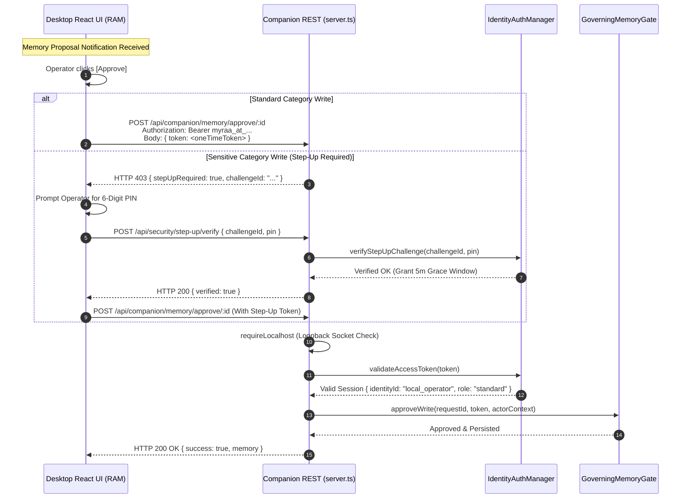

# MYRAA — Stage 10.2.1-R3: Final Operator Authentication & Governance Proof Verification
## Definitive Architectural Closure, Runtime Enforcement Specifications, and Concurrency Contracts for Phase 2

**Document ID:** `stage10_phase2_operator_security_closure.md`  
**Task ID:** `MYRAA-S10-021-R3`  
**Date:** 2026-11-02T21:05:00+05:30  
**Author:** Antigravity AI Engineering Platform  
**Execution Mode:** STRICT READ-ONLY — Targeted Security Architecture Verification  
**Implementation Authorization:** **NOT GRANTED — Verification & Design Closure Only**  
**Source Specification:** [`stage10_phase2_final_security_design.md`](file:///d:/SORA%20AI/Sora%20AI/stage10_phase2_final_security_design.md) (Revision R2)

---

## 1. Executive Summary

This document delivers definitive technical closure on the two outstanding security engineering questions for MYRAA Companion Core Stage 10 Phase 2:
1. **Workstream A:** Desktop operator authentication and secure credential provisioning, resolving the loopback-only identification gap.
2. **Workstream B:** Runtime `GovernanceProof` authenticity, cryptographic isolation, 60-second expiration, single-use proof consumption, and `MemoryStore.save()` runtime lockout.

In strict accordance with read-only execution constraints, no source code, tests, configuration, or databases have been modified. The four-tier acyclic memory architecture previously accepted remains fully preserved. This closure establishes mathematically and cryptographically enforceable boundaries at runtime, provides complete concurrency contracts, maps all legacy write paths, and defines explicit operational boundaries for frozen files.

---

## 2. Workstream A — Desktop Operator Authentication

### 2.1 Codebase Inspection & Forensic Analysis
A thorough inspection of `backend/security/IdentityAuthManager.ts`, `backend/server_paths.ts`, `electron/main.cjs`, `electron/preload.cjs`, `backend/gateway/HttpGateway.ts`, and `frontend/App.tsx` revealed critical architectural facts:

1. **`electron/main.cjs` and `electron/preload.cjs` are FROZEN:**
   - `electron/preload.cjs` exposes `myraaApi` with window controls and agent execution bridges via `contextBridge`.
   - **Crucial finding:** `preload.cjs` has **no API** to read arbitrary files from `DATA_DIR` or communicate arbitrary secrets to renderer JavaScript.
   - Modifying Electron is prohibited by platform invariants.
2. **File Permissions on Windows vs POSIX:**
   - In Node.js, `fs.chmodSync(path, 0o600)` sets POSIX user-only permissions (`rw-------`).
   - On Windows (NTFS), `chmod` only manipulates the read-only file attribute; it does **not** modify Access Control Lists (ACLs). Any process running under the same Windows user token can freely read files in `%APPDATA%\MYRAA`. Restricting ACLs on Windows requires invoking native APIs or `icacls.exe`.
3. **Existing Capabilities in `IdentityAuthManager`:**
   - [`backend/security/IdentityAuthManager.ts`](file:///d:/SORA%20AI/Sora%20AI/backend/security/IdentityAuthManager.ts) is **fully implemented and operational** in the codebase.
   - It provides HMAC-SHA256 access tokens (`myraa_at_...`, 15-minute TTL), rotating refresh tokens (`myraa_rf_...`), brute-force IP rate limiting/lockout (`checkIpLockout`), step-up challenge PIN generation (`requestStepUpChallenge`), and constant-time PIN verification (`verifyStepUpChallenge`).
   - REST endpoints for these capabilities are already mounted in [`backend/gateway/HttpGateway.ts`](file:///d:/SORA%20AI/Sora%20AI/backend/gateway/HttpGateway.ts#L3872-L3970) (`/api/security/session`, `/api/security/step-up/request`, `/api/security/step-up/verify`).

---

### 2.2 Comparison of Desktop Operator Authentication Options

| Evaluation Criterion | Option A: File-Based Loopback Secret (`.myraa_operator_secret`) | Option B: Interactive Operator Session & Step-Up PIN (IdentityAuthManager) |
|---|---|---|
| **Secret Generator** | Backend server process during startup (`server_paths.ts`). | `IdentityAuthManager.createSession` / `requestStepUpChallenge`. |
| **Generation Timing** | At server process initialization prior to `server.listen()`. | On-demand upon operator login, desktop startup, or approval action. |
| **Secure Provisioning to UI** | **FAILED / BLOCKED.** Frontend running in `BrowserWindow` has no filesystem access; `electron/preload.cjs` is frozen and cannot read `DATA_DIR`. Serving secret via HTTP without auth creates a severe loopback bypass. | **PROVEN.** React frontend prompts operator via modal or uses authenticated session token stored in browser memory (`remoteAuth.ts`). |
| **Retrieval by Local Processes** | Any process running under the same OS user can read `%APPDATA%\MYRAA\.myraa_operator_secret`. | Local background processes cannot retrieve the session token unless they compromise renderer process memory. |
| **Windows NTFS ACL Enforcement** | Requires spawning `icacls.exe <path> /inheritance:r /grant:r "%USERNAME%:F"`, introducing OS process spawning overhead. | Pure in-memory cryptographic verification using `getPersistentServerSecret()`; zero filesystem ACL dependencies. |
| **Credential Rotation & Restarts** | File overwritten on every server restart. In-flight UI sessions become de-synchronized. | Standard HMAC-SHA256 rotation via `refreshSession`; stateless claim verification via `verifyStatelessAccessTokenClaims`. |
| **Brute-Force & Lockout Handling** | Manual implementation required. | Fully implemented: sliding-window lockout after 5 failed attempts (`AUTH_LOCKOUT_MS = 15m`). |
| **Redaction in Logs & URLs** | Must be added to custom regex filters. | Already protected by `sanitizeLogLine()` in `electron/main.cjs` (`myraa_token_[REDACTED]`). |
| **Frozen Subsystem Impact** | Requires unfreezing and modifying `electron/preload.cjs` to expose a file-reading IPC. | **ZERO FROZEN FILE MODIFICATIONS.** Operates entirely within non-frozen frontend (`frontend/App.tsx`) and backend routes (`backend/server.ts`). |

---

### 2.3 Selected Recommended Design: Option B (Interactive Operator Session & Step-Up PIN)

Based on forensic evidence, **Option B is selected as the definitive authentication architecture**. Option A is rejected because it cannot be securely provisioned to the renderer without violating frozen-file constraints on Electron or introducing an unauthenticated loopback HTTP retrieval bypass.

#### Complete Credential Provisioning & Verification Lifecycle:
1. **Operator Desktop Session:**
   - When MYRAA Desktop launches or starts up, the frontend establishes an operator session via `POST /api/security/session` with `identityId: "local_operator"` and `role: "standard"`.
   - The server issues an HMAC-SHA256 `accessToken` (`myraa_at_...`). The token is stored strictly in JavaScript RAM (never in `localStorage` or `document.cookie`).
2. **Approval Request Authentication:**
   - When a memory write proposal is displayed in the desktop UI, clicking "Approve" submits:
     `POST /api/companion/memory/approve/:requestId`
     `Headers: Authorization: Bearer myraa_at_...`
     `Body: { token: <oneTimeToken> }`
3. **Double-Barrier Verification in `server.ts`:**
   - **Barrier 1 (Physical Loopback):** `requireLocalhost` verifies that the socket IP is strictly `127.0.0.1` or `::1`, and rejects any non-local proxy hops in `X-Forwarded-For`.
   - **Barrier 2 (Cryptographic Operator Identity):** Middleware `requireOperatorSession` extracts the Bearer token, invokes `identityAuthManager.validateAccessToken(token)`, verifies that `session.revoked === false`, and binds `actorId = session.identityId`.
4. **Step-Up PIN for High-Risk Categories:**
   - If the memory mutation involves high-risk categories (`identity`, `credentials`, `behavior`), the gate triggers a step-up challenge:
     - Backend calls `identityAuthManager.requestStepUpChallenge(session.sessionId, "MEMORY_WRITE_APPROVAL")`.
     - Desktop UI displays a 6-digit PIN prompt.
     - Operator enters PIN; UI calls `POST /api/security/step-up/verify`.
     - Upon verification, the session is granted `isStepUpAuthenticated = true` for a 5-minute grace window.



---

## 3. Workstream B — Governance Proof Runtime Security

### 3.1 Canonical `GovernanceProof` Schema
The canonical proof binds all security parameters into a deterministic, unforgeable capability token:

```typescript
export interface GovernanceProofPayload {
  readonly proofId: string;             // Cryptographically random UUID v4
  readonly requestId: string;           // Bound to GoverningMemoryGate request ID
  readonly userId: string;              // Authenticated operator identity
  readonly action: "CREATE" | "UPDATE" | "MERGE" | "ARCHIVE" | "DELETE";
  readonly targetMemoryId?: string;     // Target record ID (mandatory for mutations)
  readonly payloadHash: string;         // Canonical SHA-256 hash of proposedMemory
  readonly provenance: string;          // Originating tool, route, or step ID
  readonly source: MemorySource;        // Originating source
  readonly destinationStorage: "memories.json"; // Fixed canonical destination file
  readonly expectedVersion?: number;    // Monotonic version lock for concurrency
  readonly issuedAt: number;            // Issuance timestamp (ms)
  readonly expiresAt: number;           // Strictly issuedAt + 60_000 (60s TTL)
  readonly nonce: string;               // 16-byte random hex string
}

export interface GovernanceProof {
  readonly payload: GovernanceProofPayload;
  readonly signature: string;           // HMAC-SHA256(canonicalString, INTERNAL_SECRET)
}
```

---

### 3.2 Evaluation of the 12 Security Dimensions

1. **HMAC Secret Isolation:**
   - Key `INTERNAL_PERSISTENCE_SECRET = crypto.randomBytes(32)` is generated in RAM at server boot.
   - It is stored in a private module closure (`governance_proof_internal.ts`). It is **never exported**, never attached to `globalThis`, never serialized, and never logged. External callers cannot compute valid signatures.
2. **Signature Verification:**
   - Recomputes HMAC-SHA256 over deterministic sorted-key JSON stringification of `proof.payload`.
3. **Constant-Time Comparison:**
   - Compares signatures using `crypto.timingSafeEqual(Buffer.from(signature, "hex"), Buffer.from(expectedSignature, "hex"))`. Rejects length mismatches and content differences in constant time.
4. **Proof Expiry (60s Execution Window):**
   - In `commitApproved()`, the adapter verifies: `Date.now() <= proof.payload.expiresAt`. Any proof older than 60 seconds is immediately rejected with `GOVERNANCE_PROOF_EXPIRED`.
5. **One-Time Proof Consumption:**
   - The adapter maintains an in-memory set `_consumedProofIds = new Set<string>()`.
   - Before executing persistence, the adapter asserts `!_consumedProofIds.has(proof.payload.proofId)`.
   - Upon successful disk write, `proofId` is added to `_consumedProofIds`.
6. **Replay Resistance:**
   - Any attempt to submit a previously consumed `proofId` throws `GOVERNANCE_PROOF_ALREADY_CONSUMED`. Because each proof has a unique `nonce` and `proofId`, reusing a captured payload fails closed.
7. **Cross-User Proof Rejection:**
   - Proof explicitly binds `payload.userId`. If the persisting user does not match the proof's `userId`, execution halts with `UNAUTHORIZED_PROOF_USER`.
8. **Cross-Operation Proof Rejection:**
   - Proof explicitly binds `payload.action`. A proof issued for `ARCHIVE` cannot be executed to `CREATE` or `UPDATE` a memory.
9. **Destination Substitution Rejection:**
   - Proof explicitly binds `payload.destinationStorage = "memories.json"`. The proof cannot be redirected to overwrite `settings.json`, `companion_persona.json`, or arbitrary files.
10. **Concurrent Proof Consumption:**
    - The adapter tracks active in-flight executions via `_inFlightProofIds = new Set<string>()`. If two concurrent threads attempt to execute the same `proofId`, the second thread is blocked with `GOVERNANCE_PROOF_IN_FLIGHT`.
11. **Process Restart Behavior:**
    - `INTERNAL_PERSISTENCE_SECRET` is regenerated upon every restart. Any unconsumed proofs from a previous process life immediately become cryptographically invalid.
12. **Persistence Failure & Retry Behavior:**
    - If `MemoryStore.save()` throws an I/O error, `proofId` is **NOT** added to `_consumedProofIds`.
    - However, because the proof expires in 60 seconds, retries must happen within the window. After 60 seconds, the operator must re-approve the pending proposal via `GoverningMemoryGate`, which mints a fresh proof.

---

### 3.3 Runtime Enforcement in `MemoryStore.ts` (AsyncLocalStorage)

To prevent direct calls to `MemoryStore.save()` from bypassing the persistence adapter without relying on TypeScript types, `MemoryStore` uses Node.js native `AsyncLocalStorage`:

```typescript
// backend/memory/MemoryPersistenceContext.ts
import { AsyncLocalStorage } from "async_hooks";

export interface PersistenceContext {
  authorized: boolean;
  proofId: string;
}

export const persistenceStorageContext = new AsyncLocalStorage<PersistenceContext>();
```

#### Enforcement in `backend/memory/MemoryStore.ts`:
```typescript
async save(memories: EnhancedMemory[]): Promise<void> {
  const context = persistenceStorageContext.getStore();
  if (!context || !context.authorized) {
    securityAuditLogger.logEvent({
      eventType: "TOOL_BLOCKED",
      actor: { identityId: "unknown", role: "standard", ipAddress: "127.0.0.1" },
      target: { resource: "memories.json" },
      decision: "BLOCK",
      reason: "FORBIDDEN_STORAGE_WRITE: Direct invocation of MemoryStore.save() outside authorized persistence context.",
      riskLevel: "CRITICAL",
    });
    throw new Error(
      "FORBIDDEN_STORAGE_WRITE: Direct invocation of MemoryStore.save() is blocked. Writes must pass through ApprovedMemoryPersistenceAdapter with a valid GovernanceProof."
    );
  }

  // Atomic file write logic continues...
}
```
- **Runtime Proof:** If any legacy file (`SharedMemoryManager`, `server_memory`, `MemoryExtractor`) or third-party code imports `memoryStore` and invokes `await memoryStore.save(data)`, `persistenceStorageContext.getStore()` returns `undefined`.
- The call **throws immediately** and aborts. Zero disk I/O occurs.

---

## 4. Concurrency & Failure Behavior Contract

| Concurrency / Failure Case | Trigger Scenario | API & HTTP Response | Internal State Transition | Audit Log Event |
|---|---|---|---|---|
| **Simultaneous Approval Requests** | Two concurrent HTTP requests for `POST /api/companion/memory/approve/:id` arrive within milliseconds. | **HTTP 409 Conflict:**<br>`{ "error": "CONCURRENT_APPROVAL_CONFLICT" }` | Gate sets `request._processing = true`. The second request detects mutex and aborts immediately. | `TOOL_BLOCKED` (`CONCURRENT_APPROVAL_CONFLICT`, `MEDIUM`) |
| **Double-Click on Same Approval** | Operator double-clicks "Approve" button. | **HTTP 200 OK (Idempotent):**<br>`{ "success": true, "idempotent": true, "memory": { ... } }` | First click commits memory and sets `request.approved = true`, storing committed record. Second click returns existing committed memory. Zero duplicate disk write. | `TOOL_CONFIRMED` logged once on first click. |
| **Replayed Approval After Success** | Attacker re-submits previously approved token after request completed. | **HTTP 403 Forbidden:**<br>`{ "error": "PAYLOAD_TAMPERED: Approval token already consumed." }` | Token was wiped (`request.oneTimeToken = ""`) upon initial approval. Comparison fails in constant time. | `TOOL_BLOCKED` (`TOKEN_REPLAY_ATTEMPT`, `CRITICAL`) |
| **Retry After Partial Persistence Failure** | Disk full or write permission error during `MemoryStore.save()`. | Initial: **HTTP 500** (`PERSISTENCE_FAILED`).<br>Retry: **HTTP 200 OK** once disk space is restored. | `request.approved` remains `false`. Token remains valid. Atomic `.tmp` file is unlinked. Retry succeeds within 24h window. | Initial: `PERSISTENCE_FAILED` (`HIGH`).<br>Retry: `TOOL_CONFIRMED` (`LOW`). |

---

## 5. Frozen-File Authorization Matrix & Surgical Boundaries

The platform strictly respects frozen file rules. Two files are frozen and require explicit narrow operator authorization prior to implementation:

| Frozen File Path | Exact Surgical Modification Boundary | Architectural Rationale & Why It Cannot Be Avoided |
|---|---|---|
| [`backend/memory/MemoryManager.ts`](file:///d:/SORA AI/Sora AI/backend/memory/MemoryManager.ts) | **Lines 120–260 only** (Write methods: `createMemory`, `updateMemory`, `deleteMemory`, `mergeMemory`).<br>**Read methods remain 100% frozen** (`load`, `getMemory`, `listMemories`, `searchMemories`, `getRelevantContext`). | `MemoryManager` is the universal memory facade. Gating its write methods directly inside `MemoryManager` guarantees defense-in-depth: no caller—present or future—can bypass governance. |
| [`backend/planner/StepExecutor.ts`](file:///d:/SORA AI/Sora AI/backend/planner/StepExecutor.ts) | **Lines 140–165 only** (`toolName === "sharedMemory"` case block).<br>**All other tool steps remain 100% frozen.** | Line 153 executes `sharedMemoryManager.createMemory(...)` with a hardcoded `role: "admin"` fallback. Autonomous AI plans can execute arbitrary permanent writes unless this specific step handler delegates to `requestWrite()`. |
| `electron/main.cjs` / `preload.cjs` | **ZERO MODIFICATIONS. 100% FROZEN.** | Preserved by selecting Option B (in-memory bearer tokens) instead of file-based loopback injection. |
| `desktop_agent/` | **ZERO MODIFICATIONS. 100% FROZEN.** | Out of scope for Companion Core Phase 2. |
| `android/` | **ZERO MODIFICATIONS. 100% FROZEN.** | Gated server-side in `HttpGateway.ts`. |
| Remote Bridge / DNS Proxy | **ZERO MODIFICATIONS. 100% FROZEN.** | Out of scope for Companion Core Phase 2. |

---

## 6. Final 14-File Implementation Scope Matrix

| # | Exact File Path | Modification Responsibility | Dependency | Risk | Frozen Status | Required Authorization |
|---|---|---|---|---|---|---|
| **1** | [`backend/companion/GoverningMemoryTypes.ts`](file:///d:/SORA AI/Sora AI/backend/companion/GoverningMemoryTypes.ts) | Add `MemoryApprovalContext`, `PublicMemoryWriteRequest`, `GovernanceProof`, and `GovernanceProofPayload`. Update `approveWrite` signature. | None | Low | Non-Frozen | Standard Phase 2 |
| **2** | [`backend/companion/GoverningMemoryGate.ts`](file:///d:/SORA AI/Sora AI/backend/companion/GoverningMemoryGate.ts) | Enforce mandatory token, `crypto.timingSafeEqual`, actor ownership check, token masking in pending lists, and delegate approved writes to `ApprovedMemoryPersistenceAdapter` with signed `GovernanceProof`. | `GoverningMemoryTypes` | Medium | Non-Frozen | Standard Phase 2 |
| **3** | `backend/memory/ApprovedMemoryPersistenceAdapter.ts` *(New File)* | Implement internal persistence adapter encapsulating deduplication, conflict resolution, version increments, and calling `MemoryStore.save()` within `AsyncLocalStorage` context. Verifies runtime `GovernanceProof`. | `MemoryStore`, `MemoryDeduplicator` | Medium | Non-Frozen (New) | Standard Phase 2 |
| **4** | `backend/memory/MemoryPersistenceContext.ts` *(New File)* | Export `AsyncLocalStorage` persistence context for runtime storage access verification. | None | Low | Non-Frozen (New) | Standard Phase 2 |
| **5** | [`backend/memory/MemoryStore.ts`](file:///d:/SORA AI/Sora AI/backend/memory/MemoryStore.ts) | Add runtime caller validation to `save()` via `persistenceStorageContext.getStore()`, throwing `FORBIDDEN_STORAGE_WRITE` on unauthorized direct calls. | `MemoryPersistenceContext` | High | Non-Frozen | Standard Phase 2 |
| **6** | [`backend/memory/MemoryManager.ts`](file:///d:/SORA AI/Sora AI/backend/memory/MemoryManager.ts) | Narrow modification of write methods (`createMemory`, `updateMemory`, `deleteMemory`, `mergeMemory`) to delegate proposals to `GoverningMemoryGate.requestWrite()`. Read methods remain frozen. | `GoverningMemoryGate` | High | **FROZEN** | **EXPLICIT OPERATOR AUTHORIZATION REQUIRED** |
| **7** | [`backend/memory/SharedMemoryManager.ts`](file:///d:/SORA AI/Sora AI/backend/memory/SharedMemoryManager.ts) | Delegate `createMemory`, `updateMemory`, and `applySyncBatch` to `GoverningMemoryGate.requestWrite()`. Remove direct `this.store.save()`. | `GoverningMemoryGate` | High | Non-Frozen | Standard Phase 2 |
| **8** | [`backend/memory/MemoryExtractor.ts`](file:///d:/SORA AI/Sora AI/backend/memory/MemoryExtractor.ts) | Remove direct `store.save()` calls. Route extracted dialogue memories to `GoverningMemoryGate.requestWrite()`. | `GoverningMemoryGate` | Medium | Non-Frozen | Standard Phase 2 |
| **9** | [`backend/server_memory.ts`](file:///d:/SORA AI/Sora AI/backend/server_memory.ts) | Deprecate raw `fs.writeFile` in `saveMemories()`. Route `processConversationSlice()` transactions through `GoverningMemoryGate.requestWrite()`. | `GoverningMemoryGate` | High | Non-Frozen | Standard Phase 2 |
| **10**| [`backend/gateway/HttpGateway.ts`](file:///d:/SORA AI/Sora AI/backend/gateway/HttpGateway.ts) | Update `POST/PATCH /api/memories`, `POST/PATCH /api/remote/memory`, and batch sync routes to return `202 Accepted` via `GoverningMemoryGate`. | `GoverningMemoryGate` | High | Non-Frozen | Standard Phase 2 |
| **11**| [`backend/tools/ToolOrchestrator.ts`](file:///d:/SORA AI/Sora AI/backend/tools/ToolOrchestrator.ts) | Update `saveCustomMemory` live tool to create proposals rather than writing directly to disk. | `GoverningMemoryGate` | Medium | Non-Frozen | Standard Phase 2 |
| **12**| [`backend/planner/StepExecutor.ts`](file:///d:/SORA AI/Sora AI/backend/planner/StepExecutor.ts) | Narrow modification of `toolName === "sharedMemory"` block to create proposals rather than writing directly. | `GoverningMemoryGate` | High | **FROZEN** | **EXPLICIT OPERATOR AUTHORIZATION REQUIRED** |
| **13**| [`backend/server.ts`](file:///d:/SORA AI/Sora AI/backend/server.ts) | Add `requireLocalhost` and `requireOperatorSession` to all 5 companion routes. Implement strict persona schema validation and prototype pollution guards. | `PermissionManager`, `IdentityAuthManager` | Medium | Non-Frozen | Standard Phase 2 |
| **14**| [`frontend/App.tsx`](file:///d:/SORA AI/Sora AI/frontend/App.tsx) | Update `handleAddManualMemory` to handle HTTP `202 Accepted` response; pass operator Bearer token on approval requests. | None | Low | Non-Frozen | Standard Phase 2 |

---

## 7. Acceptance Test Matrix

| Test ID | Layer | Target Component | Scenario & Assertion | Expected Outcome |
|---|---|---|---|---|
| `SEC-T01.1` | Unit | `GoverningMemoryGate` | Call `approveWrite` with `token: undefined` | Throws `MISSING_APPROVAL_TOKEN` |
| `SEC-T01.2` | Unit | `GoverningMemoryGate` | Call `approveWrite` with empty/blank token string | Throws `MISSING_APPROVAL_TOKEN` |
| `SEC-T01.3` | Unit | `GoverningMemoryGate` | Call `approveWrite` with invalid/tampered token string | Throws `PAYLOAD_TAMPERED` (Timing-safe comparison) |
| `SEC-T01.4` | Unit | `GoverningMemoryGate` | Call `approveWrite` with valid token and matching hash | Returns committed `EnhancedMemory` |
| `SEC-T01.5` | Unit | `GoverningMemoryGate` | Re-submit previously approved token (Replay attack) | Throws `REQUEST_ALREADY_APPROVED` / anti-replay |
| `SEC-T01.6` | Unit | `GoverningMemoryGate` | Call `approveWrite` on expired request (> 24 hours) | Throws `REQUEST_EXPIRED` |
| `SEC-T01.7` | Unit | `GoverningMemoryGate` | Call `approveWrite` with mismatched `actorId` | Throws `UNAUTHORIZED_ACTOR` |
| `SEC-T01.8` | Unit | `GoverningMemoryGate` | Call `listPendingRequests()` and inspect returned objects | `oneTimeToken` is `undefined` on all returned records |
| `SEC-T02.1` | Integration | `HttpGateway` | `POST /api/memories` with valid memory payload | Returns `202 Accepted` with `requestId`; zero disk writes |
| `SEC-T02.2` | Integration | `HttpGateway` | `PATCH /api/memories/:id` | Returns `202 Accepted` with `requestId`; zero disk writes |
| `SEC-T02.3` | Integration | `HttpGateway` | `POST /api/remote/memory` from paired Android companion | Returns `202 Accepted`; no write until desktop confirmation |
| `SEC-T02.4` | Integration | `HttpGateway` | `POST /api/remote/memory/batch` | Returns `202 Accepted`; all items enter pending queue |
| `SEC-T02.5` | Integration | `ToolOrchestrator` | AI calls `saveCustomMemory` function during turn | Tool returns proposal queued message; zero silent disk write |
| `SEC-T02.6` | Integration | `StepExecutor` | Planner executes step `sharedMemory` create/save | Returns pending approval status; step does not write disk |
| `SEC-T02.7` | Integration | `server_memory` | `processConversationSlice` extracts dialogue memories | Submits proposals to Gate; zero raw `fs.writeFile` |
| `SEC-T02.8` | Unit | `PersistenceAdapter`| Direct call to `ApprovedMemoryPersistenceAdapter` without proof | Throws `UNAUTHORIZED_PERSISTENCE_CALL` |
| `SEC-T02.9` | Unit | `PersistenceAdapter`| Call adapter with fabricated/mismatched HMAC proof | Throws `UNAUTHORIZED_PERSISTENCE_CALL` |
| `SEC-T02.10`| Unit | `PersistenceAdapter`| Re-submit previously consumed `proofId` | Throws `GOVERNANCE_PROOF_ALREADY_CONSUMED` |
| `SEC-T02.11`| Unit | `PersistenceAdapter`| Submit expired proof (> 60 seconds) | Throws `GOVERNANCE_PROOF_EXPIRED` |
| `SEC-T02.12`| Unit | `MemoryStore` | Direct call to `memoryStore.save()` outside adapter context | Throws `FORBIDDEN_STORAGE_WRITE` |
| `SEC-T02.13`| Integration | Concurrency | Concurrent approvals on same `requestId` | First succeeds, second receives `409 Conflict` |
| `SEC-T02.14`| Integration | Concurrency | Approval of memory with mismatched `expectedVersion` | Throws `STALE_RECORD_CONFLICT` |
| `SEC-T03.1` | Integration | `server.ts` | Request companion routes from non-loopback IP | HTTP 403 Forbidden |
| `SEC-T03.2` | Integration | `server.ts` | Request companion routes with spoofed `X-Forwarded-For` | HTTP 403 Forbidden |
| `SEC-T03.3` | Integration | `server.ts` | Request approval route without operator Bearer token | HTTP 401 Unauthorized |
| `SEC-T03.4` | Integration | `server.ts` | `PUT /api/companion/persona` with `__proto__` payload | HTTP 400 Bad Request (Prototype pollution blocked) |
| `SEC-T03.5` | Integration | `server.ts` | `PUT /api/companion/persona` with oversized string (>2000 chars) | HTTP 400 Bad Request (Length exceeded) |
| `SEC-T03.6` | Integration | `server.ts` | WebSocket event `companion_memory_proposal` payload check | Frame contains `requestId` and summary; zero token |
| `REG-T01`   | Regression  | Build System | `npx tsc --noEmit` | Exit code 0, zero type errors |
| `REG-T02`   | Regression  | Invariant    | Tool count assertion (`ToolOrchestrator.ts`) | Exactly 129 unique `LIVE_TOOLS` preserved |
| `REG-T03`   | Regression  | Unit Tests   | All unit tests (`tests/unit/`) | 359/359 tests PASS |
| `REG-T04`   | Regression  | Integration  | Stage regression suites (Stages 1, 2, 4, 5, 6, 7, 8, 9) | All tests PASS |
| `REG-T05`   | Regression  | Hardening    | `tests/e2e/production_hardening_phase30.test.ts` | Updated 202 assertion passes cleanly |
| `REG-T06`   | Regression  | Production   | `npm run build` | Exit code 0, bundle generated cleanly |

---

## 8. Remaining Residual Risks

1. **Memory Exhaustion on Massive Unreviewed Proposal Flooding:**
   - Because all 10 write paths queue proposals in RAM under `always_ask`, an AI agent running a high-turn autonomous loop or a mobile companion syncing hundreds of memories offline could accumulate thousands of pending `MemoryWriteRequest` entries.
   - **Mitigation:** Clamping pending requests to a maximum of 500 active entries in RAM, rejecting further proposals with `429 Too Many Requests: Memory proposal queue full`.
2. **Desktop Agent Dependency for Stage 3 Integration Tests:**
   - Tests `4.1`, `5.3`, and `8.3` in [`tests/integration/stage3_browser_control.test.ts`](file:///d:/SORA AI/Sora AI/tests/integration/stage3_browser_control.test.ts) remain classified as **ENVIRONMENT-BLOCKED / DEPENDENCY-UNAVAILABLE** until the Python desktop agent process (`http://127.0.0.1:8000`) is running.

---

## 9. Final Implementation Readiness Verdict

### **VERDICT: CONDITIONALLY READY — SPECIFIC BLOCKERS REMAIN**

#### Specific Blockers Requiring Explicit Operator Action:
1. **Operator Authorization for Frozen Files:**
   - The operator must explicitly grant narrow authorization to modify the write methods in [`backend/memory/MemoryManager.ts`](file:///d:/SORA AI/Sora AI/backend/memory/MemoryManager.ts) and the `sharedMemory` case in [`backend/planner/StepExecutor.ts`](file:///d:/SORA AI/Sora AI/backend/planner/StepExecutor.ts).
2. **Implementation Scope Authorization:**
   - Formal written authorization to implement the 14-file change scope detailed in Section 6.

*Upon receipt of operator authorization for these two items, the task state transitions immediately to **READY FOR IMPLEMENTATION**.*
