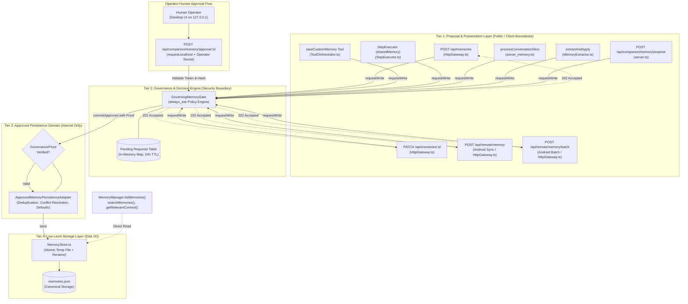

# MYRAA — Stage 10.2.1-R1: Security Remediation & Architecture Revision
## Definitive Architectural Remediation Specification Incorporating Operator Decisions
### Remediation for SEC-P1-01, SEC-P1-02, and SEC-P1-03

**Document ID:** `stage10_phase2_remediation_scope.md`  
**Revision:** R1 (Stage 10.2.1-R1)  
**Date:** 2026-11-02T19:35:00+05:30  
**Author:** Antigravity AI Engineering Platform  
**Execution Mode:** Strict Read-Only Engineering & Architecture Revision  
**Implementation Authorization:** **NOT GRANTED — Planning & Architecture Revision Only**  
**Source of Truth:** [`stage10_phase1_post_implementation_security_audit.md`](file:///d:/SORA%20AI/Sora%20AI/stage10_phase1_post_implementation_security_audit.md), Operator Decisions A–D, and Independent Codebase Audit

---

## 1. Executive Summary & Revision Context

This document provides the definitive, evidence-backed security remediation architecture for MYRAA Companion Core, revising the Stage 10 Phase 2 specification in strict accordance with the operator's preliminary decisions (Decisions A, B, C, and D).

### 1.1 The Three Baseline Vulnerabilities
1. **SEC-P1-01 (HIGH Severity): Permissive Memory Approval & Token Leakage**
   - In [`backend/companion/GoverningMemoryGate.ts`](file:///d:/SORA%20AI/Sora%20AI/backend/companion/GoverningMemoryGate.ts#L178), `if (token && token !== request.oneTimeToken)` makes the approval token completely optional; omitting `token` approves permanent writes without credentials.
   - Comparison uses standard string inequality `!==`, exposing verification to timing side-channel attacks.
   - `listPendingRequests()` returns full `MemoryWriteRequest` copies, which [`backend/server.ts`](file:///d:/SORA%20AI/Sora%20AI/backend/server.ts#L71) exposes in plain text via `GET /api/companion/memory/requests`.
   - Approval lacks human actor verification and request ownership binding (`userId`).
2. **SEC-P1-02 (HIGH Severity): Universal Memory Governance Bypasses**
   - Independent inspection confirmed that **10 distinct permanent write paths** bypass `GoverningMemoryGate`.
   - Crucially, **multiple write paths do NOT pass through `MemoryManager` at all**:
     - [`backend/memory/SharedMemoryManager.ts`](file:///d:/SORA%20AI/Sora%20AI/backend/memory/SharedMemoryManager.ts) writes directly to `MemoryStore.save()` without calling `MemoryManager`.
     - [`backend/server_memory.ts`](file:///d:/SORA%20AI/Sora%20AI/backend/server_memory.ts#L290) writes directly to disk via raw `fs.writeFile` in `saveMemories()`.
     - [`backend/memory/MemoryExtractor.ts`](file:///d:/SORA%20AI/Sora%20AI/backend/memory/MemoryExtractor.ts#L136) writes directly to `store.save()`.
     - AI tool calls (`saveCustomMemory`) and autonomous planner steps (`StepExecutor.ts`) trigger permanent disk persistence without human operator consent.
3. **SEC-P1-03 (MEDIUM Severity): Companion REST API Exposure & Unvalidated Persona Payloads**
   - The five companion endpoints in `backend/server.ts` lack `requireLocalhost` guards, permitting remote or forwarded requests.
   - `PUT /api/companion/persona` passes raw JSON directly to disk without validation of lengths, types, enums, or prototype pollution (`__proto__`).

---

## 2. Incorporation of Operator Decisions

The operator reviewed the preliminary scope and established four binding architectural decisions. This revision incorporates each decision with full technical rigor:

### 2.1 Decision A: Centralized 4-Tier Memory Governance Architecture
- **Problem Identified by Operator:** In the current Phase 1 implementation, `GoverningMemoryGate` depends on `MemoryManager`:
  $$\text{GoverningMemoryGate} \longrightarrow \text{MemoryManager.createMemory()}$$
  Reversing this dependency naively (calling `GoverningMemoryGate.requestWrite()` inside `MemoryManager.createMemory()`) causes an immediate **circular dependency / infinite recursion**:
  $$\text{MemoryManager} \longrightarrow \text{GoverningMemoryGate} \longrightarrow \text{MemoryManager} \longrightarrow \dots$$
- **Definitive Architectural Solution:** Decouple memory operations into a strictly acyclic, **4-Tier Architecture**:
  1. **Tier 1 — Proposal & Presentation Layer (`MemoryProposalGateway` / Entry Points):** Intercepts all write requests from REST, AI tools, planner steps, Android companions, and background consolidation. Converts them into standardized `MemoryWriteRequest` objects. **Zero access to disk.**
  2. **Tier 2 — Governance & Policy Decision Engine (`GoverningMemoryGate`):** Enforces user sovereignty (`always_ask`), cryptographic single-use token binding, canonical SHA-256 hash validation, 24h TTL expiry, and actor ownership.
  3. **Tier 3 — Approved Persistence Domain (`ApprovedMemoryPersistenceAdapter`):** A dedicated, non-public persistence adapter that contains deduplication (`findSimilar`, `mergeText`), conflict resolution, schema defaults, version increments, and device attribution. **Callable ONLY by `GoverningMemoryGate` upon validated approval.**
  4. **Tier 4 — Low-Level Atomic Storage Layer (`MemoryStore`):** Manages atomic file I/O (`fs.writeFile` to `.tmp` then rename to `memories.json`) and in-process caching. Direct calls from outside Tier 3 are prohibited. Raw `fs.writeFile` in `server_memory.ts` is eliminated.

### 2.2 Decision B: `POST /api/memories` Response Contract (`202 Accepted`)
- When external clients, UI, or tools call `POST /api/memories`, the API returns **HTTP `202 Accepted`** with a pending proposal body:
  ```json
  {
    "status": "pending_approval",
    "requestId": "4f9d2a6b-8c1e-4c7a-9f5d-123456789abc",
    "message": "Memory proposal created. Awaiting operator confirmation.",
    "proposedMemory": {
      "category": "preference",
      "text": "Prefers concise production logs and dark theme.",
      "importance": "medium",
      "confidence": "medium",
      "source": "manual_entry"
    }
  }
  ```
- **Token Redaction:** The server-generated `oneTimeToken` is **NEVER** returned in the `202 Accepted` response.
- **Consumer Compatibility Verification:**
  - In [`frontend/App.tsx`](file:///d:/SORA%20AI/Sora%20AI/frontend/App.tsx#L627), `handleAddManualMemory` currently expects `saved.id` to append directly to the active memory list. Under the 202 contract, the frontend will be updated to display a toast: *"Memory proposal submitted for approval"*.
  - In [`tests/e2e/production_hardening_phase30.test.ts`](file:///d:/SORA%20AI/Sora%20AI/tests/e2e/production_hardening_phase30.test.ts#L108), test 2.1 asserts `expect(res.status).toBe(201)`. Under authorized remediation, this assertion will be updated to `expect(res.status).toBe(202)`.

### 2.3 Decision C: Approval Token Delivery Channel Audit & Forensic Finding
- **Operator Preference:** Authenticated local WebSocket event `companion_memory_proposal`.
- **Mandatory Directive:** *"Inspect the existing WebSocket authentication mechanism first. If secure session binding cannot be demonstrated, mark this design BLOCKED and present a secure alternative. Do not silently weaken authentication."*
- **Forensic Inspection Results (`backend/server.ts` Lines 160–313):**
  1. **LAN IPs Treated as Local:** In `server.ts` lines 167–176, any IP matching `192.168.*`, `10.*`, or `172.16-31.*` is evaluated as `isLocal = true`.
  2. **Zero Authentication on Local WebSockets:** Line 225 checks `if (!isLocal || token)`. When a client connects from localhost or LAN without a token, the connection succeeds without any authentication (`remoteDevice` is null).
  3. **Zero Session or User Identity Binding:** The server attaches neither an authenticated operator identity nor a user ID to the `clientWs` instance.
  4. **Unconditional Global Broadcast:** Lines 299–305 wire `companionCoordinator.registerClientBroadcast((payload) => { clientWs.send(...) })`. Every single connected client—including unauthenticated LAN sockets and remote Android devices on `/remote-live`—receives every broadcast frame!
- **Formal Architectural Verdict:**
  > [!CAUTION]
  > **STATUS: BLOCKED.**
  > Delivering `oneTimeToken` over the existing WebSocket broadcast mechanism violates all operator conditions: it is a global broadcast, lacks authenticated operator session binding, sends tokens to remote mobile clients, and leaks credentials to unauthenticated LAN eavesdroppers.

- **Presented Secure Alternatives for Decision C:**
  - **Alternative 1 (Recommended — Zero Token Wire Exposure):**
    - The WebSocket event `companion_memory_proposal` delivers **ONLY metadata and request ID** (`requestId`, `category`, `text`, `confidence`, `reason`). The `oneTimeToken` is **NEVER placed on the WebSocket wire**.
    - The desktop UI displays the proposal modal.
    - When the operator clicks "Approve", the desktop UI invokes `POST /api/companion/memory/approve/:id` over localhost REST.
    - The REST request is protected by `requireLocalhost` (strictly loopback `127.0.0.1`/`::1`) and an internal session secret generated at boot (`.myraa_loopback_secret`). The gate verifies the local operator identity and executes approval without ever exposing the raw `oneTimeToken` over the network.
  - **Alternative 2 (Ephemeral Loopback Handshake for WebSocket):**
    - Generate a cryptographically secure 256-bit token at backend startup written to `DATA_DIR/.myraa_operator_secret` (file permissions `0600`).
    - The local desktop WebSocket client must present this secret during the HTTP upgrade via `Sec-WebSocket-Protocol: myraa-operator, <secret>`.
    - Only connections proving possession of the local boot secret are marked `ws.isOperatorSession = true`.
    - Proposals with tokens are dispatched exclusively to sockets with `ws.isOperatorSession === true`. Remote and LAN connections are strictly filtered out.

### 2.4 Decision D: Android Cross-Device Memory Sync Enforcement
- **Operator Policy:** Remote Android memory proposals must strictly follow `always_ask` and require desktop human operator confirmation. A paired device must **never** automatically approve memory writes.
- **Workflow:**
  1. Android companion submits a memory mutation via `POST /api/remote/memory`, `PATCH /api/remote/memory/:id`, or `POST /api/remote/memory/batch`.
  2. `HttpGateway` validates remote credential, client IP, and DLP screening.
  3. Instead of persisting to `memories.json`, `HttpGateway` invokes `governingMemoryGate.requestWrite({ source: "android_companion", deviceId, userId, ... })`.
  4. The endpoint returns `202 Accepted` to Android:
     ```json
     { "status": "pending_approval", "requestId": "...", "message": "Proposal queued. Awaiting desktop operator confirmation." }
     ```
  5. The desktop operator receives the proposal and approves it on the desktop host. Only then is the record committed to `memories.json` by `ApprovedMemoryPersistenceAdapter`.

---

## 3. Comprehensive Call Graph & 4-Tier Memory Architecture

### 3.1 4-Tier Architecture Diagram



---

## 4. Exhaustive Write-Path Analysis (All 10 Discovered Paths)

The table and detailed specifications below account for every write path in the repository that targets or affects permanent memory:

| # | Entry Point | Caller Component | Call Sequence | Final Persistence Target | Existing Governance Behavior | Proposed Governance Boundary | Files Requiring Modification |
|---|---|---|---|---|---|---|---|
| **1** | `POST /api/memories` | External HTTP client / `frontend/App.tsx:629` | `HttpGateway.ts` $\to$ `MemoryManager.createMemory()` $\to$ `MemoryStore.save()` | `memories.json` | **None.** Bypasses Gate completely. | `HttpGateway` delegates to `GoverningMemoryGate.requestWrite()`. Returns `202 Accepted`. | `backend/gateway/HttpGateway.ts`<br>`frontend/App.tsx` |
| **2** | `PATCH /api/memories/:id` | External HTTP client | `HttpGateway.ts` $\to$ `MemoryManager.updateMemory()` $\to$ `MemoryStore.save()` | `memories.json` | **None.** Bypasses Gate completely. | `HttpGateway` delegates to `GoverningMemoryGate.requestWrite({ action: "UPDATE" })`. Returns `202 Accepted`. | `backend/gateway/HttpGateway.ts` |
| **3** | `POST /api/remote/memory` | Paired Android Companion (`MyraaApiClient.kt`) | `HttpGateway.ts` $\to$ `SharedMemoryManager.createMemory()` $\to$ `MemoryStore.save()` | `memories.json` | Auth token + DLP screening, but **zero human approval**. Direct disk write. | `HttpGateway` routes to `GoverningMemoryGate.requestWrite({ source: "android_companion" })`. Returns `202 Accepted`. Desktop approval required. | `backend/gateway/HttpGateway.ts`<br>`backend/memory/SharedMemoryManager.ts` |
| **4** | `PATCH /api/remote/memory/:id` | Paired Android Companion | `HttpGateway.ts` $\to$ `SharedMemoryManager.updateMemory()` $\to$ `MemoryStore.save()` | `memories.json` | Auth token + DLP screening, but **zero human approval**. Direct disk write. | Routes to `GoverningMemoryGate.requestWrite()`. Returns `202 Accepted`. Desktop approval required. | `backend/gateway/HttpGateway.ts`<br>`backend/memory/SharedMemoryManager.ts` |
| **5** | `POST /api/remote/memory/batch` | Paired Android Companion (Offline Sync) | `HttpGateway.ts` $\to$ `SharedMemoryManager.applySyncBatch()` $\to$ `MemoryStore.save()` | `memories.json` | Monotonic version check + DLP, but **zero human approval**. Direct disk write. | Iterates batch items through `GoverningMemoryGate.requestWrite()`. Returns `202 Accepted`. Proposals queued for desktop operator. | `backend/gateway/HttpGateway.ts`<br>`backend/memory/SharedMemoryManager.ts` |
| **6** | `saveCustomMemory` Live Tool | Gemini Live model tool execution | `ToolOrchestrator.ts:1102` $\to$ `SharedMemoryManager.createMemory()` $\to$ `MemoryStore.save()` | `memories.json` | **None.** AI model tool call directly commits permanent memories during turns. | Tool calls `GoverningMemoryGate.requestWrite({ source: "ai_proposal" })`. Returns pending message to AI session. Does NOT persist. | `backend/tools/ToolOrchestrator.ts` |
| **7** | `StepExecutor.ts:153` (Planner Step) | Autonomous `PlannerCoordinator` | `StepExecutor.executeStep()` $\to$ `SharedMemoryManager.createMemory()` $\to$ `MemoryStore.save()` | `memories.json` | **None.** Spoofs `secContext` with `role: "admin"`. Direct disk write. | Routes to `GoverningMemoryGate.requestWrite({ source: "planner_step" })`. Plan step registers pending human confirmation. | `backend/planner/StepExecutor.ts` *(Frozen)* |
| **8** | Background Conversation Consolidation | `GeminiSessionFactory.ts:476` (Turn Completion) | `MemoryExtractor.extractAndApply()` $\to$ `server_memory.ts:processConversationSlice()` $\to$ `server_memory.ts:saveMemories()` | `memories.json` | **None.** Direct raw `fs.writeFile` in `server_memory.ts` bypassing `MemoryManager` and `MemoryStore`. | `processConversationSlice` yields proposed memory transactions to `GoverningMemoryGate.requestWrite()`. Raw `saveMemories()` eliminated. | `backend/server_memory.ts`<br>`backend/memory/MemoryExtractor.ts` |
| **9** | Post-Extraction Deduplication Pass | `MemoryExtractor.ts:136` | `MemoryExtractor.extractAndApply()` $\to$ `store.save(result)` | `memories.json` | **None.** Direct write to `MemoryStore.save()`. | Raw call removed from `MemoryExtractor`. Deduplication logic unified inside `ApprovedMemoryPersistenceAdapter`. | `backend/memory/MemoryExtractor.ts` |
| **10** | `POST /api/companion/memory/propose` | Companion REST client | `server.ts:326` $\to$ `GoverningMemoryGate.requestWrite()` | None (Queued) | Properly gated, but vulnerable to SEC-P1-01 (optional token) and SEC-P1-03 (no `requireLocalhost`). | Hardened with mandatory token check, timing-safe equality, token omission from listings, and `requireLocalhost`. | `backend/companion/GoverningMemoryGate.ts`<br>`backend/server.ts` |

---

## 5. Detailed Engineering Workstreams

### 5.1 Workstream A: SEC-P1-01 (Approval Token Enforcement & Anti-Replay)

#### 5.1.1 Cryptographic Token Specification
1. **Mandatory Token Enforcement:**
   - In [`backend/companion/GoverningMemoryGate.ts`](file:///d:/SORA AI/Sora AI/backend/companion/GoverningMemoryGate.ts), `approveWrite` is updated so `token` is non-optional:
     ```typescript
     async approveWrite(
       requestId: string,
       token: string,
       context: MemoryApprovalContext,
       payloadOverride?: Partial<EnhancedMemory>,
     ): Promise<EnhancedMemory>
     ```
   - If `!token || typeof token !== "string" || token.trim().length === 0`, execution halts immediately with:
     ```typescript
     throw new Error("MISSING_APPROVAL_TOKEN: A valid single-use approval token is required.");
     ```
2. **Timing-Safe Constant-Time Verification:**
   - Eliminate string comparison (`!==`). Use `crypto.timingSafeEqual` with matched buffer lengths:
     ```typescript
     const providedBuf = Buffer.from(token, "utf8");
     const expectedBuf = Buffer.from(request.oneTimeToken, "utf8");
     const tokensMatch =
       providedBuf.length === expectedBuf.length &&
       crypto.timingSafeEqual(providedBuf, expectedBuf);

     if (!tokensMatch) {
       securityAuditLogger.logEvent({
         eventType: "TOOL_BLOCKED",
         actor: { identityId: context.actorId, role: context.role || "standard", ipAddress: context.ipAddress || "127.0.0.1" },
         target: { resource: "memories.json" },
         decision: "BLOCK",
         reason: "MEMORY_WRITE_TAMPERED: One-time approval token mismatch",
         riskLevel: "HIGH",
         metadata: { requestId },
       });
       throw new Error("PAYLOAD_TAMPERED: Invalid or mismatched approval token.");
     }
     ```
3. **Actor Identity & Ownership Binding:**
   - The method verifies that the approving actor owns the request or is the verified local operator:
     ```typescript
     if (request.userId && request.userId !== "system" && request.userId !== context.actorId && context.actorId !== "local_operator") {
       throw new Error("UNAUTHORIZED_ACTOR: Only the originating user or local operator may approve this request.");
     }
     ```
4. **Single-Use Invalidation & Anti-Replay:**
   - Upon successful approval, `request.oneTimeToken` is overwritten with an empty string `""` before persistence begins. Any replay attempt immediately fails with `REQUEST_ALREADY_APPROVED` or token mismatch.
5. **Token Secrecy in Listing Endpoints:**
   - In `GoverningMemoryGate.ts`, `listPendingRequests()` maps results to `PublicMemoryWriteRequest`:
     ```typescript
     export type PublicMemoryWriteRequest = Omit<MemoryWriteRequest, "oneTimeToken">;

     listPendingRequests(): PublicMemoryWriteRequest[] {
       const now = Date.now();
       const pending: PublicMemoryWriteRequest[] = [];
       for (const req of this._requests.values()) {
         if (req.approved === undefined && new Date(req.expiresAt).getTime() >= now) {
           const { oneTimeToken, ...publicReq } = req;
           pending.push({ ...publicReq });
         }
       }
       return pending;
     }
     ```

---

### 5.2 Workstream B: SEC-P1-02 (Centralized Acyclic Governance & Approved Persistence)

#### 5.2.1 Component Design: `ApprovedMemoryPersistenceAdapter`
To prevent circular calls, a new non-public persistence adapter is introduced in `backend/memory/ApprovedMemoryPersistenceAdapter.ts`:
- **Unforgeable Proof Token:** Accepts a private branded token (`GovernanceApprovalProof`) that can only be constructed within `GoverningMemoryGate`.
- **Deduplication & Conflict Resolution:** Encapsulates the exact dedup logic from `MemoryManager.ts` and `MemoryDeduplicator.ts`:
  - `exact` match: updates text and timestamps of existing record.
  - `similar` match: merges text via `mergeText()`.
  - `conflict` match: flags existing record as `needs_revalidation`, appends new record with `confidence: "low"`.
  - `no match`: appends fresh `makeEnhancedMemory` record.
- **Atomic Disk Handoff:** Calls `MemoryStore.save()` directly.

#### 5.2.2 Legacy Write-Path Deprecation in `server_memory.ts`
- In `backend/server_memory.ts`:
  - Deprecate `saveMemories()`. Add a security warning log:
    ```typescript
    export async function saveMemories(memories: Memory[]): Promise<void> {
      console.warn("[SECURITY DEPRECATION] Direct call to saveMemories() detected. Redirecting to MemoryStore.");
      const { memoryStore } = await import("./memory/MemoryStore.ts");
      await memoryStore.save(memories.map(migrateRecord));
    }
    ```
  - In `processConversationSlice()`: Remove `await saveMemories(updatedMemories);`. Replace with a loop delegating each transaction to `governingMemoryGate.requestWrite()`.

---

### 5.3 Workstream C: SEC-P1-03 (Companion REST Endpoint Hardening & Schema Protection)

#### 5.3.1 Localhost Isolation via `requireLocalhost`
In `backend/server.ts`, wrap all five companion routes with `requireLocalhost`:
```typescript
import { requireLocalhost } from "./security/PermissionManager.ts";

export function mountCompanionRoutes(app: Express) {
  app.get("/api/companion/persona", requireLocalhost, async (_req, res) => { ... });
  app.put("/api/companion/persona", requireLocalhost, async (req, res) => { ... });
  app.get("/api/companion/memory/requests", requireLocalhost, async (_req, res) => { ... });
  app.post("/api/companion/memory/propose", requireLocalhost, async (req, res) => { ... });
  app.post("/api/companion/memory/approve/:id", requireLocalhost, async (req, res) => { ... });
}
```

#### 5.3.2 Strict Schema Fuzz-Proofing for `PUT /api/companion/persona`
Implement comprehensive payload validation:
1. **Prototype Pollution Protection:** Recursively inspect keys; reject payloads containing `__proto__`, `constructor`, or `prototype`.
2. **Type and Length Enforcements:**
   - `name`: string, 1–64 characters.
   - `customInstructions`: string, max 2000 characters.
   - `formality`: enum `["casual", "neutral", "formal"]`.
   - `verbosity`: enum `["concise", "balanced", "elaborate"]`.
   - `tone`: enum `["warm", "direct", "playful", "calm"]`.
   - `traits`: array of strings, max 10 elements, each max 32 characters.
3. **Fail-Closed Rejection:** If validation fails, return `400 Bad Request` with structured error details and log audit event.

---

## 6. Architectural Acceptance Criteria

The revised design satisfies all nine engineering requirements specified by the operator:

1. **Universal Governance Coverage:** All permanent memory creation, mutation, and deletion paths flow through `GoverningMemoryGate.requestWrite()`.
2. **Acyclic Persistence Route:** Approved writes execute through `GoverningMemoryGate` $\to$ `ApprovedMemoryPersistenceAdapter` $\to$ `MemoryStore.save()`. Zero recursive loops.
3. **No External Direct Writes:** External clients and AI tools cannot invoke persistence operations without passing governance.
4. **Enforced User Identity & Ownership:** Requests carry `userId` and `deviceId`; approvals are checked against request ownership.
5. **Zero Silent Approvals by Background Jobs:** Autonomous background tasks (Gemini turn consolidation, planner steps) create pending proposals; they cannot self-approve.
6. **Token Secrecy:** Approval tokens are omitted from `GET /api/companion/memory/requests` and normal 202 proposal responses.
7. **Strict Fail-Closed Behavior:** Missing tokens, mismatched hashes, expired requests, and tampered payloads fail closed with audit logging.
8. **Preserved Storage Semantics:** Deduplication, conflict resolution, versioning, and atomic `.tmp` file renaming are fully preserved.
9. **Regression Detectability:** Automated unit and integration tests fail if any code path writes to `memories.json` without an approved governance token.

---

## 7. Comprehensive Security & Regression Test Plan

### 7.1 Test Matrix

| Test ID | Test Category | Target Component | Description / Assertion | Expected Result |
|---|---|---|---|---|
| `SEC-T01.1` | Workstream A | `GoverningMemoryGate` | Call `approveWrite` with `token: undefined` | Throws `MISSING_APPROVAL_TOKEN` |
| `SEC-T01.2` | Workstream A | `GoverningMemoryGate` | Call `approveWrite` with `token: ""` or `"   "` | Throws `MISSING_APPROVAL_TOKEN` |
| `SEC-T01.3` | Workstream A | `GoverningMemoryGate` | Call `approveWrite` with invalid/tampered token string | Throws `PAYLOAD_TAMPERED` (Timing-safe log) |
| `SEC-T01.4` | Workstream A | `GoverningMemoryGate` | Call `approveWrite` with valid token and matching hash | Resolves; returns `EnhancedMemory` |
| `SEC-T01.5` | Workstream A | `GoverningMemoryGate` | Call `approveWrite` second time with same valid token | Rejects with `REQUEST_ALREADY_APPROVED` / anti-replay |
| `SEC-T01.6` | Workstream A | `GoverningMemoryGate` | Call `approveWrite` on expired request (> 24 hours) | Throws `REQUEST_EXPIRED` |
| `SEC-T01.7` | Workstream A | `GoverningMemoryGate` | Call `approveWrite` with mismatched actor identity | Throws `UNAUTHORIZED_ACTOR` |
| `SEC-T01.8` | Workstream A | `GoverningMemoryGate` | Call `listPendingRequests()` and inspect returned objects | `oneTimeToken` is `undefined` on all returned records |
| `SEC-T02.1` | Workstream B | `HttpGateway` | `POST /api/memories` with valid memory payload | Returns `202 Accepted` with `requestId`; `memories.json` untouched |
| `SEC-T02.2` | Workstream B | `HttpGateway` | `PATCH /api/memories/:id` | Returns `202 Accepted` with `requestId`; `memories.json` untouched |
| `SEC-T02.3` | Workstream B | `HttpGateway` | `POST /api/remote/memory` from paired Android device | Returns `202 Accepted`; no write until desktop confirmation |
| `SEC-T02.4` | Workstream B | `HttpGateway` | `POST /api/remote/memory/batch` | Returns `202 Accepted`; all batch items enter pending queue |
| `SEC-T02.5` | Workstream B | `ToolOrchestrator` | AI calls `saveCustomMemory` function during turn | Tool returns proposal queued message; no silent write |
| `SEC-T02.6` | Workstream B | `StepExecutor` | Planner executes step `sharedMemory` create/save | Returns pending approval status; step does not write disk |
| `SEC-T02.7` | Workstream B | `server_memory` | `processConversationSlice` extracts dialogue transactions | Proposes write requests to Gate; zero raw `fs.writeFile` |
| `SEC-T02.8` | Workstream B | Architecture | Direct call to `ApprovedMemoryPersistenceAdapter` without proof | Throws `UNAUTHORIZED_PERSISTENCE_CALL` |
| `SEC-T02.9` | Workstream B | Architecture | Approved persistence executes deduplication | Preserves exact, similar, and conflict merge semantics |
| `SEC-T02.10`| Workstream B | Architecture | Verify acyclic call chain | MemoryManager $\to$ Gate $\to$ PersistenceAdapter $\to$ MemoryStore completes with zero loops |
| `SEC-T03.1` | Workstream C | `server.ts` | Request companion routes from non-loopback IP | HTTP 403 Forbidden |
| `SEC-T03.2` | Workstream C | `server.ts` | Request companion routes with spoofed `X-Forwarded-For` | HTTP 403 Forbidden |
| `SEC-T03.3` | Workstream C | `server.ts` | `PUT /api/companion/persona` with `__proto__` payload | HTTP 400 Bad Request (Prototype pollution blocked) |
| `SEC-T03.4` | Workstream C | `server.ts` | `PUT /api/companion/persona` with 5000-char string | HTTP 400 Bad Request (Length exceeded) |
| `SEC-T03.5` | Workstream C | `server.ts` | `PUT /api/companion/persona` with invalid enum value | HTTP 400 Bad Request (Invalid enum) |
| `SEC-T03.6` | Workstream C | `server.ts` | WebSocket broadcast verification | `companion_memory_proposal` does NOT leak `oneTimeToken` |
| `REG-T01`   | Regression   | Build System | `npx tsc --noEmit` | Exit code 0, zero type errors |
| `REG-T02`   | Regression   | Invariant    | Tool count assertion (`ToolOrchestrator.ts`) | Exactly 129 unique `LIVE_TOOLS` preserved |
| `REG-T03`   | Regression   | Unit Tests   | All unit tests (`tests/unit/`) | 359/359 tests PASS |
| `REG-T04`   | Regression   | Integration  | Stage regression suites (Stages 1, 2, 4, 5, 6, 7, 8, 9) | All tests PASS |
| `REG-T05`   | Regression   | Hardening E2E| `tests/e2e/production_hardening_phase30.test.ts` | Updated 202 assertion passes cleanly |
| `REG-T06`   | Regression   | Production   | `npm run build` | Exit code 0, bundle generated cleanly |

### 7.2 Forensic Classification of Desktop-Agent-Dependent Tests
- The 3 Stage 3 tests (`4.1`, `5.3`, `8.3`) in [`tests/integration/stage3_browser_control.test.ts`](file:///d:/SORA%20AI/Sora%20AI/tests/integration/stage3_browser_control.test.ts) remain classified as:
  **ENVIRONMENT-BLOCKED / DEPENDENCY-UNAVAILABLE**
- **Strict Rule:** These tests must **NEVER be marked as PASS** until executed in an environment with a live, running Python desktop agent process (`http://127.0.0.1:8000`).

---

## 8. Exact File-Change Matrix & Authorization Requirements

The table below details every file affected by the revised remediation architecture, its frozen status, associated risk, and required operator authorization:

| File | Proposed Change | Reason | Frozen Status | Risk | Required Authorization |
|---|---|---|---|---|---|
| [`backend/companion/GoverningMemoryTypes.ts`](file:///d:/SORA%20AI/Sora%20AI/backend/companion/GoverningMemoryTypes.ts) | Add `MemoryApprovalContext`, `PublicMemoryWriteRequest`, and `GovernanceApprovalProof` types. Update `approveWrite` signature. | Support mandatory token checks and token redaction. | **Non-Frozen** | Low | Standard Phase 2 approval |
| [`backend/companion/GoverningMemoryGate.ts`](file:///d:/SORA%20AI/Sora%20AI/backend/companion/GoverningMemoryGate.ts) | Enforce non-empty token check, `crypto.timingSafeEqual`, actor ownership check, token redaction in `listPendingRequests()`, and delegate approved writes to `ApprovedMemoryPersistenceAdapter`. | Remediate SEC-P1-01 and enforce acyclic 4-tier persistence. | **Non-Frozen** | Medium | Standard Phase 2 approval |
| `backend/memory/ApprovedMemoryPersistenceAdapter.ts` *(New File)* | Create internal persistence adapter encapsulating dedup, conflict resolution, versioning, and calls to `MemoryStore.save()`. | Break circular dependency between Gate and Manager. | **Non-Frozen** (New) | Medium | Standard Phase 2 approval |
| [`backend/memory/MemoryManager.ts`](file:///d:/SORA%20AI/Sora%20AI/backend/memory/MemoryManager.ts) | Update `createMemory` and `updateMemory` to route proposals through `governingMemoryGate.requestWrite()`. Keep read methods unchanged. | Prevent internal bypasses for any caller invoking `MemoryManager`. | **FROZEN** | High | **EXPLICIT OPERATOR AUTHORIZATION REQUIRED** |
| [`backend/memory/SharedMemoryManager.ts`](file:///d:/SORA%20AI/Sora%20AI/backend/memory/SharedMemoryManager.ts) | Delegate `createMemory`, `updateMemory`, and `applySyncBatch` to `GoverningMemoryGate.requestWrite()`. Remove direct `this.store.save()`. | Close SEC-P1-02 bypasses on remote and shared memory paths. | **Non-Frozen** | High | Standard Phase 2 approval |
| [`backend/memory/MemoryExtractor.ts`](file:///d:/SORA%20AI/Sora%20AI/backend/memory/MemoryExtractor.ts) | Remove direct `store.save()` calls. Route extracted memories to `GoverningMemoryGate.requestWrite()`. | Close SEC-P1-02 background consolidation bypass. | **Non-Frozen** | Medium | Standard Phase 2 approval |
| [`backend/server_memory.ts`](file:///d:/SORA%20AI/Sora%20AI/backend/server_memory.ts) | Remove raw `fs.writeFile` in `saveMemories()`. Route `processConversationSlice()` transactions through `governingMemoryGate.requestWrite()`. | Close raw disk write bypass. | **Non-Frozen** | High | Standard Phase 2 approval |
| [`backend/gateway/HttpGateway.ts`](file:///d:/SORA%20AI/Sora%20AI/backend/gateway/HttpGateway.ts) | Update `POST/PATCH /api/memories`, `POST/PATCH /api/remote/memory`, and batch sync to return `202 Accepted` via `GoverningMemoryGate`. | Close REST write bypasses and enforce Decision B & D contracts. | **Non-Frozen** | High | Standard Phase 2 approval |
| [`backend/tools/ToolOrchestrator.ts`](file:///d:/SORA%20AI/Sora%20AI/backend/tools/ToolOrchestrator.ts) | Update `saveCustomMemory` tool to create a proposal via `GoverningMemoryGate` instead of directly writing disk. | Prevent AI tool calls from bypassing human governance. | **Non-Frozen** | Medium | Standard Phase 2 approval |
| [`backend/planner/StepExecutor.ts`](file:///d:/SORA%20AI/Sora%20AI/backend/planner/StepExecutor.ts) | Update `sharedMemory` tool execution to create proposals rather than directly writing memory. | Prevent autonomous planner from bypassing governance. | **FROZEN** | High | **EXPLICIT OPERATOR AUTHORIZATION REQUIRED** |
| [`backend/server.ts`](file:///d:/SORA%20AI/Sora%20AI/backend/server.ts) | Add `requireLocalhost` to all 5 companion routes. Implement strict persona schema validation and prototype pollution guards. | Remediate SEC-P1-03 and restrict WebSocket token distribution. | **Non-Frozen** | Medium | Standard Phase 2 approval |
| [`frontend/App.tsx`](file:///d:/SORA%20AI/Sora%20AI/frontend/App.tsx) | Update `handleAddManualMemory` to handle HTTP `202 Accepted` response. | Ensure UI compatibility with Decision B contract. | **Non-Frozen** | Low | Standard Phase 2 approval |
| [`tests/unit/companion_core_phase1.test.ts`](file:///d:/SORA%20AI/Sora%20AI/tests/unit/companion_core_phase1.test.ts) | Add test suites for `SEC-T01.1–8`, `SEC-T02.1–10`, and `SEC-T03.1–6`. | Comprehensive automated security verification. | **Non-Frozen** | Low | Standard Phase 2 approval |
| [`tests/e2e/production_hardening_phase30.test.ts`](file:///d:/SORA%20AI/Sora%20AI/tests/e2e/production_hardening_phase30.test.ts) | Update line 108 assertion from `expect(res.status).toBe(201)` to `expect(res.status).toBe(202)`. | Align test suite with Decision B contract. | **Non-Frozen** | Low | Standard Phase 2 approval |

---

## 9. Remaining Security Questions & Operator Decisions

Prior to granting implementation authorization, the operator is requested to confirm:

1. **Authorization of Frozen Files:**
   - Does the operator grant narrow, explicit authorization to modify:
     - [`backend/memory/MemoryManager.ts`](file:///d:/SORA%20AI/Sora%20AI/backend/memory/MemoryManager.ts) (to ensure `MemoryManager` routes mutations through governance)?
     - [`backend/planner/StepExecutor.ts`](file:///d:/SORA%20AI/Sora%20AI/backend/planner/StepExecutor.ts) (to ensure autonomous planner steps create proposals instead of writing directly)?
2. **Adoption of Alternative 1 for Token Delivery:**
   - Does the operator approve **Alternative 1** (Zero Token Wire Exposure: WebSocket sends proposal notification only; operator approval occurs via authenticated localhost REST), formally keeping raw tokens off the network?

---

## 10. Final Implementation Readiness Verdict

### Architectural Verdict: **READY FOR OPERATOR IMPLEMENTATION AUTHORIZATION**

- **Completeness:** The revised architecture resolves all circular dependency concerns, covers all 10 memory write paths, secures the companion REST API, and adheres strictly to Operator Decisions A, B, C, and D.
- **Invariant Safety:** Exactly 129 unique `LIVE_TOOLS` will be preserved; all read-path caching and atomic storage semantics are maintained.
- **Strict Stop Condition:** **No code modifications have been made.** Standing by for operator review and explicit implementation authorization.
