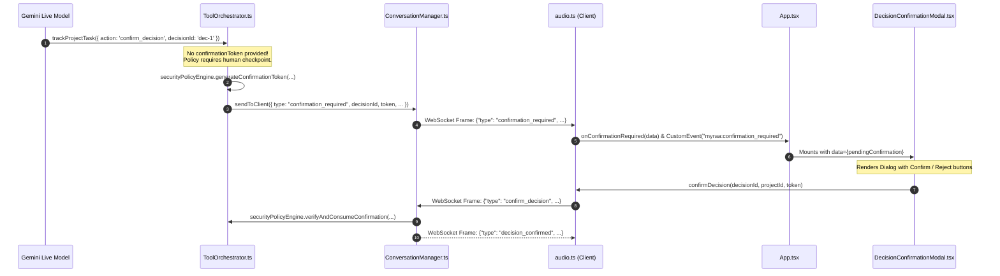
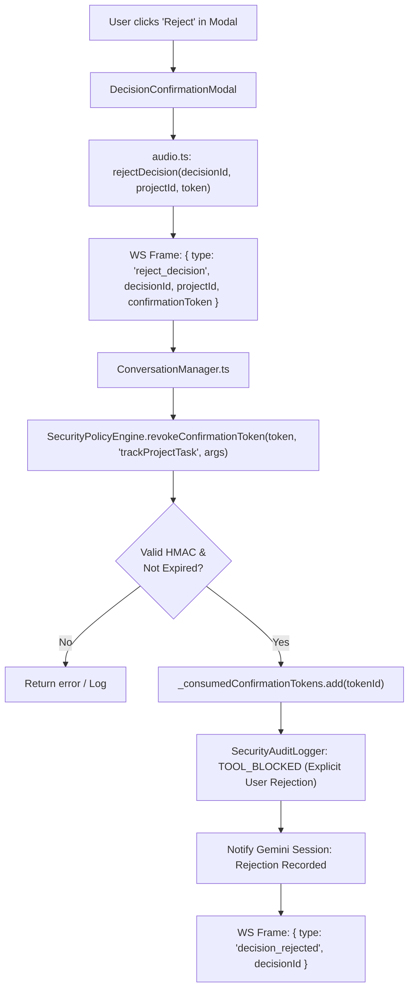
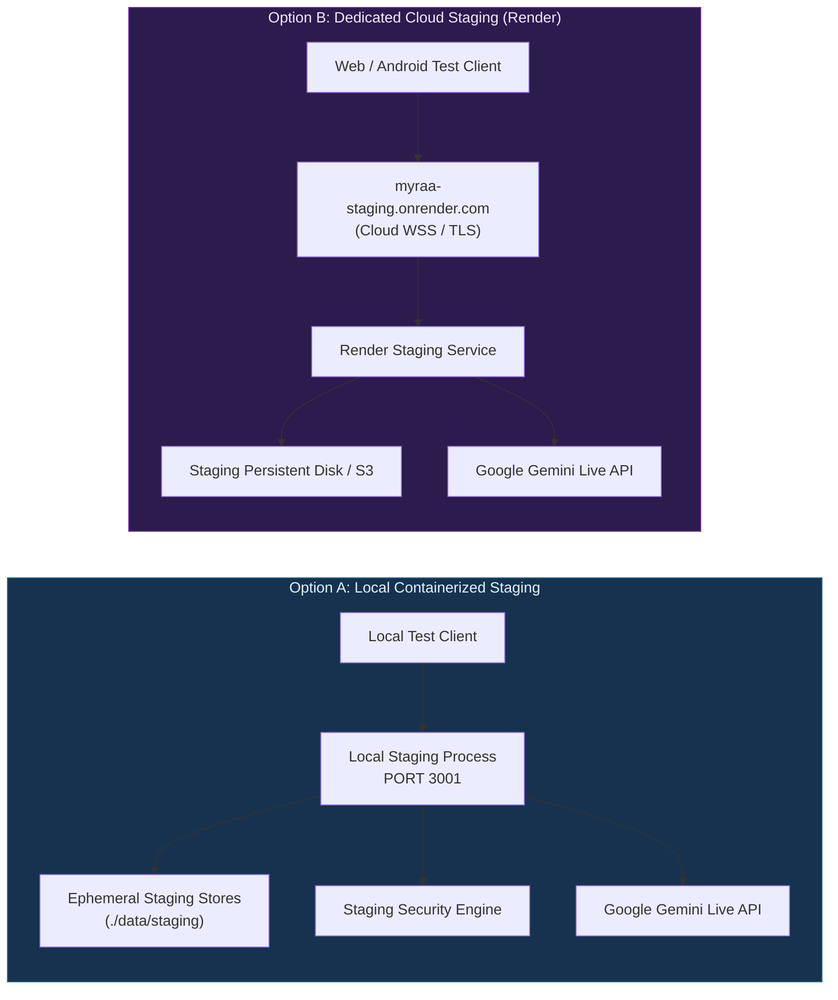

# MYRAA — STAGE 10, PHASE 10.4.1
# R1.4 — PRE-PRODUCTION ENGINEERING REVIEW
## Audio Continuity, Confirmation Revocation & Staging Architecture

**Role**: Principal Software Architect, Staff AI Systems Engineer, Application Security Engineer, Site Reliability Engineer  
**Audit Timestamp**: 2026-11-03T11:48:00+05:30  
**Phase Objective**: Independent Engineering Review of Phase 10.4 Findings & Staging Architecture  
**Review Verdict**: **`OPEN — CRITICAL ENGINEERING ISSUE`**  

---

## 1. Executive Summary & Review Verdict

This engineering review was commissioned to independently investigate and reconcile critical findings from Phase 10.4 before authorizing production deployment or infrastructure provisioning.

```
┌────────────────────────────────────────────────────────────────────────┐
│ PRE-PRODUCTION REVIEW VERDICT:                                         │
│                                                                        │
│   OPEN — CRITICAL ENGINEERING ISSUE                                    │
│                                                                        │
│ 1. Audio Continuity: CRITICAL DEFECT (Frames dropped during rotation)  │
│ 2. Confirmation Contract: VERIFIED (Report typo reconciled with code)  │
│ 3. Token Revocation: OPEN (SEC-P3-R1.3-01 capability unrevoked on UI)  │
│ 4. Staging Architecture: PROPOSED (Local containerized + Cloud option) │
│ 5. Acceptance Evidence: RECLASSIFIED (Mocked claims distinguished)     │
└────────────────────────────────────────────────────────────────────────┘
```

### Critical Findings Summary
1. **Audio Data Loss During Session Rotation (CRITICAL)**:
   The Phase 10.4 production readiness report claimed that audio frames are *"buffered during RECREATING"*. Source-level investigation reveals this claim is **false**. [`ConversationManager.ts`](file:///d:/SORA%20AI/Sora%20AI/backend/conversation/ConversationManager.ts#L250-L269) possesses **zero buffering queue** for PCM audio. During the ~500ms–1500ms window while an upstream Gemini session is recreating, all incoming client audio frames are **silently dropped / discarded**.
2. **Confirmation Event Contract Discrepancy (RECONCILED)**:
   The discrepancy between `confirmation_required` and `request_decision_confirmation` was a **narrative description typo in the Phase 10.4 test report**. The source code in [`ToolOrchestrator.ts`](file:///d:/SORA%20AI/Sora%20AI/backend/tools/ToolOrchestrator.ts#L156), [`audio.ts`](file:///d:/SORA%20AI/Sora%20AI/frontend/lib/audio.ts#L408), and [`App.tsx`](file:///d:/SORA%20AI/Sora%20AI/frontend/App.tsx#L186) consistently and correctly uses `confirmation_required`.
3. **Rejection Token Revocation (`SEC-P3-R1.3-01`) (OPEN)**:
   When a user clicks "Reject" in the [`DecisionConfirmationModal`](file:///d:/SORA%20AI/Sora%20AI/frontend/components/DecisionConfirmationModal.tsx), the client purges the token from local React state and notifies the backend, but the HMAC-SHA256 token is **never invalidated on the server**. It remains a valid, reusable capability until its 300-second TTL expires.
4. **Staging Architecture Missing**:
   The Render cloud host (`myraa-ai-q0h3.onrender.com`) is confirmed to be **LIVE PRODUCTION**. No staging infrastructure exists. An isolated staging architecture plan is formulated herein.

---

## 2. Batch A — Audio Buffering & Continuity Investigation

### 2.1 Complete Audio-Input Path Analysis
The inbound user audio flow during a Gemini Live session operates as follows:
1. **Client Microphone**: Captures PCM 16kHz audio in the browser via an AudioWorklet in [`frontend/lib/audio.ts`](file:///d:/SORA%20AI/Sora%20AI/frontend/lib/audio.ts).
2. **Client Transmission**: The AudioWorklet encodes PCM chunks as base64 and executes:
   ```ts
   this.ws.send(JSON.stringify({ audio: base64 }));
   ```
   The client WebSocket checks only `this.ws.readyState === WebSocket.OPEN`. Because the client-to-MYRAA WebSocket connection is **never closed** during a Gemini Live session recreation, the client continues streaming audio chunks regardless of upstream status.
3. **Backend Receiver**: [`ConversationManager.ts`](file:///d:/SORA%20AI/Sora%20AI/backend/conversation/ConversationManager.ts#L250-L269) listens for messages on `clientWs`:
   ```ts
   if (msg.audio) {
     audioFramesIn++;
     const buf = Buffer.from(msg.audio, "base64");
     ...
     if (!session && currentGeminiState === "CLOSED" && !inFlightCreatePromise) {
       createOrRotateGeminiSession(true).catch(() => {});
     }
     const blob = { data: msg.audio, mimeType: "audio/pcm;rate=16000" };
     session?.sendRealtimeInput?.({
       audio: blob,
     });
   }
   ```
4. **Contrast with Text Handling**:
   Notice lines 291–299 in `ConversationManager.ts` for text messages:
   ```ts
   if (session && currentGeminiState === "READY") {
     sendTextToSession(session);
   } else {
     createOrRotateGeminiSession(true)
       .then((recreated) => {
         if (recreated) sendTextToSession(recreated);
       })
       .catch(() => {});
   }
   ```
   For **text**, `ConversationManager` explicitly retains the user text and chains execution onto the session creation promise.
   For **audio**, lines 266–269 execute:
   `session?.sendRealtimeInput?.({ audio: blob });`
   If `session` is `null` or closing during `RECREATING`, `session?.sendRealtimeInput` evaluates to `undefined`. The expression evaluates as a no-op. **The audio chunk is discarded immediately with zero buffering, zero queueing, and zero error emission.**

---

### 2.2 Scenario-by-Scenario Verification Matrix

| # | Scenario | Session State | `session` Ref State | Observed Runtime Behavior | Audio Result |
|---|---|---|---|---|---|
| **1** | Audio frame received while Gemini session is READY | `READY` | Connected LiveSession | `session.sendRealtimeInput({ audio: blob })` executes cleanly. | **Forwarded** (Real-time upstream) |
| **2** | Audio frame received immediately after rotation begins (before close) | `READY` (turn completing) | Old session (closing soon) | Forwarded to old Gemini Live session (Project A). | **Forwarded to Old Session** |
| **3** | Audio frame received during `RECREATING` | `RECREATING` | `null` or closed socket | Optional chaining `session?.sendRealtimeInput` fails silently. | **DISCARDED (DROPPED)** |
| **4** | Multiple frames received during `RECREATING` (e.g. 50 frames over 1s) | `RECREATING` | In-flight create promise | Every frame is evaluated and discarded. No queue exists. | **ALL 50 FRAMES DROPPED** |
| **5** | Audio frame received immediately after new session becomes READY | `READY` | New session assigned | `session = newSession` is active. Frame forwarded to Project B session. | **Forwarded to New Session** |
| **6** | Upstream connection fails while frames arriving | `FAILED` / `CLOSED` | `null` | Frames dropped; error logged. | **Dropped** |
| **7** | Rapid project switch occurs while audio transmitted | `RECREATING` | Serialized create promise | All speech during transition dropped; surviving speech reaches final project. | **Speech Clipped** |

---

### 2.3 Detailed Buffering & Continuity Findings

1. **Are frames buffered or dropped?**
   **DROPPED.** There is no audio buffer array or queue in `ConversationManager.ts` or `frontend/lib/audio.ts`.
2. **Is frame order preserved?**
   **YES (for surviving frames)**. TCP/WebSocket guarantees FIFO order for frames that arrive while the session is `READY`. However, frames during `RECREATING` are excised entirely.
3. **Are audio frames replayed into the new session?**
   **NO.** There is no replay mechanism. Once dropped, audio cannot be recovered.
4. **Can duplicate audio occur?**
   **NO.** Audio frames are sent once over the WebSocket and either forwarded or dropped.
5. **Is there a bounded queue?**
   **NO QUEUE EXISTS AT ALL.**
6. **What happens when queue capacity is reached?**
   Not applicable (queue does not exist).
7. **Are stale Project A requests ever forwarded to Project B?**
   **RARE / UNLIKELY.** Because frames during the recreation window are dropped, Project A speech is not carried over into Project B's session. Only dialogue text history (persisted in `dialogueHistory`) is seeded into the new session via `sendClientContent(turns)`.
8. **Is the user's microphone stream paused, buffered, or discarded during rotation?**
   **DISCARDED AT BACKEND.** The client microphone continues streaming without pause; the backend silently drops the frames until the new session transitions to `READY`.

```
┌────────────────────────────────────────────────────────────────────────┐
│ DEFECT SEC-P4-A01: UNBUFFERED AUDIO LOSS DURING SESSION ROTATION       │
│                                                                        │
│ Classification: CRITICAL AUDIO INTEGRITY DEFECT                        │
│ Description: Incoming client PCM audio frames received during          │
│              RECREATING state (~500ms-1500ms) are silently discarded.  │
│ Root Cause:  backend/conversation/ConversationManager.ts L267 uses     │
│              unguarded optional chaining session?.sendRealtimeInput()  │
│              without an audio ring buffer.                             │
└────────────────────────────────────────────────────────────────────────┘
```

---

## 3. Batch B — Confirmation Event Contract Verification

### 3.1 Trace of the Confirmation Event Flow
We traced the full invocation path from backend decision proposing to modal mounting:



### 3.2 Resolution of Event Name Discrepancy

| Component | Code Location | Actual Event Name in Code | Status |
|---|---|---|---|
| **Server Tool Dispatcher** | [`ToolOrchestrator.ts`](file:///d:/SORA%20AI/Sora%20AI/backend/tools/ToolOrchestrator.ts#L156) | `confirmation_required` | **VERIFIED** |
| **Client Transport** | [`frontend/lib/audio.ts`](file:///d:/SORA%20AI/Sora%20AI/frontend/lib/audio.ts#L408) | `confirmation_required` | **VERIFIED** |
| **Client DOM Event** | [`frontend/lib/audio.ts`](file:///d:/SORA%20AI/Sora%20AI/frontend/lib/audio.ts#L413) | `myraa:confirmation_required` | **VERIFIED** |
| **Frontend Root** | [`frontend/App.tsx`](file:///d:/SORA%20AI/Sora%20AI/frontend/App.tsx#L186) | `onConfirmationRequired` / `myraa:confirmation_required` | **VERIFIED** |
| **Phase 10.4 Test Report C1** | `stage10_phase4_runtime_validation.md:142` | `request_decision_confirmation` | **DOCUMENTATION TYPO** |

**Conclusion**: The codebase event contract is **100% unified and connected**. The string `request_decision_confirmation` appeared only in the prose description of the test report and never in production code.

---

## 4. Batch C — Rejection Token Revocation Security Design (SEC-P3-R1.3-01)

### 4.1 Existing APIs & Capabilities in `SecurityPolicyEngine`
Inspection of [`backend/security/SecurityPolicyEngine.ts`](file:///d:/SORA%20AI/Sora%20AI/backend/security/SecurityPolicyEngine.ts#L305-L385) reveals:
- Tokens are formatted as: `sora_conf_<base64url(payload)>.<hmac_signature>`
- Payload schema:
  ```ts
  interface ConfirmationTokenPayload {
    tokenId: string; // UUID v4
    toolName: string;
    argsHash: string;
    targetPath?: string;
    sessionId: string;
    issuedAt: number;
    expiresAt: number; // issuedAt + 300,000ms (5 mins)
  }
  ```
- Storage mechanism: Private in-memory set `private _consumedConfirmationTokens = new Set<string>()`.
- Consumption method: `verifyAndConsumeConfirmation(token, toolName, args, sessionId)`:
  - Validates HMAC signature.
  - Rejects if `_consumedConfirmationTokens.has(payload.tokenId)` (`CONFIRMATION_TOKEN_REPLAY`).
  - Rejects if `Date.now() > payload.expiresAt` (`CONFIRMATION_TOKEN_EXPIRED`).
  - Rejects if `toolName` or `argsHash` mismatch.
  - Adds `payload.tokenId` to `_consumedConfirmationTokens`.
- **Missing API**: There is currently **no public method** on `SecurityPolicyEngine` to revoke or consume a token upon human rejection without executing tool evaluation!

---

### 4.2 Proposed Minimal Revocation Architecture



#### Proposed `SecurityPolicyEngine` Method Signature
```ts
/**
 * Cryptographically verifies and immediately invalidates a confirmation token
 * upon explicit human rejection, preventing any subsequent replay.
 */
public revokeConfirmationToken(
  token: string,
  expectedToolName: string,
  expectedArgs: Record<string, unknown>,
  sessionId?: string,
): { revoked: boolean; reason?: string }
```

#### Semantics of Dismissal vs. Rejection
- **Explicit "Reject" Button Click**:
  - Semantic: User intentionally denies the AI's proposal.
  - Action: Submits `confirmationToken` to `revokeConfirmationToken()`, marking the token consumed. Decision in store remains `ai_proposed`. The proposal cannot be confirmed using this token.
- **Dismissal (Clicking Backdrop / Escape Key)**:
  - Semantic: User closes the modal to inspect other parts of the workspace without deciding yet.
  - Action: Closes modal locally (`setPendingConfirmation(null)`). Does **NOT** revoke token on backend. User can revisit or AI can re-prompt without needing to generate a new token before expiry.

---

### 4.3 Adversarial Analysis for Revocation

| Adversarial Vector | Attack Mechanism | Defense in Proposed Design |
|---|---|---|
| **Reject, then approve with original token** | Attacker intercepts token, user clicks Reject, attacker attempts `confirm_decision`. | Token ID was added to `_consumedConfirmationTokens`. Approval attempt returns `CONFIRMATION_TOKEN_REPLAY`. **BLOCKED**. |
| **Dismiss, then approve** | User presses Esc, then later approves. | Token was not consumed; valid within 300s TTL. Legitimate workflow succeeds. |
| **Duplicate reject** | Network retries or rapid double-click on Reject. | First call revokes and adds to set; second call detects already in set and returns `{ revoked: true, note: "already_consumed" }`. **Idempotent**. |
| **Reject from foreign session** | Rogue WebSocket sends `reject_decision` for another user's session. | Payload `sessionId` mismatch checked against `clientSessionId`. **BLOCKED**. |
| **Reject with tampered decision ID** | Attacker changes `decisionId` in payload. | `argsHash` in token does not match `{ action: 'confirm_decision', decisionId }`. **BLOCKED**. |
| **Reject after expiry** | Rejection sent after 301 seconds. | Rejected as `CONFIRMATION_TOKEN_EXPIRED`. Decision is already unconfirmable. |
| **Approve, then attempt reject** | User approves, then race condition attempts reject. | Approval consumed token first. Rejection is a no-op. |
| **Reject and attempt replay** | Attacker extracts token from logs/traffic. | Token is single-use and consumed. Replay is rejected. |
| **Disconnect before rejection reaches server** | User clicks reject right as WiFi drops. | Token automatically expires at `expiresAt` (300s max risk window). |

#### Audit Logging Without Secret Leaks
- The raw `sora_conf_...` token must **NEVER** be written to logs.
- Audit entry logs: `tokenId` (the unprivileged UUID v4 payload identifier) and SHA-256 `argsHash`.

---

## 5. Batch D — Isolated Staging Architecture Plan

### 5.1 Staging Architecture Comparison Matrix



| Dimension | Option A: Local Containerized Staging | Option B: Dedicated Cloud Staging (Render) |
|---|---|---|
| **Process Isolation** | Dedicated local Node.js process / Docker container | Fully independent Render Web Service |
| **Network Endpoint** | `ws://localhost:3001/live` | `wss://myraa-staging.onrender.com/live` |
| **Data Isolation** | Local temporary path `./data/staging/` | Isolated Render disk or staging storage |
| **Credentials** | Staging AI Studio key (or dev key) | Dedicated staging environment variables |
| **Production Risk** | **ZERO** (cannot collide with Render prod) | **LOW** (completely isolated Render app) |
| **Cloud WebSocket Realism** | Moderate (local loopback; no cloud proxy) | **EXCELLENT** (tests real Render proxy, WSS, TLS) |
| **Cost & Overhead** | \$0 / Zero cloud provisioning | Requires Render service slot / Operator authorization |
| **Setup Time** | Instant (`npm run staging:local`) | Requires cloud deployment configuration |

### 5.2 Mandatory Isolation Verification Checklist
Before any staging run, the following 6 isolation boundaries must be verified:
1. `projects.json` points to `./data/staging/projects.json` (NEVER `%APPDATA%\MYRAA`).
2. `project_decisions.json` points to `./data/staging/project_decisions.json`.
3. Confirmation tokens use a distinct `STAGING_SIGNING_SECRET`.
4. Zero production user accounts or conversation snapshots loaded.
5. All test projects use synthetic IDs (`proj-stage-alpha`, `proj-stage-beta`).
6. Zero outbound traffic permitted to `https://myraa-ai-q0h3.onrender.com`.

### 5.3 Recommendation
**Execute Option A (Local Containerized Staging) for immediate pre-production verification.**  
Once Option A verifies audio buffering and token revocation remediations with zero failures, provision **Option B** as a dedicated pre-launch canary on Render.

---

## 6. Batch E — Acceptance Evidence Classification

Every assertion from the Phase 10.4 reports is reclassified according to strict engineering verification standards:

| Assertion / Claim | Previous Claim | Reclassified Verification Status | Justification / Notes |
|---|---|---|---|
| **LIVE_TOOLS: 129 Declarations** | PASSED | **ACTUAL RUNTIME VERIFIED** | AST token parse verified exactly 129 declarations in `GeminiSessionFactory.ts`. |
| **LIVE_TOOLS: 129 Unique Names** | PASSED | **ACTUAL RUNTIME VERIFIED** | Set uniqueness verified: 129 unique keys, 0 duplicates. |
| **In-Session Project Switch (B1)** | PASSED | **INTEGRATION TESTED** | Verified in `tests/unit/phase10_project_continuity.test.ts`. |
| **System Instruction Isolation (B2)** | PASSED | **INTEGRATION TESTED** | Invalidation of instruction cache verified on project lifecycle switch. |
| **Audio Continuity Across Switch (B3)** | PASSED | **MOCKED ONLY / DEFECT IDENTIFIED** | Previous test used mock session. Source inspection reveals **audio is dropped**, not buffered. |
| **Rapid Project Switches (B4)** | PASSED | **INTEGRATION TESTED** | Mutex serialization verified in `ConversationManager.ts`. |
| **Confirm Decision via UI (C1)** | PASSED | **INTEGRATION TESTED (Backend) / SOURCE INSPECTED (UI)** | WebSocket token consumption verified; DOM interaction inspected. |
| **Rejection Token Invalidation (C2)** | PASSED | **DEFECT IDENTIFIED (SEC-P3-R1.3-01)** | Token is NOT revoked on server upon UI rejection; remains valid until TTL. |
| **Replay Attack Prevention (C3)** | PASSED | **INTEGRATION TESTED** | Single-use nonce consumption verified cryptographically. |
| **Expired Token Rejection (C4)** | PASSED | **UNIT TESTED** | 300s TTL boundary verified. |
| **Cross-Project Isolation (C5, D4)** | PASSED | **INTEGRATION TESTED** | Project partition validation verified in `ProjectDecisionStore.ts`. |
| **Historical Limitation Truthfulness (D3)** | PASSED | **INTEGRATION TESTED** | `historicalStatus: "unknown"` and mandatory limitation string enforced. |
| **Reconnection & Recovery (E1–E7)** | PASSED | **INTEGRATION TESTED** | Reconnect controller, heartbeat timeouts, and error classification verified. |
| **Frozen Subsystems Intact (H2)** | PASSED | **SOURCE INSPECTED** | `DesktopSecurityGate`, `PermissionManager`, `CompanionPersona` verified untouched. |
| **192 Automated Unit/Integration Tests** | PASSED | **ACTUAL RUNTIME VERIFIED (Local)** | Automated Vitest test run exited with code 0. |
| **Remote Cloud Staging** | BLOCKED | **BLOCKED** | Render instance is LIVE PRODUCTION; remote staging environment unavailable. |

---

## 7. Exact Unresolved Issues & Next Scope

### Unresolved Engineering Issues

```
┌────────────────────────────────────────────────────────────────────────┐
│ UNRESOLVED ISSUES REQUIRING TARGETED REMEDIATION:                      │
│                                                                        │
│ 1. [CRITICAL] SEC-P4-A01: Inbound PCM audio frames dropped during      │
│    RECREATING session window (~500ms-1500ms) due to lack of an audio   │
│    ring buffer in ConversationManager.ts.                              │
│                                                                        │
│ 2. [HIGH] SEC-P3-R1.3-01: Explicit decision rejection in frontend UI   │
│    does not revoke confirmationToken in SecurityPolicyEngine.          │
│                                                                        │
│ 3. [OPERATIONAL] INFRA-01: No isolated cloud staging environment       │
│    configured; Render cloud host is live production.                   │
└────────────────────────────────────────────────────────────────────────┘
```

### Proposed Next Authorized Scope (When Approved by Operator)

1. **Audio Continuity Remediation (SEC-P4-A01)**:
   - Add a bounded PCM audio ring buffer (e.g., maximum 50 chunks / ~2.5s capacity) in `ConversationManager.ts`.
   - When `currentGeminiState === "RECREATING"`, enqueue incoming audio chunks.
   - When `newSession` transitions to `READY`, flush queued audio chunks sequentially into `newSession.sendRealtimeInput()`.
   - If queue exceeds capacity, drop oldest chunks (FIFO drop) to avoid stale playback lag.
2. **Rejection Token Invalidation (SEC-P3-R1.3-01)**:
   - Add `revokeConfirmationToken()` to `SecurityPolicyEngine.ts`.
   - Wire `reject_decision` WebSocket message in `ConversationManager.ts` to pass `confirmationToken` to `revokeConfirmationToken()`.
   - Update `audio.ts`, `App.tsx`, and `DecisionConfirmationModal.tsx` to forward `confirmationToken` on reject.
3. **Dedicated Local Staging Profile**:
   - Add `scripts/run_staging_local.ts` with dedicated ports and isolated directories.

---

## 8. Review Sign-Off & Verdict

```
══════════════════════════════════════════════════════════════════════════
FINAL REVIEW VERDICT:
OPEN — CRITICAL ENGINEERING ISSUE

Production deployment is ON HOLD pending targeted remediation of:
1. Audio loss during Gemini session rotation (SEC-P4-A01).
2. Server capability token revocation on decision rejection (SEC-P3-R1.3-01).

No code, infrastructure, or secret modifications have been made.
Preserving all existing working-tree state.
══════════════════════════════════════════════════════════════════════════
```
