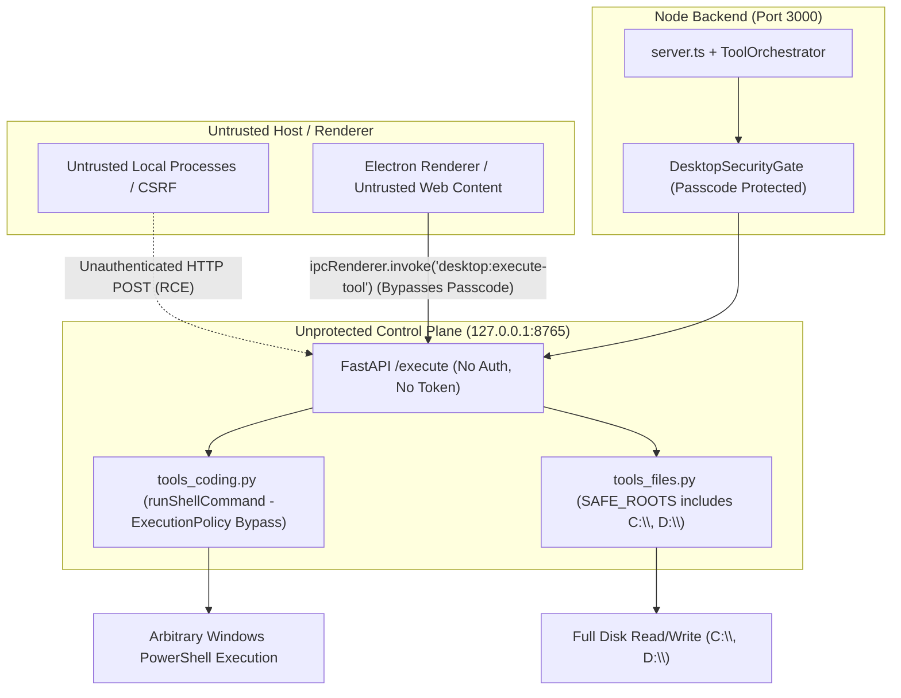

# Sora AI / MYRAA — Comprehensive Security Audit Report

**Date:** 2026-11-24  
**Project:** Sora AI / MYRAA Desktop AI Assistant  
**Target Root:** `D:\SORA AI\Sora AI`  
**Review Type:** Defensive Local Static Source-Code Audit & Tool-Assisted Review  
**Auditor Engine:** Strix CLI (v1.7.1) & Automated Architecture Analysis Suite  

---

## 1. Executive Summary

A comprehensive defensive security review was conducted on the **Sora AI** (MYRAA) desktop assistant codebase. The application is an advanced hybrid architecture comprising:
1. **Electron Host Shell (`electron/main.cjs`):** Single-instance desktop runtime managing child processes, window lifecycles, and IPC bridges.
2. **Node.js Local Server (`backend/server.ts`, `backend/gateway/HttpGateway.ts`):** Express & WebSocket backend managing session lifecycles, Google Gemini Live AI streaming, project continuity, memory governance, and task orchestration.
3. **Desktop Automation Agent (`desktop_agent/main.py`):** Standalone FastAPI service running locally on `127.0.0.1:8765`, exposing OS automation tools (file manipulation, window management, application launching, browser automation, and PowerShell command execution).

### Security Posture Score: **68 / 100 (Moderate / Needs Immediate Remediation)**

While the Node backend exhibits commendable defense-in-depth engineering (e.g. strict loopback IP validation on `/live`, anti-CSWSH origin checks, constant-time HMAC-SHA256 governance proofs, and non-model-callable decision guards), severe systemic security boundaries are circumvented by the local Python Desktop Agent and its Electron IPC integration.

---

## 2. Risk Matrix & Severity Summary

| Severity | Count | Primary Impact Areas |
| :--- | :---: | :--- |
| **CRITICAL** | 2 | Unauthenticated Remote Code Execution (RCE) on `127.0.0.1:8765/execute`, Arbitrary PowerShell Execution via `runShellCommand` |
| **HIGH** | 2 | Sandbox Boundary Collapse in `tools_files.py` (arbitrary drive access), Electron IPC Bridge Authorization Bypass (`desktop:execute-tool`) |
| **MEDIUM** | 3 | Web Proxy Same-Origin Execution / Universal XSS (`/api/web-proxy`), Unauthenticated Loopback Port Hijack Risk, Incomplete Blacklist Sanitization |
| **LOW** | 2 | Ephemeral Governance Secret Lifetime Drift, Verbose Diagnostic Error Leakage |
| **INFORMATIONAL**| 1 | Automated Tool Rate-Limiting Constraints (Strix Groq ITPM boundaries) |

---

## 3. High-Priority Architectural Vulnerabilities

1. **Unauthenticated Local RPC Daemon (Critical):**  
   `desktop_agent/main.py` listens on `127.0.0.1:8765` without any API key, bearer token, mutual TLS, or authentication headers. Any process running under any user account on the machine can dispatch arbitrary tool executions to `/execute`.
2. **Direct Shell Execution Without Hard Guardrails (Critical):**  
   The `runShellCommand` handler in `desktop_agent/tools_coding.py` runs arbitrary commands using `powershell.exe -ExecutionPolicy Bypass -Command <cmd>`. It relies on an easily bypassable string blocklist (`format `, `rm -rf`, `del /s`), leaving the system vulnerable to command injection and reverse shell execution.
3. **Electron IPC Authorization Bypass (High):**  
   In `electron/main.cjs`, the IPC handler `desktop:execute-tool` forwards commands directly to `http://127.0.0.1:8765/execute` without enforcing the `DesktopSecurityGate` passcode verification present in the Node backend.
4. **Filesystem Sandbox Breakout (High):**  
   In `desktop_agent/tools_files.py`, all available Windows drive roots (`C:\`, `D:\`, `E:\`, etc.) are appended to `SAFE_ROOTS`. Consequently, the sandbox check is effectively disabled on Windows, permitting read/write/delete operations across the entire filesystem.
5. **Web Proxy Same-Origin Execution (Medium):**  
   The endpoint `/api/web-proxy` fetches remote websites and returns their HTML directly under the origin `http://127.0.0.1:<PORT>` with rewritten script navigations, creating a Cross-Site Scripting (XSS) risk against the local application.

---

## 4. Remediation Roadmap

1. **Phase 1 (Immediate / P0):**
   - Introduce an ephemeral shared secret / mutual authentication bearer token between `electron/main.cjs`, `backend/server.ts`, and `desktop_agent/main.py`.
   - Remove `runShellCommand` from the default agent tool registry or require strict human-in-the-loop modal authorization via system dialog.
2. **Phase 2 (High / P1):**
   - Constrain `SAFE_ROOTS` to explicitly designated user workspace directories (e.g. `Desktop`, `Documents`, `Downloads`, and active project directories) and remove whole drive root paths (`C:\`, `D:\`).
   - Validate IPC caller frames (`event.senderFrame`) in `electron/main.cjs` to reject calls from unexpected frames or webviews.
3. **Phase 3 (Medium / P2):**
   - Serve proxied web content under an isolated origin or sandbox iframe with `sandbox="allow-scripts"` (omitting `allow-same-origin`).
   - Upgrade third-party dependencies with identified security advisories.
